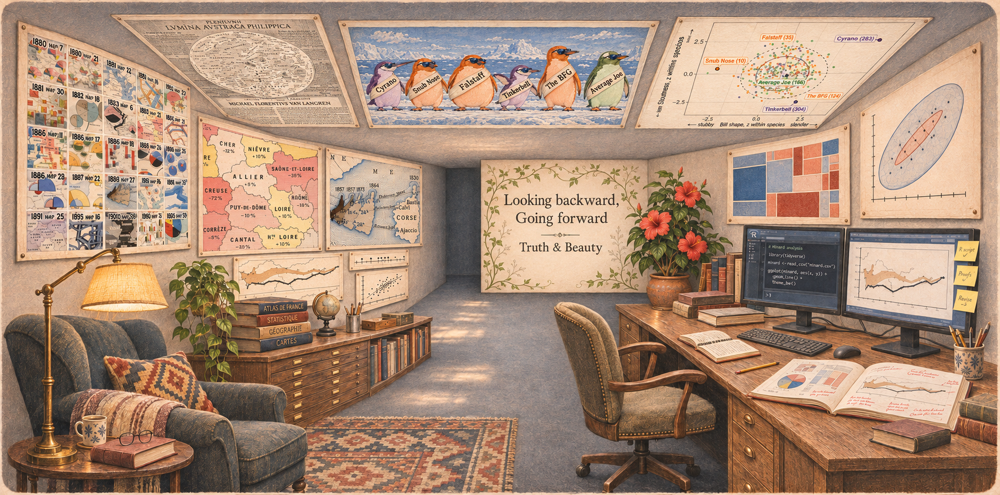

::: columns

::: {.column width=45%}

{fig-align="center" fig-alt="Photo of Michael Friendly"}

:::

::: {.column width=5%}

:::

::: {.column width=50%}

**Michael Friendly**

 

<i class="bi bi-globe"></i> [datavis.ca](https://datavis.ca) [Legacy web site]

 [dataVisFriendly](https://bsky.app/profile/dataVisFriendly.bsky.social) [BlueSky]

<i class="bi bi-github"></i> [friendly](https://github.com/friendly) [GitHub]

<i class="bi bi-mastodon"></i> [vis.social/\@datavisFriendly](https://vis.social/@datavisFriendly) [Mastodon]

:::

:::

{fig-align="center" width="100%" fig-alt="Warm, hand-drawn study with a reading chair and brass lamp beneath maps by Minard and Cheysson. A dual-monitor desk sits below a mosaic plot and an HE plot. Ceiling panels show van Langren’s lunar map, six Palmer penguins, and a scatterplot of their bill shape and body stoutness. Beside a flowering red hibiscus, painted vines frame the words Looking backward, Going forward and Truth & Beauty."}

[Michael Friendly](https://datavis.ca) is a
Fellow of the American Statistical Association, Professor of Psychology and coordinator of the
[Statistical Consulting Service](https://www.yorku.ca/research/scs/) at York University. He is an associate editor of the _Journal of Computational and Graphical Statistics_ and has served as an editorial collaborator for many other journals.
He received his Ph.D. in psychometrics and cognitive psychology from Princeton University.

His current research work includes the development of graphical methods for data visualization, where he is a principal innovator of novel methods for
relatively "un-vizzed" problems, including visualizing categorical data
(_Visualizing Categorical Data_, 2000; [_Discrete Data Analysis with R_](books.qmd#discrete-data-analysis-with-r), with David Meyer, 2016)
and multivariate data, the subject of his book [_Visualizing Multivariate Data and Models in R_](books.qmd#visualizing-multivariate-data-and-models-in-r).
Along with this, he is the author and maintainer of many [R packages](packages.qmd).

His passion for the deep roots of modern graphical methods led him to become a world-known amateur historian of data visualization.
In the latter, he directs [The Milestones Project](http://www.datavis.ca/milestones/), a comprehensive catalog and database of the principal developments in the histories of thematic cartography, statistical graphics and data visualization.
He is a founder of an international group, _Les Chevaliers des Albums de Statistique Graphique_, devoted to this history and
is author of multiple books and research papers on these topics. His most recent book in this area, with Howard Wainer, is
[_A History of Data Visualization and Graphic Communication_](https://www.hup.harvard.edu/books/9780674975231) (Harvard University Press, 2021).
