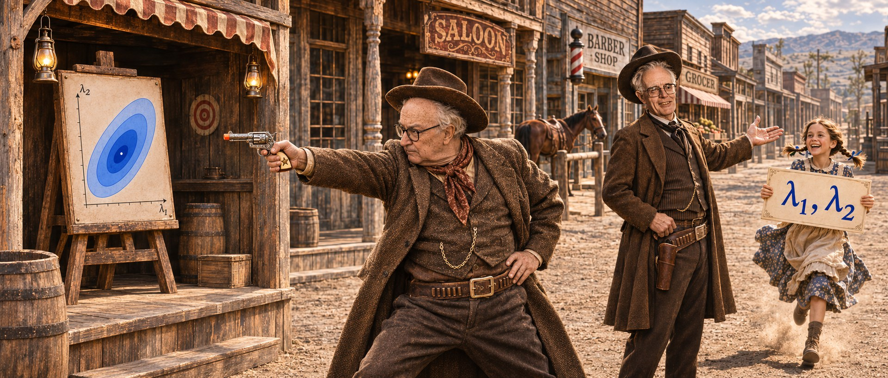
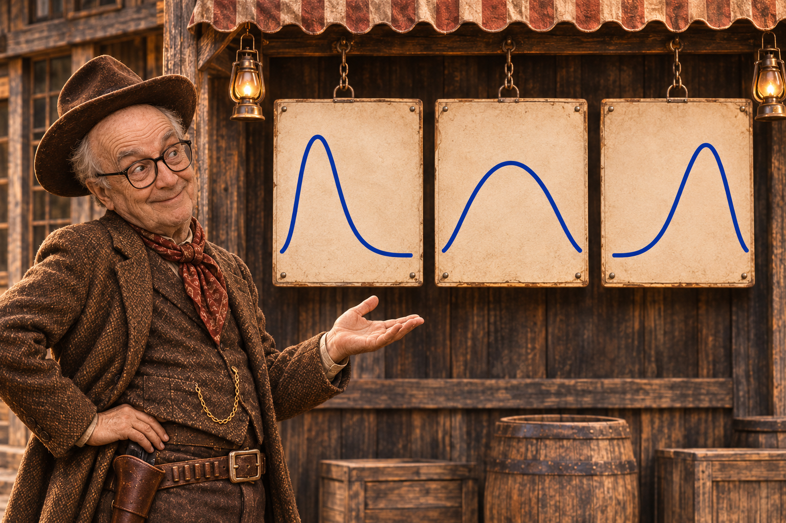

<!-- Banner: figures/box-cox-banner.jpg, a JPEG of figures/box-cox-western-banner-v2.png (see
figures/banner-notes.md); likeness references in figures/refs/. -->

```{=html}
<style>
.thesis blockquote {
  border: 2px solid var(--bs-primary);
  border-left-width: 6px;
  border-radius: 6px;
  background: rgba(var(--bs-primary-rgb), 0.08);
  padding: 1em 1.25em;
  margin: 1.5em 1em;
  font-size: 1.1em;
  font-style: italic;
  color: var(--bs-body-color);
}
.thesis blockquote p:last-child { margin-bottom: 0; }
</style>
```

```{r setup}
#| include: false
library(car)
library(heplots)
data(Dystrophy, package = "heplots")
data(Diabetes, package = "heplots")
```

{fig-alt="A Western main street with a saloon, barber shop and grocer. George Box aims a toy revolver at an easel showing nested blue elliptical contours on lambda-1 and lambda-2 axes. David Cox gestures with an open hand, and a girl with pigtails runs toward them holding a sign reading lambda-1, lambda-2."}

## Introduction

In a recent post, [On Extending `lm()` Methods to `"mlm"`](https://friendly.github.io/blog/posts/2026-11-extending-lm/),
I argued that R fits a multivariate linear model with the same `lm()` call as a univariate one,
but that many of the methods built around `lm` objects stop working, or quietly do something
univariate. The underlying issue is that **every object gains a dimension**: a scalar becomes a
vector, a variance becomes a covariance matrix, an interval becomes an ellipse. The thesis was:

::: {.thesis}
> A good multivariate extension isn't just "run the univariate method $q$ times". It has to
> decide what to do with the extra dimension: find the matrix that plays the role of the
> scalar, and then find a way to see it. Most often, as it turns out, that way is an ellipse.
:::

I ran into the same tensions again soon after. A re-reading of @RencherChristensen:2012 on
transformations of multivariate data [@AndrewsGnanadesikanWarner:71] suggested a new graphical
method for choosing Box-Cox powers [@BoxCox:64] for the responses in an mlm. It turned out to
have a bonus: a transformation chosen for multivariate normality can also please Box's
$\mathcal{M}$ [@Box:1949], the test of equal covariance matrices that MANOVA relies on.

This post follows that work: what the univariate tools give you, what they miss, and the
design decisions behind three new functions in heplots (version 1.8.7): `bcProfile()`, to see
the likelihood for one or two powers; `bcRefit()`, to refit the model with the chosen powers;
and `bcBoxM()`, to choose powers that make the covariance matrices alike. They are all
documented on one help page, `?bcProfile`.

## One response at a time

The running example is `heplots::Dystrophy` [Rencher & Christensen, Table 5.7, from
@AndrewsHerzberg:85]. Four serum enzymes, creatine kinase (`CK`), hemopexin (`Hpx`), pyruvate
kinase (`PK`) and lactate dehydrogenase (`LD`), were measured in 73 women, to see whether they
can detect carriers of Duchenne muscular dystrophy. Age and the month of the blood sample are
covariates.

```{r dmd-mod}
dmd.mod <- lm(cbind(CK, Hpx, PK, LD) ~ group + age + month, data = Dystrophy)
```

Enzyme levels are often skewed, so it is natural to ask about transformations. The familiar
tool is the Box-Cox plot of the profile log-likelihood for the power $\lambda$ in
$y^{(\lambda)} = (y^\lambda - 1)/\lambda$ (with $\log y$ for $\lambda = 0$). With
`car::boxCox()`, one response at a time:

```{r fig-uni-boxcox}
#| fig-cap: "Univariate Box-Cox profile log-likelihoods for each Dystrophy enzyme, from `car::boxCox()`, with the same predictors. The dashed lines mark the MLE and the 95% confidence interval for $\\lambda$."
#| fig-width: 8
#| fig-height: 7
op <- par(mfrow = c(2, 2), mar = c(4, 4, 3, 1))
for (v in c("CK", "Hpx", "PK", "LD")) {
  boxCox(lm(reformulate(c("group", "age", "month"), response = v), data = Dystrophy),
         main = v)
}
par(op)
```

Each panel gives a clear answer: `CK` wants something like $1/\sqrt{y}$, `PK` and `LD` want a log,
and hemopexin, skewed to the *left*, wants to be squared (its MLE, 2.3, is just beyond the default
plotting range), which "log the skewed ones" would miss.
In every panel, $\lambda = 1$ is far outside the interval.

### What's lacking?

{width="440px" fig-align="center" fig-alt="George Box shrugs at three hanging targets, each bearing a single blue likelihood curve with a peak in a different place."}

Four answers to what is really one question:

* **No joint answer.** There are four intervals but no joint test that the responses need no
  transformation, $\boldsymbol{\lambda} = (1, 1, 1, 1)$, and no joint confidence region.
* **The responses are correlated, and the one-at-a-time estimates ignore this.** The residual
  correlation of `CK` and `PK` is 0.78. The powers that make the *joint* distribution of the
  residuals closest to multivariate normal are not, in general, the ones that make each margin
  closest to normal.
* **The estimates are correlated, too.** How far one $\hat\lambda_j$ can move depends on where the
  others are. Four separate curves can't show that.
* **Normality is not the only assumption.** MANOVA also assumes that the groups have equal
  covariance matrices. The univariate check is a test of equal variances for each response, one
  at a time (here, `bartlettTests()`), which says nothing about the covariances.

```{r uni-bartlett}
Y <- model.response(model.frame(dmd.mod))
cor(residuals(dmd.mod)) |> round(2)
bartlettTests(Y, Dystrophy$group)
```

* **It's not implemented in software, either.** Give the multivariate model to `boxCox()` and it
  stops; so does `MASS::boxcox()`:

```{r hook}
#| error: true
boxCox(dmd.mod)
```

This is another row for the "hook table" in the extending-lm post: a method that works for `lm`
and refuses an mlm.

## The statistics already existed

The surprise was that the estimation was already done. `car::powerTransform()` accepts an mlm and
maximizes the multivariate likelihood of @AndrewsGnanadesikanWarner:71
[@RencherChristensen:2012, eq. 4.43], over all $q$ powers at once. (I checked that it matches a
direct `optim()` of eq. 4.43.) It also gives the two joint tests that the univariate plots lack:

```{r powertransform}
dmd.pt <- powerTransform(dmd.mod)
summary(dmd.pt)
```

Compared with the one-at-a-time estimates, the joint ones shift a little: for `CK`, from $-0.47$ to
$-0.36$; for `PK`, from $-0.25$ to $-0.15$. Here the rounded powers come out the same. In the
Diabetes example below they don't.

```{r uni-vs-multi}
uni <- sapply(c("CK", "Hpx", "PK", "LD"), \(v)
  coef(powerTransform(lm(reformulate(c("group", "age", "month"), response = v),
                         data = Dystrophy))))
rbind(univariate = uni, multivariate = coef(dmd.pt)) |> round(2)
```

One more question arises only when there's a model with several responses: **marginal or
conditional?** `powerTransform(Y)` makes the *responses* multinormal; `powerTransform(mlm)` makes
the *residuals* multinormal, which is what MANOVA assumes. The functions here use the residual
(conditional) version.

So the gap was not the statistics, but the **graphics and the workflow**: there is no `plot()`
method for a `powerTransform` object, no easy way to refit with the chosen powers, and no
before/after comparison. As the `?bcProfile` help page now says, the work "stemmed from reading
Rencher & Christensen's description of the problem, and the recognition that
`car::powerTransform()` had already done the heavy lifting". That is the extending-lm story almost
exactly: the hard part is the software design.

### Every object gains a dimension

| Univariate | Multivariate |
|---|---|
| $\lambda$, a scalar | $\boldsymbol{\lambda} = (\lambda_1, \dots, \lambda_q)$, a vector |
| profile log-likelihood $\ell(\lambda)$, a curve | a surface over $q$ dimensions, shown as 1-D profiles and 2-D contour plots for pairs |
| 95% CI for $\lambda$, an interval | a confidence **region** for a pair, with the **Wald ellipse** from the inverse Hessian beside the LR region |
| "is $\lambda = 1$ in the interval?" | "how far is $(1, \dots, 1)$ from the region?", an LR test on $q$ df |
| transform $\mathbf{y}$ | transform each column of $\mathbf{Y}$, and refit |
| test equal variances; spread-level plot | test equal **covariance matrices** (Box's $\mathcal{M}$); choose $\boldsymbol{\lambda}$ to make them alike |

: What changes for Box-Cox when the response is a matrix {#tbl-dimension}

And once again, "find the ellipse that shows it": the Wald confidence ellipse for
$(\lambda_j, \lambda_k)$ is a data ellipse for parameters, and comparing it with the exact LR
region shows how good the quadratic approximation is.

## Seeing the likelihood: `bcProfile()`

`bcProfile(pt, variables)` takes a `powerTransform` object (or an mlm, for which it calls
`powerTransform()`). For one variable it gives a curve; for two, a surface: the dimension of the
result follows the dimension of the question. Underneath is one small internal function that
recomputes the log-likelihood from the pieces a `powerTransform` object keeps (the responses, and
the QR decomposition of $\mathbf{X}$). It reproduces car's LR tests exactly, so the plots and car's
tests can't disagree.

### One power at a time, in the joint model

The 1-D version looks like the univariate plot, but it is a profile of the *joint* likelihood:
at each value of $\lambda_j$, the other powers are re-estimated.

```{r fig-dmd-1d}
#| fig-cap: "1-D profile log-likelihoods for the four Dystrophy enzymes in the multivariate model, extended to show $\\lambda = 1$, with Box's $\\mathcal{M}$ (green) on the right axis."
#| fig-width: 9
#| fig-height: 8
op <- par(mfrow = c(2, 2), mar = c(4, 4, 4, 4))
for (v in c("CK", "Hpx", "PK", "LD")) {
  prof <- bcProfile(dmd.pt, v, extend_range = TRUE, group = Dystrophy$group)
  plot(prof, main = v)
}
par(op)
```

Two design decisions show here. **Show how far "no transformation" is**: with
`extend_range = TRUE`, the range widens to include $\lambda = 1$, marks it, and annotates its LR
test. Around the MLE alone, the plot can't show how strongly the data reject leaving things
alone. And **$\lambda$ in the axis labels**: $\lambda_{CK}$, not `CK`, since the axis is a power,
not data. The green curve for Box's $\mathcal{M}$ is the subject of a later section.

### Two powers: a region and an ellipse

```{r fig-dmd-2d}
#| fig-cap: "2-D profile log-likelihood for $(\\lambda_{CK}, \\lambda_{Hpx})$: nested LR regions, the 95% region and the Wald ellipse, extended to show how far $(1, 1)$ is, with dashed contours of Box's $\\mathcal{M}$."
#| fig-width: 7
#| fig-height: 7
prof2x <- bcProfile(dmd.pt, c("CK", "Hpx"), extend_range = TRUE, n = 81,
                    group = Dystrophy$group)
plot(prof2x)
```

How to draw a likelihood surface took a few rounds. The answer was nested LR regions at several
coverage levels, each with a light, low-alpha fill, so the colour builds up toward the maximum; a
fine grid, so the contours are smooth; the 95% LR contour and the Wald ellipse drawn on top; and
reference lines at the "nice" powers $-1, -\tfrac12, 0, \tfrac12, 1, 2$. Here the Wald ellipse
and the LR region nearly coincide, and $(1, 1)$ is far outside both.

### Profile or slice?

A true profile re-maximizes over the other powers at every grid point: one `optim()` per point,
about 10 seconds for a $61 \times 61$ grid. A *slice* holds the other powers at their MLEs, and
is instant. Which to use is a multivariate question: they agree when the $\hat\lambda$s are
uncorrelated, and differ when they're not. In Dystrophy, no correlation of the estimates exceeds
0.13. In the Diabetes data (below), the estimates for `glufast` and `glutest` correlate 0.40:

```{r diab-cor}
diab.mod <- lm(cbind(relwt, glufast, glutest, instest, sspg) ~ group, data = Diabetes)
diab.pt <- powerTransform(diab.mod)
cov2cor(diab.pt$invHess) |> round(2)
```

So a slice for $\lambda_{glufast}$, which holds $\lambda_{glutest}$ fixed, falls off too fast:

```{r fig-diab-slice}
#| fig-cap: "Profile and slice of the log-likelihood for $\\lambda_{glufast}$ in the Diabetes data. The slice holds the other four powers at their MLEs, so it falls off faster and gives a narrower 95% interval (where each curve crosses the dotted line)."
#| fig-width: 6
#| fig-height: 5
prof  <- bcProfile(diab.pt, "glufast")
slice <- bcProfile(diab.pt, "glufast", type = "slice")
lam <- prof$grid[[1]]
par(mar = c(4.5, 4.5, 1, 1))
plot(lam, -prof$deviance / 2, type = "l", lwd = 2, col = "blue",
     ylim = range(-slice$deviance / 2), cex.lab = 1.3,
     xlab = expression(lambda[glufast]), ylab = "log-likelihood (relative to max)")
lines(lam, -slice$deviance / 2, lwd = 2, lty = 2, col = "red")
abline(h = -qchisq(0.95, 1) / 2, lty = 3)
legend("bottom", c("profile", "slice"), lwd = 2, lty = 1:2, col = c("blue", "red"),
       bty = "n")
```

The profile interval is $(-1.08, -0.47)$, the slice $(-1.04, -0.50)$: a modest difference here,
but in the direction that matters, overstating the precision. Conversely, a 2-D plot of
(`glufast`, `glutest`) shows almost no difference between profile and slice, because what is held
fixed is then the powers that *aren't* correlated with them. So the cheap version is safe only when
the powers held fixed are nearly uncorrelated with those plotted, and the default is
`type = "profile"`. An instance of knowing when the multivariate version adds nothing, and when it
does.

## Refitting: `bcRefit()`

Once the powers are chosen, the model has to be refit with the transformed responses.
`bcRefit(mod, lambda)` does this; `lambda` may be a vector of powers or the `powerTransform`
object itself, whose rounded powers are used.

```{r refit}
dmd.bc <- bcRefit(dmd.mod, dmd.pt)   # rounded powers (-0.5, 2, 0, 0)
colnames(coef(dmd.bc))
Anova(dmd.bc)
```

Three small decisions:

* It keeps the **Box-Cox scaling** $(y^\lambda - 1)/\lambda$, not the simple power $y^\lambda$, so
  the direction of an effect is preserved when $\lambda < 0$.
* Transformed responses need names that are valid in R: `CK^-0.5` isn't, so `CK_m0.5`, `Hpx_2`,
  `logPK`. The powers are kept as an attribute.
* The result is an ordinary mlm, so `Anova()`, `heplot()`, `cqplot()` and `boxM()` all just work
  (`boxM()` given the grouping factor, when there are covariates; see [Catching bugs](#catching-bugs)).
  Return objects that work with the rest of the ecosystem.

After the transformation, Pillai's trace for `group` rises from 0.35 to 0.47, and the residuals are
much closer to multivariate normal:

```{r fig-dmd-cqplot}
#| fig-cap: "Chi-square QQ plots of the squared Mahalanobis distances of the residuals, before and after the Box-Cox transformation."
#| fig-width: 9
#| fig-height: 4.5
op <- par(mfrow = c(1, 2))
cqplot(dmd.mod, main = "Raw")
cqplot(dmd.bc, main = "Box-Cox")
par(op)
```

## Pleasing Box's $\mathcal{M}$

Box-Cox targets normality. But for MANOVA, equality of the group covariance matrices often matters
more [@Friendly:07:manova], and the Dystrophy groups are far from equal. The transformation chosen
for normality also fixes this:

```{r boxm-dmd}
dmd.M0 <- boxM(model.response(model.frame(dmd.mod)), Dystrophy$group)
dmd.M1 <- boxM(model.response(model.frame(dmd.bc)),  Dystrophy$group)
dmd.M0
dmd.M1
```

`plot.boxM()` shows what the test statistic summarizes: the log determinant,
$\log |\mathbf{S}_i|$, of each group's covariance matrix, a measure of its overall size
(generalized variance), with a confidence interval, beside that of the pooled within-group matrix.
The two panels have x ranges of the same width, so the gaps can be compared directly:

```{r fig-dmd-boxm-plot}
#| fig-cap: "Log determinants of the group and pooled covariance matrices for the Dystrophy data, from `plot.boxM()`, before and after the Box-Cox transformation. The x ranges have the same width (10 units)."
#| fig-width: 10
#| fig-height: 4
op <- par(mfrow = c(1, 2), mar = c(4.5, 8, 3, 1))
plot(dmd.M0, gplabel = "group", main = "Raw", xlim = c(20.5, 30.5))
plot(dmd.M1, gplabel = "group", main = "Box-Cox", xlim = c(-0.5, 9.5))
par(op)
```

In raw units, the carriers' log determinant exceeds the noncarriers' by 7.6: a generalized variance
about 2000 times as large, reflecting the carriers' much higher and more variable enzyme levels.
After the transformation, the gap is 1.6, and the confidence intervals overlap.

That suggests a truly multivariate criterion: **choose $\boldsymbol{\lambda}$ to minimize Box's
$\mathcal{M}$**. $\mathcal{M}$ is invariant to rescaling each variable, so no Jacobian is needed.
The univariate ancestor is the spread-level plot, which chooses a power to stabilize the variance.

In Dystrophy the two criteria mostly agree. In @fig-dmd-1d, $\mathcal{M}$ is smallest inside the
95% LR intervals for `Hpx`, `PK` and `LD`. Only for `CK` do they disagree: $\mathcal{M}$ keeps
falling toward $-1$, beyond the interval.

### The Diabetes data

`heplots::Diabetes` [@ReavenMiller:79] has five measures of glucose tolerance and insulin
response for 145 non-obese adults, in three groups: normal, chemical diabetic and overt
diabetic. Here the one-at-a-time and joint estimates *do* differ, for the two glucose measures,
which are highly correlated:

```{r diab-uni-vs-multi}
vars <- c("relwt", "glufast", "glutest", "instest", "sspg")
uni <- sapply(vars, \(v)
  coef(powerTransform(lm(reformulate("group", response = v), data = Diabetes))))
rbind(univariate = uni, multivariate = coef(diab.pt)) |> round(2)
```

The normality transformation takes $\mathcal{M}$ from about 397 to 145. Minimizing $\mathcal{M}$
directly, with `bcBoxM()`, gets only a little further:

```{r diab-boxm}
diab.bc <- bcRefit(diab.mod, diab.pt)
c(raw    = boxM(model.response(model.frame(diab.mod)), Diabetes$group)$statistic,
  BoxCox = boxM(model.response(model.frame(diab.bc)),  Diabetes$group)$statistic)
bm <- bcBoxM(Diabetes[, vars], Diabetes$group)
round(bm$lambda, 2)
bm$M
```

and it does so by sending `relwt` to a power around 6, where $\mathcal{M}$ is flat, at a large
cost in normality. The lesson: an optimizer will exploit a flat direction. So **show the criterion
as a plot** rather than optimize it blindly. `bcProfile(..., group = )` computes $\mathcal{M}$ at
the same full $\boldsymbol{\lambda}$ as the log-likelihood at every grid point, and `plot()` draws
it on a second axis (1-D) or as dashed contours (2-D), with a note when its minimum is at the edge
of the grid ("still falling"). `bcBoxM()` is kept, with a warning in the documentation.

The clearest single picture is the covariance ellipses before and after:

```{r fig-diab-covellipses}
#| fig-cap: "Covariance ellipses for `glufast` and `glutest` in the three Diabetes groups, before and after the Box-Cox transformation."
#| fig-width: 10
#| fig-height: 5
Y <- model.response(model.frame(diab.mod))
Z <- model.response(model.frame(diab.bc))
op <- par(mfrow = c(1, 2))
covEllipses(Y[, c("glufast", "glutest")], Diabetes$group, fill = TRUE, fill.alpha = 0.1,
            main = "Raw")
covEllipses(Z[, c("glufast_m1", "glutest_m0.5")], Diabetes$group, fill = TRUE,
            fill.alpha = 0.1, main = "Box-Cox")
par(op)
```

In raw units, the overt diabetics' ellipse dwarfs the others. After the transformation the three
are much closer in size, but differences in shape and orientation remain that no power
transformation can remove.

That figure shows only one pair of the five responses. The `plot.boxM()` view, as in
@fig-dmd-boxm-plot, uses all five at once:

```{r fig-diab-boxm-plot}
#| fig-cap: "Log determinants of the group and pooled covariance matrices for the Diabetes data, from `plot.boxM()`, before and after the Box-Cox transformation. The x ranges have the same width (9 units)."
#| fig-width: 10
#| fig-height: 4.5
diab.M0 <- boxM(diab.mod)
diab.M1 <- boxM(diab.bc)
op <- par(mfrow = c(1, 2), mar = c(4.5, 9, 3, 1))
plot(diab.M0, gplabel = "group", main = "Raw", xlim = c(22.5, 31.5))
plot(diab.M1, gplabel = "group", main = "Box-Cox", xlim = c(-28.5, -19.5))
par(op)
```

In raw units, the log determinants spread over about 6.5 units: the overt diabetics' covariance
matrix has a generalized variance hundreds of times that of the normal group. After the
transformation, the three groups are within 0.6 of each other. Their *sizes* are now nearly equal.

But the pooled matrix now sits above every group. Because $\log |\mathbf{S}|$ is concave, the log
determinant of the pooled matrix is always at least the (weighted) average of the groups'. If the
groups differed only in size ($\mathbf{S}_i = c_i \mathbf{S}$), it could not exceed the largest of
them. When it does, the matrices must differ in shape or orientation. So this plot says where the
remaining $\mathcal{M} = 145$ comes from: not from size, which the transformation fixed, but from
the shape and orientation differences visible in the ellipses for `glufast` and `glutest`.

## Smaller design decisions

In designing `heplots` functions for this, there are few more that decide whether a plot can be read easily and whether users can find these methods helpful:

* **Colours are arguments, and the defaults depend on the plot.** The "$\lambda = 1$" highlight is
  bold red in a 1-D plot, but dark orange in the busier 2-D plot, where red competes with
  everything else. To keep that unambiguous, the rounded powers are purple and Box's
  $\mathcal{M}$ dark green.
  
* **Plotmath, not Unicode**, for annotations like "$\lambda = 1$: $\chi^2(1) = \dots$", so they
  work on every graphics device. `R CMD check` runs the examples on `pdf()`, which can't always
  encode $\lambda$ or $\chi^2$.
  
* **A larger `cex.lab` (1.3) by default**, since that's what users end up overriding. More generally, choice of defaults should always be considered.

* **Help pages**: It is most useful if users (and agents!) can find related topics via
  See Also links. `bcProfile()`, `bcRefit()` and `bcBoxM()` are one
  workflow, so they share `?bcProfile` (not `?bcPower`, which would collide with car's topic). The
  See also is organized by relationship: estimation and tests (car); the univariate versions
  (`car::boxCox()`, `MASS::boxcox()`, `symbox()`, `spreadLevelPlot()`); checking assumptions
  before and after (`cqplot()`, `boxM()`, `covEllipses()`, `bartlettTests()`, `leveneTests()`); an
  alternative for heavy tails rather than skewness (`robmlm()`); and seeing the effects after
  (`heplot()`, `pairs.mlm()`). That grouping is itself a small map of where this sits among
  multivariate diagnostics.

## What other displays might please Box & Cox?

`bcProfile()` answers questions about one power or one pair. With four or five responses, the
next question is how to see all of them at once. This part isn't done, and it is where the design
questions get interesting.

### A `pairs()` method, and what to leave out

The obvious next step is a `pairs()` method: 1-D profiles on the diagonal, 2-D profiles off it, as
`pairs.mlm()` does for HE plots. But a pairs plot multiplies the clutter of one panel by $q^2$. A
pairs method has to decide what to show and what to exclude to show something useful. The
questions:

* **Which pairs deserve a 2-D panel?** When two $\hat\lambda$s are nearly uncorrelated, the 2-D
  region is close to the product of the two 1-D intervals, so the panel adds nothing the diagonal
  doesn't already show. In Dystrophy, every correlation of the estimates is at most 0.13; in
  Diabetes, only (`glufast`, `glutest`), at 0.40, stands out. So compute the 2-D profile only where
  the correlation is large, and show something cheaper elsewhere: the Wald ellipse alone, which is
  free from the inverse Hessian, or just the correlation as a number.
* **Which variables?** A response for which $\lambda = 1$ is well inside its interval (`relwt` in
  Diabetes) needs no transformation, and including it adds a row and a column of empty panels.
  Default to the responses that need transforming (by the LR test of $\lambda_j = 1$), with
  `variables =` to override.
* **What goes above and below the diagonal?** A natural split: normality (the likelihood regions)
  below the diagonal, and homogeneity (contours of Box's $\mathcal{M}$) above it, on the same pairs
  of axes, transposed. Then whether the two criteria agree or conflict is visible pair by pair.
* **Shared axes, or zoom?** A scatterplot matrix uses one range per variable, across its row and
  column. But the range that shows the region well (a few standard errors around the MLE) and the
  range that includes $\lambda = 1$ can differ by a factor of five, as in @fig-dmd-2d. A shared
  range that includes 1 shrinks every region to a dot. Probably: zoom around the MLE, and show how
  far $\lambda = 1$ is on the diagonal only, or as a number.
* **Cost.** Each 2-D profile is one `optim()` per grid point, 10–20 seconds for a $61 \times 61$
  grid; with $q = 5$ there are 10 pairs. A slice is instant, but misleads exactly when the
  $\hat\lambda$s are correlated, which is when the 2-D panel matters. So: profiles only for the
  selected pairs, on a coarser grid in small panels.
* **Annotation.** Legends, the "$\lambda = 1$" test, labelled deviance contours: none of it fits
  in a small panel. One shared legend, and numbers on the diagonal only.

### Or something simpler: one row per response

Is a pairs plot the right display at all? For most data, the useful summary is per variable: the
MLE and its interval, the rounded power, where Box's $\mathcal{M}$ is smallest, whether the two
criteria agree, and how far $\lambda = 1$ is. All of that comes from the 1-D profiles. A quick
prototype:

```{r bc-summary}
#| code-fold: true
# One row per response, from the 1-D profiles: MLE, LR interval, rounded power,
# where Box's M is smallest (and whether that is at the edge of the grid),
# and the LR test that this lambda = 1, with the others at their MLEs
bc_summary <- function(pt, group, level = 0.95) {
  vars <- names(coef(pt))
  do.call(rbind, lapply(vars, function(v) {
    p <- bcProfile(pt, v, extend_range = TRUE, group = group)
    lam <- p$grid[[1]]
    inside <- lam[p$deviance <= qchisq(level, 1)]
    data.frame(variable = v, mle = p$lambda[v], lwr = min(inside), upr = max(inside),
               rounded = p$roundlam[v], Mmin = lam[which.min(p$M)],
               Medge = which.min(p$M) %in% c(1, length(lam)),
               LR1 = testTransform(pt, replace(pt$lambda, v, 1))$LRT,
               row.names = v)
  }))
}

dmd.sum  <- bc_summary(dmd.pt,  Dystrophy$group)
diab.sum <- bc_summary(diab.pt, Diabetes$group)
diab.sum[, -1] |> round(2)
```

```{r fig-bc-dotplot}
#| code-fold: true
#| fig-cap: "A prototype per-variable display for the Dystrophy (left) and Diabetes (right) models. Blue: the MLE and 95% LR interval for each power; purple ×: the rounded power; green triangle: where Box's $\\mathcal{M}$ is smallest (open, with an arrow, when it is still falling at the edge of the range). The numbers at the right are the LR $\\chi^2(1)$ tests of $\\lambda_j = 1$."
#| fig-width: 10
#| fig-height: 4.5
bc_dotplot <- function(s, main = "", xlim = range(-1.5, 3.5)) {
  n <- nrow(s); y <- n:1
  plot(NA, xlim = xlim, ylim = c(0.5, n + 0.5), yaxt = "n", cex.lab = 1.3,
       xlab = expression("power, " * lambda), ylab = "", main = main)
  axis(2, at = y, labels = s$variable, las = 1)
  abline(v = c(-1, -0.5, 0, 0.5, 2, 3), col = "gray90")
  abline(v = 1, col = "darkorange", lwd = 2)
  segments(s$lwr, y, s$upr, y, col = "blue", lwd = 3)
  points(s$mle, y, pch = 16, col = "blue", cex = 1.4)
  points(s$rounded, y, pch = 4, col = "purple", cex = 1.4, lwd = 2)
  Mx <- pmin(pmax(s$Mmin, xlim[1]), xlim[2])
  points(Mx, y + 0.25, pch = ifelse(s$Medge, 2, 17), col = "darkgreen", cex = 1.3)
  edge <- which(s$Medge)
  if (length(edge))
    arrows(Mx[edge], y[edge] + 0.25, Mx[edge] + 0.4 * sign(Mx[edge] - s$mle[edge]),
           y[edge] + 0.25, length = 0.08, col = "darkgreen", xpd = NA)
  mtext(sprintf("%.1f", s$LR1), side = 4, at = y, las = 1, line = 0.5, cex = 0.9)
  mtext(expression(chi^2 * (1)), side = 4, at = n + 0.75, las = 1, line = 0.5, cex = 0.9)
}
op <- par(mfrow = c(1, 2), mar = c(4.5, 6, 3, 3.5))
bc_dotplot(dmd.sum,  main = "Dystrophy")
bc_dotplot(diab.sum, main = "Diabetes")
par(op)
```

This shows at a glance what took several 1-D and 2-D plots above. In Dystrophy, the two criteria
agree for `Hpx`, `PK` and `LD`; only for `CK` is Box's $\mathcal{M}$ still falling, toward a
reciprocal, outside the interval. In Diabetes they agree for the four measures that need
transforming. For `relwt`, $\lambda = 1$ is inside the interval ($\chi^2(1) = 0.1$), and
$\mathcal{M}$ just drifts toward the edge: that flat direction is what sent `bcBoxM()` to a power
of 6. A display like this, with 2-D panels kept for the few correlated pairs, may say more than a
full $q \times q$ matrix.

### Zeros and negative values

Box-Cox needs positive responses. Zeros (counts, times, concentrations below a detection limit)
and negative values need either a shift (a start value added to each response), car's `bcnPower`
family [Box-Cox with negatives, @HawkinsWeisberg:2017], or the Yeo-Johnson family
[@YeoJohnson:2000], both available in `car::powerTransform()`. For an mlm, that means a shift or
a $\gamma$ parameter for each response: another dimension again. For now, `bcProfile()` handles
only the `bcPower` family, and its help page points to the others.

### Whose method is it?

A `plot()` method for `powerTransform` objects arguably belongs in car, next to `powerTransform()`
itself, rather than in heplots. That is a question for John Fox. It is also a familiar one from
the extending-lm post: when the multivariate extension of a method in one package is written in
another, where should it live?

## Catching bugs {#catching-bugs}

Writing this up had a side effect I didn't plan for: it turned up bugs, in my own packages, that
had been sitting there quietly. Not in the new code, but in old code that the new work happened to
lean on in a new way.

* **`boxM()` with covariates.** The Dystrophy model has two covariates, `age` and `month`. Given
  that model, `boxM()` formed "groups" from every distinct combination of `group`, `age` and
  `month`: 66 groups of one person each, all with singular covariance matrices, and a test
  statistic of `NA`, with only a long warning to say why. The documentation said the predictors
  "must all be factors", but nothing checked it. It now stops with a message that says what to do
  instead: `boxM(Y, group)`.
* **`boxM()` with crossed factors.** Testing that fix turned up a second bug, in the same three
  lines: for a two-way design, `lm(cbind(...) ~ A * B)`, `boxM()` failed with "undefined columns
  selected", because it looked up the interaction term `A:B` as if it were a column of the data.
  Both bugs came from a rewrite a year earlier, which replaced a call to the (correct) formula
  method with new code that handled only the simplest case: one factor, no covariates. That is
  the case every example in the documentation used.
* **A claim in my own notes.** I had written that a slice and a profile differ in 2-D for the
  correlated pair (`glufast`, `glutest`). Drawing the figure showed they don't. The difference
  shows in 1-D, as in @fig-diab-slice, and the rule is about the powers *held fixed*, not the ones
  plotted. Not a bug in the code, but a bug in the explanation, which would have gone into the
  help page.
* **Earlier, in mvinfluence.** Writing the [extending-lm post](https://friendly.github.io/blog/posts/2026-11-extending-lm/)
  turned up two more: `influence(fit, m = 2)` fails, because `m` partially matches the generic's
  argument `model`; and `cooks.distance()` for an mlm names its result by case number rather
  than by the row names of the data.

None of these would show up in a univariate analysis, or in the examples on the help pages. They
showed up because extending a method to an mlm sends ordinary objects down paths nobody had
walked: a MANCOVA rather than a one-way MANOVA, a two-way design, a model with several responses
and a subset size. That is what *should* happen when you bring a univariate method to
Multivariate Town. The extra dimension is a test as well as a feature: every object that gains a
dimension is a new chance for code to be wrong, and a worked example that actually uses it is
the cheapest way to find out.

A practical lesson: when a bug turns up in the middle of writing, write it down where it will be
fixed, not where it was found. Each of these went into the package's own task list, with the
error, a reproduction and a suggested fix, and the `boxM()` bugs were fixed (in heplots 1.9.0,
in development) before this post was finished.

## What I learned

<!-- TODO: tie back to the extending-lm thesis; the hard part was again the software design, not the
statistics; and the bonus of a multivariate criterion (Box's M) that has no univariate counterpart
beyond the spread-level plot. Pointer to Vis-MLM [@Friendly:2024:VisMLM]. -->

## References {.unnumbered}

::: {#refs}
:::
