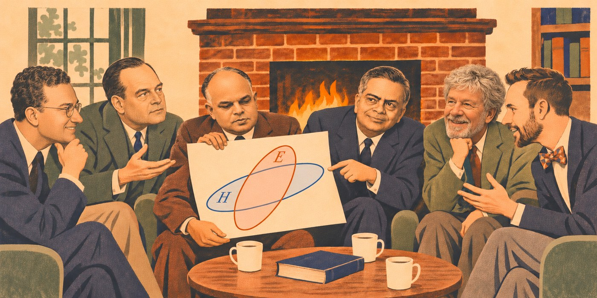
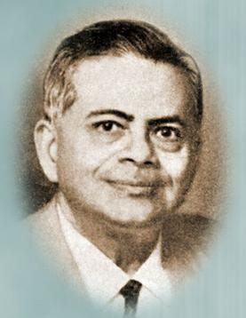
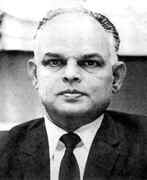
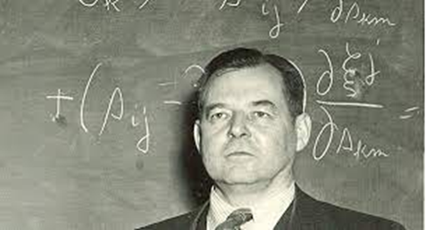
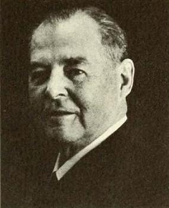
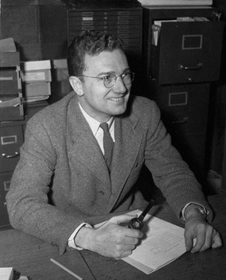
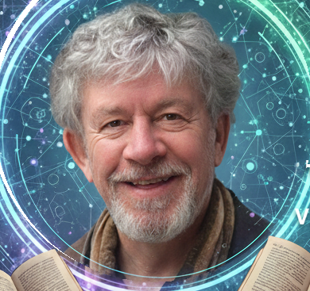

# Fireside HE chat: notes on editing the banner

*2026-11-22.* For the banner of *How Big Is a Matrix?* The candidate is now
`fireside-HE-chat-V2.jpg`, with the redraws done. The table and prompts below refer to the original,
`fireside-HE-chat.png`. The cast and original prompts are in `fireside-HE-chat.md`.

## In brief

Comparing the original drawing with photographs, more than Roy needed fixing.

| Seat (from left) | Cast as | As drawn | In the photos | What to do |
|---|---|---|---|---|
| 1 | Hotelling | slim, wavy dark hair, glasses | heavy-set, straight hair, no glasses | **Rename as Wilks**, whom he already resembles |
| 2 | Wilks | bald, mustache, glasses | full wavy hair, clean-shaven, glasses | **Redraw as Hotelling** |
| 3 | Pillai | slim, thick wavy hair, glasses | bald, full face, no glasses | **Redraw** |
| 4 | Roy | white-haired white man (generated as Lawley) | Indian, full face, dark graying hair | **Redraw first**: he is the joke |
| 5 | Friendly | curly gray hair, beard, glasses | curly gray hair, shorter beard, no glasses | Optional touch-up |
| 6 | Wickham | short hair, beard, bow tie | short hair, reddish beard | OK as is |

## What to keep

- **Roy's pointing hand.** The geometry works. Estimated from the drawing, the direction of Roy's
  largest root is about 13° above horizontal, and the long axis of **H**, where his finger is, is
  about 17°.
- **The ellipses**, exactly as drawn: $\lambda_1 \approx 5.3$, $\lambda_2 \approx 0.2$, one dominant
  root, the case that favors Roy.
- **The colors**: red **E** and blue **H**, as in heplots and to go with the first banner.
- **The composition**, and Pillai holding the sheet.

## Editing prompts

Edit one seat at a time, in this order, starting each edit from the last good result. Attach only
something based on the reference photo for that seat. If there's a selection tool from the reference photo,
select just the head (plus the
hands, only if skin tone must change). After each step, check that the ellipses, the two letters
and the pointing finger haven't moved.

### 1. Seat 4: Roy (attach `refs/Roy.jpg`)

> Edit only the fourth seated man from the left. Make him S. N. Roy, an Indian (Bengali)
> statistician in his fifties, using the attached photograph for his likeness: full round face,
> dark hair graying at the sides, heavy dark eyebrows, clean-shaven, no glasses. Give his face and
> hands a natural, matching skin tone. Keep his pose, suit, gaze and pointing hand exactly where
> they are, and draw him in the same illustration style. Do not change the sheet, the ellipses,
> the letters or anyone else.

### 2. Seat 3: Pillai (attach `refs/Pillai.jpg`)

> Edit only the head of the third seated man from the left, who holds the sheet. Make him
> K. C. S. Pillai, an Indian statistician, using the attached photograph for his likeness: bald on
> top with short hair at the sides, full face, clean-shaven, no glasses. He must be clearly a
> different person from the man to his right in the picture. Keep the head angle, downward gaze,
> suit, hands and illustration style. Do not change the sheet, the ellipses, the letters or anyone
> else.

### 3. Seat 2: Hotelling (attach `refs/Hotelling.png`)

> Edit only the head of the second seated man from the left. Make him Harold Hotelling, using the
> attached photograph for his likeness: broad heavy face, straight dark hair combed back from a
> high forehead, clean-shaven, no glasses. Keep the head angle, pose, suit, open hand and
> illustration style. Do not change anything or anyone else.

### 4. Seat 5: Friendly, optional (attach `refs/Friendly.png`)

> Edit only the head of the fifth seated man from the left, using the attached photograph for his
> likeness: tousled curly gray hair, short gray beard and mustache, smiling, no glasses. Keep the
> head angle, pose, clothing and illustration style. Do not change anything or anyone else.

Leave out "no glasses" if you'd rather keep them.

## Reference images

| | Person | File | Source |
|---|---|---|---|
| {width=120} | S. N. Roy (1906–1964) | `refs/Roy.jpg` | [Wikipedia](https://en.wikipedia.org/wiki/File:SamarendraNathRoy.jpg), non-free; also [MacTutor](https://mathshistory.st-andrews.ac.uk/Biographies/Roy/) |
| {width=120} | K. C. S. Pillai (1920–1985) | `refs/Pillai.jpg` | [MacTutor](https://mathshistory.st-andrews.ac.uk/Biographies/Pillai/), rights not stated; only 147 × 180 px |
| {width=120} | Harold Hotelling (1895–1973) | `refs/Hotelling.png` | **Your portraits folder**: `C:\Dropbox\Documents\milestones\images\portraits\HaroldHotelling.png` |
| {width=120} | Hotelling, older | `refs/Hotelling-older.jpg` | [Wikipedia](https://en.wikipedia.org/wiki/File:Harold_Hotelling.jpg), non-free |
| {width=120} | S. S. Wilks (1906–1964) | `refs/Wilks.jpg` | [Wikipedia](https://en.wikipedia.org/wiki/File:Samuel_S_Wilks.jpg), non-free; a profile view at [MacTutor](https://mathshistory.st-andrews.ac.uk/Biographies/Wilks/) |
| {width=120} | Michael Friendly | `refs/Friendly.png` | This site's avatar, `images/MF-face.png` |
| {width=120} | Hadley Wickham | `refs/Wickham.jpg` | [Wikimedia Commons](https://commons.wikimedia.org/wiki/File:Hadley-wickham2016-02-04.jpg), by Hadley Wickham, CC BY-SA 4.0 |
| *none found* | D. N. Lawley (1915–2012) | | No MacTutor or English Wikipedia page. Try the Royal Society of Edinburgh or University of Edinburgh archives. |

`refs/` is git-ignored, because several photos are non-free and this repo is public. Use them as
references only. The links above will find them again on another machine.

## Before using the banner

- [x] Redraw seats 4, 3 and 2 (done in V2, along with touch-ups to 1 and 5).
- [x] Update the cast in `fireside-HE-chat.md`: Wilks, Hotelling, Pillai, Roy, Friendly,
      Wickham, left to right.
- [ ] Account for Lawley, perhaps in the caption: "(Lawley sends his regrets.)" With no photo,
      don't add an invented likeness.
- [ ] If the caption will name Hadley Wickham, send him the picture first.
- [x] Recheck that Roy's finger is still at the right-hand end of **H**.
- [x] Make a 1400 px JPEG from the final version, for the post and its `image:` line: V2 is one
      (252 KB). When the post is published, only that gets copied; the PNG can stay behind in drafts.
- [ ] Write the `fig-alt` from the final image.
