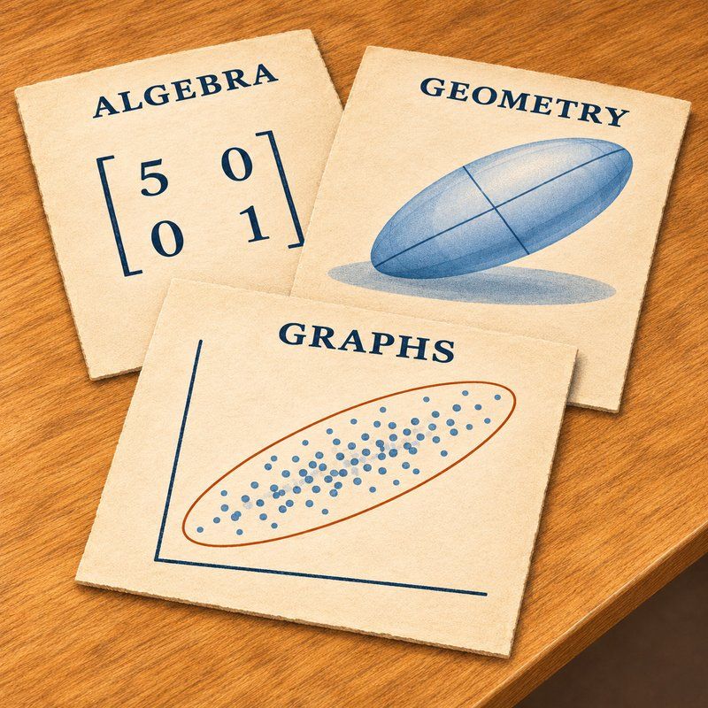

<!--
FIRST DRAFT, 2026-11-23: the framing and the illustrations. Sections after "Ellipses have
shadows" are stubs, each pointing to its section of Reducing-dimensions-notes.md.
-->

<!-- The precept box, as in the first post: orange for the question -->
```{=html}
<style>
.precept {
  border-top: 3px solid #F58518;
  border-bottom: 3px solid #F58518;
  background: rgba(245, 133, 24, 0.08);
  padding: 0.7em 1.25em;
  margin: 1.5em 1em;
  font-size: 1.15em;
  text-align: center;
}
.precept p { margin: 0; }
.precept .precept-title {
  display: block;
  font-variant: small-caps;
  letter-spacing: 0.06em;
  color: #B85708;
  font-weight: bold;
}
.precept .precept-motto {
  display: block;
  margin-top: 0.4em;
  font-style: italic;
  color: #B85708;
}
/* A small figure floated to the right of the text; full width on narrow screens */
.float-fig {
  float: right;
  width: 38%;
  margin: 0.3em 0 0.8em 1.2em;
}
.float-fig figure, .float-fig p { margin: 0; }
.float-fig img { width: 100%; height: auto; }
@media (max-width: 600px) {
  .float-fig { float: none; width: 80%; margin: 1em auto; }
}
</style>
```

{fig-alt="An illustration in mid-century magazine style: six men in suits sit around a coffee table in front of a brick fireplace. The man in the middle holds up a sheet with two overlapping ellipses, a wide blue one marked H and a steep red one marked E. The man to his left points at the right-hand end of the blue ellipse. On the right, a gray-bearded man with curly hair and a white-haired man in glasses look on and smile. On the table are three mugs, labeled Algebra (with a small matrix), Graphs and Geometry (with an ellipsoid), and a red book with a circle of arrows on its cover: Dempster's Elements of Continuous Multivariate Analysis."}

<!-- Before publishing with Georges named in the caption, send him the picture
     (figures/fireside-image-notes.md). -->


## Introduction

When we left A. Square, in my last post, [On Extending `lm()` Methods to
`"mlm"`](https://friendly.github.io/blog/posts/2026-11-extending-lm/), the Sphere had just
shown him what one more dimension looks like [@Abbott:1884]. Going from a univariate linear
model to a multivariate one, every object the model produces gains a dimension: a residual
becomes a vector, a coefficient vector a matrix, a variance a covariance matrix.

But earlier in the story, A. Square dreams of a trip the other way, to Lineland, whose King
can't conceive of anything but length. I used to feel a little sorry for the King. Then I
noticed how much of multivariate statistics consists of working out, very carefully, how to
get to Lineland. You start with a matrix of 130 numbers. You'd like to finish with one, and be
able to say "that's big". (Pointland, whose only inhabitant is entirely pleased with himself,
is there for the $p$-value.)

This post is about the trip back down. Each step down answers the same question, and the
question turns out to be harder than it looks:

::: {.precept}
[How big is my matrix?]{.precept-title}
First say *compared to what*, and *in what sense*.
[Every summary is a shadow]{.precept-motto}
:::

::: {.float-fig}
{fig-alt="Three cream cards on a wooden table, each titled in dark blue capitals. ALGEBRA shows the 2 by 2 matrix with rows 5, 0 and 0, 1. GEOMETRY shows a shaded blue ellipsoid with its two axes drawn, casting a shadow below it. GRAPHS, in front, shows a scatterplot of blue points rising to the right inside a red data ellipse."}
:::

**Compared to what** means choosing a metric: the identity, the error covariance, or the total.
**In what sense** means choosing what counts as size: the total, the largest part, or the volume:

* *Algebra* tells you how few numbers you need to keep to say "It's THIS big!" 
* *Geometry* shows you what those numbers measure, and what was thrown away to get them. 
* And *graphs or diagrams* show you what this means, and how to understand it all.

It's the interplay among these three Elemental Forces of Statistical Understanding that intrigues me
in my work on graphical methods for data analysis, often on Un-Vizzed problems. That's the subject
of this article. The rubric that unites them is: To climb back down the ladder of dimensions
of a problem, 

* decide what 'big' means, 
* keep what you need to measure it, and 
* draw a picture of what's left.


My title comes from the scene in the banner. Imagine the people who invented the classical
multivariate tests sitting around a fire with an HE plot, arguing about how big **H** is
compared to **E**. Each one had a different, and perfectly reasonable, answer.

## Climbing back down

Here's the whole trip in one picture, for the Pottery data used in the first post: the
chemical composition (Al, Fe, Mg, Ca, Na) of 26 samples of Romano-British pottery from four
kiln sites. The question is whether the sites differ.

{#fig-reducing-ladder width="100%" fig-alt="A funnel narrowing from left to right. Left: the data matrix Y, 26 by 5, drawn as 130 small blue cells. Then the 5 by 5 matrices H, in orange, and E, in grey, with their 15 distinct elements shaded. Then a column of three green cells, the eigenvalues 34.16, 1.25 and 0.028. Then one green cell, Pillai's V = 1.554, and finally one more, the effect size eta-squared = V / s = 0.52, on a 0 to 1 scale. Under each arrow is what that step sets aside: cases and grand means; units and directions; how the size is spread over dimensions; how many dimensions. A long arrow along the bottom is labeled set aside."}

Reading @fig-reducing-ladder from left to right:

* The 130 numbers in **Y** become two $5 \times 5$ matrices, **H** for the differences among the
  site means and **E** for the variation within sites. These keep 15 distinct numbers each, and
  set aside the individual cases and the grand means.
* **H** and **E** become $s = 3$ eigenvalues, $\lambda_i$, the nonzero roots of
  $\mathbf{H}\mathbf{E}^{-1}$. These set aside the units of the responses and the directions
  of the effect.
* The eigenvalues become one number, here Pillai's trace, $V$. This sets aside how the size of
  the effect is spread over the dimensions.
* $V$ becomes an effect size, $\eta^2 = V / s = 0.52$, the proportion of the multivariate
  variation explained by the sites. Dividing by $s$ sets aside how many dimensions there are,
  and puts the answer on a 0 to 1 scale that any reader can compare.

Every rung is still an answer to "how big?". A $p$-value would be a different kind of answer:
it sets aside the size itself and keeps only the evidence, so it doesn't belong on this ladder.

Each step is a choice, and each choice is a reasonable answer to "how big?". The rest of this
post is about those choices, and about the pictures that show what each one keeps.

There's a trade-off in coming down the ladder, and Hadley Wickham put it neatly. In a 2013
talk, as [John D. Cook paraphrased
it](https://www.johndcook.com/blog/2013/02/07/visualization-modeling-and-surprises/),
"Visualization can surprise you, but it doesn't scale well. Modeling scales well, but it can't
surprise you." In *R for Data Science* he and his co-authors give the reason
[@Wickham-etal:2023:r4ds; first edition @WickhamGrolemund:2017]: "Visualizations can surprise
you, but they don't scale particularly well because they require a human to interpret them."
Models scale, but every model makes assumptions it can't question, and so "a model cannot
fundamentally surprise you."

Every step down the ladder trades a little more surprise for a little more scale. A single
number, like a $p$-value, scales to any number of tests, but it will never show you
something you didn't think to ask. That's why I want to stop at each rung and look.

<!-- Quotes: 2nd ed. (American spelling), Introduction, "What you will learn". Check against
     the book before publishing; the 1st ed. (2017) has the same passage in British spelling.
     Wickham's slides use the short form: "Surprises, but doesn't scale" (Visualise) and
     "Scales, but doesn't (fundamentally) surprise" (Model), e.g. "Big data pipelines",
     Fields Institute, Feb. 2015. -->


## How big is a vector?

Start at the bottom, with a single vector. Its size is its *length*, and even that needs a
choice.

{#fig-unit-balls width="90%" fig-alt="Two panels. Left, titled Three lengths: a blue diamond inside an orange circle inside a green square, all centered at the origin and touching at the axes, labeled L1, L2 and L-infinity. Arrow a runs from the origin to (0.6, 0.8) on the circle, with a dashed route along the x axis and up, its vertical leg shaded green; arrow b runs to (-0.5, -0.5) on the diamond. A table below gives a: L1 1.4, L2 1, L-infinity 0.8; b: L1 1, L2 0.71, L-infinity 0.5. Right, titled Change the metric, rho = 0.75: a dashed orange unit circle and a red ellipse tilted at 45 degrees. Points A and B both lie on the circle; A is inside the ellipse and B well outside it. A note reads: A, Euclid 1, Mahalanobis 0.76; B, Euclid 1, Mahalanobis 2.00."}

* The familiar length is Euclidean, $L_2$: $\|\mathbf{y}\|^2 = \mathbf{y}^\top\mathbf{y}$.
  Centered, that's the total sum of squares, and divided by its df, it's the variance. **A
  variance is a squared length.**
* Pythagoras splits it: $SS_T = SS_H + SS_E$. The $F$ ratio compares two squared lengths, each
  per df. So even the univariate test is already asking "how big is H, relative to E?"
* Other lengths are useful too. $L_1$ adds absolute values (city-block distance), and
  $L_\infty$ takes the largest one.
* The choice of length is also **the difference between ridge regression and the lasso**.
  Both shrink the least squares coefficients by limiting their size: ridge limits their
  $L_2$ length, the lasso their $L_1$ length. The estimate moves out from the origin until an
  RSS contour first touches the constraint region (@fig-ridge-lasso). The $L_2$ disk is
  round, so that point almost never lies on an axis, and ridge shrinks every coefficient
  without setting any to zero. The $L_1$ diamond has corners on the axes, and the contours
  tend to meet it there, so the lasso sets some coefficients exactly to zero: it selects
  variables as it shrinks.
* *Compared to what?* With correlated variables, Euclidean distance is the wrong ruler. The
  Mahalanobis distance, $\mathbf{e}^\top \mathbf{S}^{-1} \mathbf{e}$, measures length in
  the metric of the data, and its unit circle is the data ellipse. In the right panel of
  @fig-unit-balls, A and B are both 1 unit from the origin by Euclid, but B is more than
  twice as far as A in the metric of the ellipse.

{#fig-ridge-lasso width="85%" fig-alt="Two panels, Ridge and Lasso, with axes beta1 and beta2. In each, red elliptical contours tilted down to the right surround the OLS point (0.25, 0.85). Left: an orange disk of radius 0.5 at the origin; the outer red contour touches it at (0.23, 0.44), labeled Ridge, and a dashed curve runs from the OLS point to the origin through it. Right: a blue diamond with corners at plus and minus 0.5 on the axes; the outer contour touches its top corner at (0, 0.50), labeled Lasso, and a dashed path runs from the OLS point down to the beta2 axis and then along it to the origin."}

<!-- Drawn by R/ridge-lasso.R. Inspired by a three-panel figure (ridge, lasso, elastic net)
     noted at Reducing-dimensions-notes.md, ~line 103; source unknown, so not used as is.
     The RSS contours are Mahalanobis ellipses in the metric of X'X: a link to the bullet
     above, if wanted. -->

## How big is a covariance matrix?

One rung up, a covariance matrix $\mathbf{S}$ for $p$ variables holds $p(p+1)/2$ different
numbers: $p$ variances and $p(p-1)/2$ covariances. How big is that? There are two classic
answers, each a single number.

* The **trace**, $\operatorname{tr}(\mathbf{S})$, adds up the variances: the *total
  variance*. It's easy to compute and to explain, but it ignores the covariances entirely.
* The **determinant**, $|\mathbf{S}|$, is what @Wilks:1932 called the *generalized
  variance*. It takes the correlations into account, and it has a lovely geometric meaning.

For any $2 \times 2$ matrix, the determinant is the **area** of the parallelogram spanned by
its rows (left panel of @fig-det-area); for a $3 \times 3$ matrix it's the volume of a
parallelepiped, and so on up [@Hannah:1996; @Locke:1994]. Area is the natural size of a
flat thing, so it's a natural candidate for the size of a matrix.

For a covariance matrix, the better picture is the data ellipse,
$\mathbf{x}^\top \mathbf{S}^{-1} \mathbf{x} = 1$. Its semi-axes point along the
eigenvectors of $\mathbf{S}$ and have lengths $\sqrt{\lambda_1}, \sqrt{\lambda_2}, \dots$,
the square roots of its eigenvalues. Then the two sizes are two ways of combining the same
axes:

$$
\operatorname{tr}(\mathbf{S}) = \sum \lambda_i \quad \text{(sum of squared semi-axes)},
\qquad
|\mathbf{S}| = \prod \lambda_i \quad \text{(product of squared semi-axes)},
$$

and the area of the ellipse is $\pi \sqrt{|\mathbf{S}|}$ (in $p$ dimensions, its volume is
proportional to $\sqrt{|\mathbf{S}|}$).

{#fig-det-area width="90%" fig-alt="Two panels. Left, titled det(A) is an area: arrows a1 from the origin to (3, 1) and a2 to (2, 4), with gray arrows completing an orange parallelogram to (5, 5), labeled area = 10. Right, titled det(S): same variances, less area: a gray unit circle, a shaded red ellipse tilted at 45 degrees, and a thinner blue ellipse along the same diagonal. Two black arrows from the origin mark the semi-axes of the red ellipse, labeled square root of lambda 1 (long, up and to the right) and square root of lambda 2 (short, up and to the left). A table reads: r 0.00, det 1.000, area 3.14; r 0.75, det 0.438, area 2.08; r 0.95, det 0.098, area 0.98."}

<!-- Drawn by R/det-area.R, with matlib::vectors(). The left panel follows step 8 of the
     matlib vignette "Properties of determinants" (a1-det-ex1). -->

The right panel shows why the two answers differ. All three ellipses have the same
variances, so the trace can't tell them apart. But as the correlation grows, the ellipse is
squeezed along its minor axis, and the generalized variance, $1 - r^2$ here, falls toward
zero. Correlated variables carry less information than their variances suggest, and the
determinant is the size that notices.

At $r = 1$ the ellipse collapses to a line: no area, $|\mathbf{S}| = 0$. The data have
dropped into Lineland, and $\mathbf{S}$ has no inverse. That's why the Mahalanobis distance
in the last section needs $|\mathbf{S}| \neq 0$. When it exists, the inverse has
$|\mathbf{S}^{-1}| = 1 / |\mathbf{S}|$, and its ellipse has the same axes with reciprocal
lengths, so the long axis becomes the short one
([geometric diagrams](https://math.stackexchange.com/questions/295250/geometric-interpretations-of-matrix-inverses/2451107#2451107)).

The determinant will be back. Wilks's $\Lambda$, one of the four MANOVA tests below, is a
ratio of two of them, $|\mathbf{E}| / |\mathbf{H} + \mathbf{E}|$: the squared ratio of two
areas.

<!-- Notes section 2b (singular values of Y or X: Frobenius and spectral norms, PCA and
     biplots, condition number and ridge df) could follow here as "How big is a matrix of
     data?", or be folded in briefly. -->

## Ellipses have shadows

<!-- MF attributes the phrase to Georges Monette. Check whether it's in print anywhere, or
     credit it as his way of saying it. -->

Georges Monette has a short way of putting one of the most useful ideas in this business:
**ellipses have shadows**. Shine a light on an ellipse, and its shadow on a line is an
interval. That is a step down from two dimensions to one, and the ellipse holds *every* such
step at once: for any linear combination of the parameters, the confidence interval is the
shadow of the confidence ellipse on that direction [@Monette:90; @Friendly-etal:ellipses:2012].

Here's the example from our ellipses paper (Fig. 13 there), with contrived data on 20
university people: an index of heart damage, predicted from their coffee consumption and
their occupational stress. Coffee and stress are strongly
correlated, so the confidence ellipse for the two slopes is long and thin.

```{r}
#| label: coffee
#| code-fold: true
data(coffee, package = "matlib")
coffee.mod <- lm(Heart ~ Coffee + Stress, data = coffee)
round(cbind(coef(coffee.mod), confint(coffee.mod)), 3)
```

{#fig-coffee-shadows width="100%" fig-alt="Two panels in the space of beta-Coffee (horizontal) and beta-Stress (vertical). In each, a long thin blue ellipse tilts down to the right, centered near (-0.4, 1.2). Left, Shadows on the axes: light orange strips run from the ellipse to both axes, ending in thick orange intervals. The interval for Coffee, on the horizontal axis, includes 0; the one for Stress, on the vertical axis, excludes 0. A larger grey ellipse surrounds the blue one, and its slightly longer grey shadows lie just outside the axes. Right, Shadows in other directions: one strip runs obliquely down to the right, landing on the horizontal axis near 1.1, labeled Coffee, ignoring Stress (the simple regression). Another runs down to the left onto a diagonal axis through the origin, labeled Stress minus Coffee, with tick marks from 0 to 2; that interval excludes 0."}

The shadows tell the whole story of this regression:

* **Straight down**, on the $\beta_\text{Coffee}$ axis, the shadow is the 95% confidence interval
  for Coffee, controlling for Stress. It includes 0. **Straight across**, the interval for
  Stress excludes 0. Once you know a person's stress, coffee adds nothing.
* **Along the tilt of the ellipse**, onto the line $\beta_\text{Stress} = 0$, the shadow lands
  on the slope for Coffee in the *simple* regression, ignoring Stress. That slope is positive
  and clearly not zero. The apparent paradox, that coffee "matters" in one model and not the
  other, is just two shadows of the same ellipse, cast from two directions.
* **On a diagonal axis**, the shadow gives an interval for $\beta_\text{Stress} - \beta_\text{Coffee}$,
  which excludes 0: the two slopes differ.

<!-- TO RESOLVE (see notes, Figures item 6): the oblique shadow's centre is exactly the
     simple-regression slope (1.108), but its width (0.97, 1.25) is narrower than the
     simple-regression CI (0.88, 1.33). Say so here, or show both in the figure. -->

The size of the ellipse depends on how many questions you want to ask of it. Scaled by
$t_{\nu}$, its shadows are ordinary 95% intervals, good for one question at a time. Scaled by
$\sqrt{2 F_{2,\nu}}$, it becomes the joint 95% confidence region, and its shadows are
Scheffé intervals, which hold simultaneously for *every* direction you might look. That's
the price of going fishing, paid in advance.

<!-- Side note, not the main thread: each one-row linear hypothesis L beta = 0 asks about one
     shadow; Scheffé protects all of them at once. A footnote pointing back to L B M = 0 in
     the first post may be enough. -->

So an ellipse is a remarkably economical summary. It stores every one-dimensional answer,
and you choose which one you want by choosing where the light comes from. That idea comes
back below, as Roy's largest root: the direction in which **H** casts its longest shadow
relative to **E**.

## How big is H, relative to E?

<!-- STUB. Notes section 3: change the metric so E is a circle, H* = E^{-1/2} H E^{-1/2};
     rotate; what's left are the eigenvalues lambda_i, s = min(q, df_h). Invariance does the
     reducing. What's lost: the directions (candisc gets them back). Pottery numbers are in
     the ladder figure. -->

## Four kinds of mean

<!-- STUB. Notes section 4: with u_i = 1/(1 + lambda_i), Pillai, Wilks, HL and Roy are the
     arithmetic, geometric, harmonic and minimum means of the same s numbers, so eta^2 is
     always ordered Pillai <= Wilks <= HL <= Roy. Concentrated vs. diffuse effects.
     Figure: figures/four-contours.png. The bar cartoon (Roy: "HIM!") could go here. -->

## Four rulers for one ellipse

<!-- STUB. Notes section 5: Fig. 19 of the ellipses paper; Roy = major axis, Wilks = area,
     HL = diagonal, Pillai = perpendicular. Figure: figures/four-rulers.png. Link back to
     the shadows: Roy is the longest shadow. -->

## All roads lead to F

<!-- STUB. Notes section 6: exact vs. approximate F conversions; the simulation table. -->

## Don't reduce too soon: HE plots

<!-- STUB. Notes section 7: center, scale, rescale for significance; read what the scalar
     lost; rotate with candisc. Figure: figures/he-vs-canonical.png. A 2D HE plot is itself a
     shadow of the q-dimensional ellipsoids. -->

## Smaller R objects, too

<!-- STUB. Notes section 8: store the factors (Sigma, (X'X)^{-1}, leverages), and let
     methods expand or reduce them. Maybe just a paragraph. -->

## Conclusion

<!-- STUB. Notes section 9: every summary is a projection, a shadow, and has things it
     can't see. The first post warned about q univariate answers; the opposite mistake is
     one multivariate answer that forgets what was averaged to get it. -->

## References {.unnumbered}

::: {#refs}
:::
