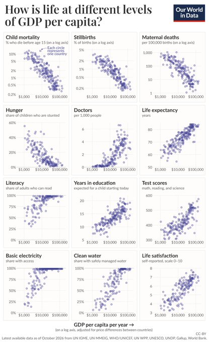

```{r setup}
#| include: false
knitr::opts_chunk$set(comment = "#>", fig.align = "center")
library(dplyr)
library(tidyr)
library(ggplot2)
library(ggrepel)
library(splines)
library(car)
library(heplots)
library(candisc)

load("data/LifeGDP.RData")

theme_set(theme_bw(base_size = 13))
```

```{r transform}
#| include: false
# empirical logit for percentages with a ceiling at 100%
elogit <- function(p, eps = 0.5) log((p + eps) / (100 - p + eps))

# 9 responses with good coverage; Literacy, TestScores, Stunting held back (missingness,
# and the 1950-vintage Literacy values)
resp <- c("ChildMort", "Stillbirth", "MatMort", "Doctors", "LifeExp",
          "SchoolYrs", "Electricity", "Water", "LifeSat")

# transformed & oriented: mortality-type outcomes are reversed (-log10), so + = better
OW <- LifeGDP |>
  transmute(country, code, region,
            GDP,
            logGDP      = log10(GDP),
            ChildMort   = -log10(ChildMort),
            Stillbirth  = -log10(Stillbirth),
            MatMort     = -log10(MatMort),
            Doctors     = log10(Doctors),
            LifeExp,
            SchoolYrs,
            Electricity = elogit(Electricity),
            Water       = elogit(Water),
            LifeSat)
rownames(OW) <- OW$country

# axis labels that say what was done to each response
resp_lab <- c(ChildMort = "-log ChildMort", Stillbirth = "-log Stillbirth",
              MatMort = "-log MatMort", Doctors = "log Doctors", LifeExp = "LifeExp",
              SchoolYrs = "SchoolYrs", Electricity = "logit Electricity",
              Water = "logit Water", LifeSat = "LifeSat")
```

```{r complete-cases}
#| include: false
cc <- OW[complete.cases(OW[, resp]), ]
# only one Oceania country is complete: merge with Asia
levels(cc$region)[levels(cc$region) %in% c("Asia", "Oceania")] <- "Asia/Oceania"
cc$region <- droplevels(cc$region)
Z <- scale(as.matrix(cc[, resp]))

# GDP tercile groups, used for covariance comparisons
cc$income <- cut(cc$logGDP, quantile(cc$logGDP, 0:3 / 3), include.lowest = TRUE,
                 labels = c("Low", "Middle", "High"))

table(cc$region)
```

## Introduction: a beautiful small-multiples chart

I saw this [chart on X](https://x.com/MaxCRoser/status/2115743768510886379) from [Our World In Data](https://ourworldindata.org/), relating aspects of "How is Life?" to countries' GDP per cap.
My first thought was "Wow!" that's an excellent example of small multiples to see many variables
together in a single view: 12 indicators, each one
plotted against log GDP per capita, one dot per country. The message is immediate: almost
all indicators of quality of life get better as countries get richer.

{#fig-owid width="60%"}

### A multivariate view?
But it also struck me as something from which more might be learned from a multivariate perspective. 
@fig-owid shows 12 *separate* bivariate displays. What it can't show:

- how the outcomes relate to *each other*, which is their joint distribution;
- whether a country that does well on one outcome, *given its GDP*, also does well on the
  others;
- whether the whole pattern differs by region, or changes with development.

Thinking this way, we can frame this as a "$p$ responses, one predictor" problem, i.e., a multivariate linear model (MLM):
$$
f(\mathbf{Y})_{n \times p} = g(x)\,\mathbf{B}_{1 \times p} + \mathbf{E}_{n \times p} \; ,
$$
where $x$ is GDP per capita. Both sides can be transformed:

- On the left, $f(\mathbf{Y}) = [f_1(\mathbf{y}_1), \dots, f_p(\mathbf{y}_p)]$ transforms each
  outcome separately (log, logit, ...) to accommodate outcome variables measured on very
  different scales, and to make their relations with GDP closer to linear.
- On the right, $g(x)$ is usually just $\log(\text{GDP})$, as in the OWID chart. But it can
  also be a polynomial or spline in $\log(\text{GDP})$, when the relation is curved.

I call this a **doubly generalized linear model**, but that is more a conceptual term than a statistical
one, because the details that give it structure need to be worked out, as in generalized linear
models (Nelder & Wedderburn, 1972) and generalized additive models (Hastie & Tibshirani, 1986). The goal is to allow flexibility
in the transformations of the predictor and the response variables that make the fitted relations
linear in the parameters in $\mathbf{B}$.

The statistical questions are then about the fitted part $g(x)\mathbf{B}$ and the residual
covariance $\boldsymbol{\Sigma}$ of the rows of $\mathbf{E}$.
These create some interesting possibilities for visualizing these relations,
using and extending the methods I describe in my book
[*Visualizing Multivariate Data and Models in R*](https://friendly.github.io/Vis-MLM-book/)
and R packages [heplots](https://friendly.github.io/heplots/), [candisc](https://friendly.github.io/candisc/), [mvinfluence](https://friendly.github.io/mvinfluence/) and others.

As an added bonus, I also discovered several aspects of a multivariate approach to this problem
and similar ones, that make analysis and visualization simpler or easier to understand.
I'm grateful to the team at [Our World In Data](https://ourworldindata.org/) for making these data so easy to get.

## The data

I found the data in the [OWID grapher](https://ourworldindata.org/charts) series. Each panel of
@fig-owid is a standard OWID chart. For example
[life expectancy](https://ourworldindata.org/grapher/life-expectancy). Every chart has a
download tab, and its data are also available as a CSV file at
`https://ourworldindata.org/grapher/<slug>.csv`. So it was easy to download the 12 indicators,
plus GDP per capita, and merge them by country code. The script `R/get-LifeGDP.R` does this. Like
the OWID chart, it takes the most recent year available for each country and indicator, and
keeps only countries, not regional aggregates. That gives a data set of
`r nrow(LifeGDP)` countries.

The indicators come from many sources (UN agencies, UNESCO, Gallup, the World Bank), so not
every country has every one. Water and life satisfaction have the most gaps, and literacy has a
more curious problem: For many rich countries the most recent literacy figure is a historical
estimate for 1950, presumably because nobody measures literacy where it is near 100%. Rather
than deal with these issues here, I use the 9 indicators with the best coverage and leave out
literacy, test scores and stunting. That leaves `r nrow(cc)` countries with complete data on all
9.

The variables used in the analyses here are:

- `GDP`: GDP per capita, in constant international dollars (PPP); the predictor
- `ChildMort`: percent of children dying before age 15
- `Stillbirth`: stillbirths per 100 births
- `MatMort`: maternal deaths per 100,000 live births
- `Doctors`: physicians per 1,000 people
- `LifeExp`: life expectancy at birth, in years
- `SchoolYrs`: expected years of schooling
- `Electricity`: percent of the population with access to electricity
- `Water`: percent of the population using safely managed drinking water
- `LifeSat`: life satisfaction, on the 0--10 Cantril ladder

### Data prep

A bit of preparation makes the multivariate analyses go more smoothly:

- **Transformations.**
  - The three mortality rates are on a log scale, as in the OWID chart, and so is the number
    of doctors.
  - Access to electricity and safe water are percentages that pile up at 100% in richer
    countries, so I use an empirical logit for them,
    $\text{logit}(y) = \log \left[ (y + 0.5) / (100 - y + 0.5) \right]$, where $y$ is the
    percentage. Adding 0.5 keeps the values at exactly 100% finite.
- **Orientation.** Child mortality, stillbirths and maternal mortality are "bad" outcomes,
  where lower is better. I reverse them (using $-\log$), so that higher means better on *every*
  response, in contrast to @fig-owid, where you have to think about what direction is better.  This small step makes every later display, from correlation matrices to biplots,
  much easier to read: all the arrows and ellipses point the same semantic way.
- **Standardization.** For the multivariate models the responses are standardized to
  $z$-scores, so that no single indicator dominates because of its units.

Finally, for comparisons among regions I use OWID's continents. Only one country from Oceania
has complete data, so I merged it with Asia.

```{r}
#| tbl-cap: "Countries in the complete-case analysis, by region"
knitr::kable(as.data.frame(table(Region = cc$region)))
```

## Development profiles: From twelve panels to one

Small multiples invite comparison *within* a panel. Comparing *across* panels is harder: each
panel in @fig-owid has its own vertical scale and units, so it is hard to say whether electricity or life
expectancy "responds" to income sooner in relation to $\log(GDP)$

A first step is to add a smoother to each panel. @fig-smoothed does this for the top two rows of
@fig-owid, using a [loess](https://en.wikipedia.org/wiki/Local_regression) curve, with the three
rates on a log scale as in the OWID chart. Stunting (the "Hunger" panel in OWID) is one of the indicators I leave out of the
later analyses. The curves bring out what the clouds of points only suggest: these relations are
not straight lines. Doctors is the clearest case, staying near zero up to about \$10,000, then
climbing steeply, and falling back among the richest countries. Smoothers help you read each panel,
but they don't make it any easier to compare one panel with another.

```{r fig-smoothed}
#| fig-cap: "The top two rows of the OWID chart, redrawn from the data with a loess smoother added to each panel."
#| fig-height: 5.5
# The top two rows of the OWID chart, with a loess smoother added to each panel
panels <- c("ChildMort", "Stillbirth", "MatMort", "Stunting", "Doctors", "LifeExp")
LifeGDP |>
  select(GDP, all_of(panels)) |>
  mutate(across(c(ChildMort, Stillbirth, MatMort), log10)) |>
  pivot_longer(all_of(panels), names_to = "indicator", values_to = "value") |>
  mutate(indicator = factor(indicator, levels = panels)) |>
  ggplot(aes(GDP, value)) +
  geom_point(shape = 1, colour = "navy") +
  geom_smooth(method = "loess", formula = y ~ x, se = FALSE, colour = "red") +
  scale_x_log10(breaks = c(1e3, 1e4, 1e5), labels = c("$1,000", "$10,000", "$100,000")) +
  facet_wrap(~ indicator, scales = "free_y") +
  labs(x = "GDP per capita (log scale)", y = "Value (log10 for ChildMort, Stillbirth, MatMort)") +
  theme(axis.text.x = element_text(size = 9))
```

One simple way to put the responses on a common footing:

1. Fit a smooth curve to each response against log GDP. I use a natural spline with 3 df, and
   all the countries available for that response.
2. Rescale each fitted curve to run from 0, the level predicted for the poorest countries, to 1,
   the level predicted for the richest.

Overlaying the rescaled curves gives @fig-profiles. I call these **development profiles**. Each
curve shows how far a typical country at a given income has come, on that indicator, along the
path from the poorest to the richest. I haven't seen this kind of chart before. I think it could
be more generally useful for this type of analysis looking at several aspects of an outcome 
("good life" here) in relation to a single predictor. 

```{r profiles-fit}
# Smooth fit of each (transformed) response on log GDP, using all available countries
# for each response, rescaled to [0, 1] over the observed GDP range:
# 0 = level of the poorest countries, 1 = level of the richest
grid <- data.frame(logGDP = seq(min(OW$logGDP), max(OW$logGDP), length.out = 200))

fit_profiles <- function(data) {
  lapply(resp, \(v) {
    fit <- lm(reformulate("ns(logGDP, 3)", v), data = data)
    yhat <- predict(fit, newdata = grid)
    data.frame(grid, response = v,
               fit = (yhat - min(yhat)) / (max(yhat) - min(yhat)))
  }) |> bind_rows()
}

# "development threshold": GDP where the fitted profile first reaches 10/50/90% of its range
fit_thresholds <- function(profiles) {
  profiles |>
    group_by(response) |>
    summarise(half = logGDP[which(fit >= 0.5)[1]],
              q10  = logGDP[which(fit >= 0.1)[1]],
              q90  = logGDP[which(fit >= 0.9)[1]]) |>
    arrange(half) |>
    mutate(response = factor(response, levels = response))
}

profiles <- fit_profiles(OW)
thresholds <- fit_thresholds(profiles)
profiles$response <- factor(profiles$response, levels = levels(thresholds$response))

# GDP values for inline text, e.g. `r usd(thr50["Water"])`
usd <- function(x) paste0("\\$", format(round(x, -2), big.mark = ",", trim = TRUE))
thr50 <- setNames(10^thresholds$half, thresholds$response)
```

```{r fig-profiles}
#| fig-cap: "Development profiles: spline fit of each response on log GDP, rescaled to [0, 1]."
dollar_log <- scale_x_continuous(breaks = 3:5, labels = c("$1,000", "$10,000", "$100,000"))

# label each curve at GDP = $10,000, where the curves are spread out; right-justified
# labels just left of the curve, with white boxes so the curves don't run through the text
lab10k <- profiles |>
  group_by(response) |>
  slice_min(abs(logGDP - 4), n = 1, with_ties = FALSE) |>
  ungroup()

ggplot(profiles, aes(logGDP, fit, colour = response)) +
  geom_line(linewidth = 1.1) +
  geom_point(data = lab10k, size = 1.8) +
  geom_label_repel(data = lab10k, aes(label = response), hjust = 1, direction = "y",
                   nudge_x = -0.15, xlim = c(NA, 3.92), box.padding = 0.15,
                   label.padding = 0.12, label.size = NA, fill = alpha("white", 0.85),
                   segment.colour = "grey50", size = 3.8, fontface = "bold",
                   min.segment.length = 0, seed = 1) +
  dollar_log +
  labs(x = "GDP per capita (log scale)",
       y = "Fitted level (0 = poorest, 1 = richest)") +
  theme(legend.position = "none")
```

The curves are not parallel. They come in a clear *sequence*, which is easiest to see by reading
across at height 0.5:

- Access to electricity is first: halfway by about `r usd(thr50["Electricity"])`.
- Doctors come next, at `r usd(thr50["Doctors"])`.
- Schooling, life satisfaction, life expectancy and the three mortality measures form a
  cluster between `r usd(thr50["SchoolYrs"])` and `r usd(thr50["Stillbirth"])`.
- Safely managed drinking water comes last, at about `r usd(thr50["Water"])`.

@fig-thresholds summarizes the profiles as "development thresholds". The dot marks the GDP at
which each profile reaches half its range, and the line runs from 10% to 90%. The lines show a
second difference, in how *quickly* each indicator changes. Electricity and doctors go from 10%
to 90% over about a 15-fold range of GDP. Life expectancy and child mortality take more than
30-fold: they improve gradually, and keep improving, over almost the whole range of incomes.

```{r fig-thresholds}
#| fig-cap: "Development thresholds: GDP per capita at which each profile reaches 10%, 50% (dot) and 90% of its range."
#| fig-height: 4
ggplot(thresholds, aes(y = response)) +
  geom_linerange(aes(xmin = q10, xmax = q90), linewidth = 1, colour = "grey60") +
  geom_point(aes(x = half), size = 3, colour = "navy") +
  dollar_log +
  labs(x = "GDP per capita where 10% / 50% / 90% of the range is reached",
       y = NULL)
```

It is tempting to read this as a story of *infrastructure and personnel first, outcomes later*.
But a caution is needed, because the sequence depends on the scale of each response.
@tbl-thresholds repeats the calculation on the original scales of the OWID chart.

```{r profiles-raw}
# Same profiles on the original scales (mortality-type outcomes only negated)
OWraw <- LifeGDP |>
  transmute(logGDP = log10(GDP), ChildMort = -ChildMort, Stillbirth = -Stillbirth,
            MatMort = -MatMort, Doctors, LifeExp, SchoolYrs, Electricity, Water, LifeSat)
thresholds_raw <- fit_thresholds(fit_profiles(OWraw))
thr50_raw <- setNames(10^thresholds_raw$half, thresholds_raw$response)
```

```{r tbl-thresholds}
#| tbl-cap: "GDP per capita at which each profile reaches half its range, on the transformed scales used here and on the original scales."
data.frame(Transformed = usd(thr50), Rank = seq_along(thr50),
           Raw = usd(thr50_raw[names(thr50)]),
           `Raw rank` = match(names(thr50), names(thr50_raw)),
           row.names = names(thr50), check.names = FALSE) |>
  knitr::kable(align = "rrrr")
```

Life expectancy, schooling and life satisfaction were not transformed, so their thresholds
don't change. The rest change a lot:

- **The mortality measures** move from the middle of the sequence to near the front. On the
  raw scale, most of the *absolute* reduction in child deaths happens early: going from 10% to
  2% of children dying before age 15 covers most of the range. On a log scale, going from 2%
  to 0.4% counts just as much, and that further improvement continues well into the
  high-income range.
- **Doctors** go the other way, from second to last. On the raw scale the number of physicians
  per 1,000 hardly changes until about \$10,000, then rises steeply, which is how it looks in
  the OWID panel. On the log scale the large *proportional* increases among poor countries
  dominate.
- **Safely managed water** moves from last to the middle, from `r usd(thr50["Water"])` to
  `r usd(thr50_raw["Water"])`. The median country has about 70% coverage by \$10,000--30,000
  and 99% above that, so on the raw scale much of the range is covered at middle incomes. The
  logit stretches out the top of the scale: going from 90% to 99% counts about as much as going
  from 50% to 90%, and that last step comes late.

Neither version is "right". A log scale measures relative change and a raw scale measures
absolute change, and which matters depends on the question. For the multivariate analyses that
follow, I chose the transformations to make the relations closer to linear and the variances
more similar. But it's worth knowing that this choice also changes the story a display tells.

One more detail: the Electricity and Doctors profiles turn *down* slightly at the top of the GDP
range. This is most likely an end effect of the spline. Only `r sum(OW$GDP > 80000)` countries
have GDP per capita above \$80,000: a mixed group of financial centers (Luxembourg, Singapore,
Ireland, Switzerland), petro-states (Qatar, Norway) and Guyana, recently rich from oil. That is
too few to pin down the shape of a curve.

## Thinking multivariately: the MLM

The development profiles were still nine separate regressions. The multivariate linear model
fits them all at once. In R this needs only a matrix on the left side of the model formula.
Here that is `Z`, the $`r nrow(Z)` \times `r ncol(Z)`$ matrix of standardized responses for the
countries with complete data. The estimated coefficients $\mathbf{B}$ are exactly the same as
from nine separate `lm()` fits. 

What the MLM adds are *tests* that consider all the responses
*together*, taking their correlations into account. Here I use Pillai's trace for these tests.

The first question is whether the relation with log GDP is linear when all the outcomes are
considered together. To allow for curvature I use a natural spline in log GDP with 3 degrees of freedom, `ns(logGDP, 3)`, which I say more about in [The spline trick](#the-spline-trick) below. A quick multivariate test shows that this gives a highly significant improvement over a straight line (Pillai = 0.71, $F(18, 220) = 6.72$, $p < 10^{-12}$).

```{r mlm-shape}
# Is the relation with log GDP linear, jointly over all responses?
mod1 <- lm(Z ~ logGDP, data = cc)
mod2 <- lm(Z ~ ns(logGDP, 3), data = cc)
anova(mod1, mod2)
```

@tbl-rsq shows that this curvature is not spread evenly across the responses. Access to
electricity gains the most (.62 to .74), followed by doctors (.70 to .77). These are the two
profiles that bend most in @fig-profiles. Electricity saturates even on the logit scale, and
doctors turn down among the richest countries. The mortality measures, water and schooling gain
less, .02 to .04, from the gentler S-shapes of their profiles. Only for life expectancy and life
satisfaction does a straight line in log GDP do about as well as a curve.

```{r tbl-rsq}
#| tbl-cap: "R² for each response: linear in log GDP, natural spline with 3 df, and their difference"
rsq <- function(mod) sapply(summary(mod), \(s) s$r.squared)
tab_rsq <- data.frame(linear = rsq(mod1), spline = rsq(mod2), row.names = resp)
tab_rsq$diff <- tab_rsq$spline - tab_rsq$linear
knitr::kable(round(tab_rsq, 2))
```

### Does region matter?

The next question is whether region matters, *beyond* GDP. 
With `region` as a 5-level factor, the standard analysis formally becomes multivariate analysis of
covariance (MANCOVA), or a test of homogeneity of regressions depending on your perspective
for what you want to account for first.

As before, I use the natural
spline in log GDP, to allow for non-linearity, as the covariate. Both terms are highly
significant (Pillai = 1.26 for GDP and 1.33 for region, both $p < 10^{-15}$). Adding region
raises $R^2$ for every response. The largest gains are for maternal mortality (.73 to .82),
doctors (.77 to .85) and electricity (.74 to .85).

```{r mlm-region1}
# Does region matter, beyond GDP?  And is the GDP slope the same in all regions?
modR <- lm(Z ~ ns(logGDP, 3) + region, data = cc)
Anova(modR)
```

The region coefficients, relative to Africa, are positive for nearly every response. At the
same level of GDP, African countries do worse on almost all of these outcomes. Europe is
furthest ahead on the mortality measures, nearly one standard deviation. Life satisfaction
gives the largest regional difference: North and South America are 1.06 and 0.82 SD above
Africa, at the same GDP. This fits the high happiness scores often noted for Latin America. The
HE plots in the next section show these region differences directly.

### Equal slopes for regions?
Last, a MANCOVA assumes that the slopes are the same in every region. That is, it assumes that
the GDP gradient is the same in Africa as in Europe. Adding a GDP × region interaction tests
this, and the assumption is rejected (Pillai = 0.66, $F(36, 416) = 2.30$, $p < .0001$). Two
caveats apply:

- This test allows only the *linear* part of the GDP slope to differ by region.
- North and South America have only 8 countries each, so their slopes are poorly estimated.

```{r mlm-region2}
modRI <- lm(Z ~ ns(logGDP, 3) + region + logGDP:region, data = cc)
anova(modR, modRI)
```

The GDP slopes are not homogeneous across regions, so this is a MANCOVA with a caveat: the region
effects in the additive model should be read as *average* differences, over the range of GDP
where the regions overlap. I keep the additive model as a useful summary for the
HE plots that follow.

## HE plots: GDP and region effects

The tests in the last section say *that* GDP and region matter, jointly over all the outcomes.
They don't say *how*. An HE plot shows this directly, for any pair of responses. It draws two
kinds of ellipses:

- The **E** ellipse (red, dashed) shows the residual, or error, covariance. It is the scatter of
  countries around the fitted model, the data ellipse of the residuals.
- An **H** ellipse for each term in the model shows the covariance of the *fitted values* for
  that term. Its size and orientation show how strongly, and in which directions, the term
  moves the responses.

The H ellipses are scaled so that a term is significant (by Roy's test, at $\alpha = .05$)
exactly when its ellipse sticks out beyond the E ellipse somewhere. Then you can read both the
significance and the direction of an effect from the same picture. 

See the
[heplots](https://friendly.github.io/heplots/) package, and the chapters on HE plots in my
book [*Visualizing Multivariate Data and Models in R*](https://friendly.github.io/Vis-MLM-book/), for more.

### The spline trick

The model is the MANCOVA from the last section, `modR`. There is one detail worth noting. With
GDP entered as a single 1-df term, $\log(\text{GDP})$, its H "ellipse" would collapse to a line:
one linear predictor can push the responses in only one direction. 

A trick, which I discovered from this example is to use a term, $g[\log(\text{GDP})]$
which adds an extra degree of freedom or two, to allow the relationship to bend smoothly
to some degree. Consequently, the GDP **H** ellipse is allowed to get slightly fatter than
a line, to the extent that the relationship differs from a strictly linear one in $\log(\text{GDP})$
relative to the transformation of the response, $f(\mathbf{y}_i)$.

Here, I use a simple _natural cubic spline_, given by `splines::ns(logGDP, df=3)`.
This gives the GDP **H** ellipse some extra wiggle room to express non-linearity, if there is any
in the data.

@fig-heplot shows this for life expectancy and life satisfaction.

- The GDP ellipse (blue) is very long and *very* thin. Even with three degrees of freedom, GDP
  moves these two outcomes along essentially a single direction: up and to the right, together.
- The region ellipse (black) is much rounder. It sticks out past the E ellipse only modestly, at
  the upper right and lower left, so region matters here, though far less than GDP. It is tilted
  up and to the right, but more steeply than the GDP ellipse, so it reaches further in the life
  satisfaction direction.

The dots in @fig-heplot need a word of explanation. By default, `heplot()` marks each region with
its *raw* mean. Here that would be misleading. The region H ellipse is adjusted for GDP, but the
raw means are not. They would mostly show differences in income again, lying along the GDP
direction, with Africa far down at the lower left. So instead I plot the *GDP-adjusted* region
means: the averages, by region, of the residuals from a model with GDP alone. Now the dots and
the region ellipse show the same thing.

At the same GDP, North and South America are about 0.5 and 0.3 SD *above* average in life
satisfaction, and Africa is about 0.25 SD below average in life expectancy. Europe and
Asia/Oceania are close to the center: their raw advantages are mostly accounted for by income.

```{r fig-heplot}
#| fig-cap: "HE plot for LifeExp and LifeSat: GDP (spline) and region effects. Dots show GDP-adjusted region means."
# GDP-adjusted responses: residuals from the model with GDP alone
res_gdp <- resid(lm(Z ~ ns(logGDP, 3), data = cc))
adj_means <- aggregate(res_gdp, list(region = cc$region), mean)

# HE plot for two responses; GDP H ellipse vs. region H ellipse, relative to E.
# Suppress the raw region means and add the GDP-adjusted ones.
vars <- c("LifeExp", "LifeSat")
heplot(modR, variables = vars, factor.means = FALSE,
       fill = TRUE, fill.alpha = 0.1, label.cex = 1.15,
       term.labels = c("GDP (spline)", "region"))
points(adj_means[, vars], pch = 16, cex = 1.2)
text(adj_means[, vars], labels = adj_means$region, pos = c(3, 1, 3, 3, 3), cex = 1.1)
```

@fig-heplot-pairs extends this to five of the responses, in an HE plot matrix. Two features
stand out:

- **The GDP effect is nearly one-dimensional.** Its ellipse is a thin cigar in almost every
  panel. Whatever the spline adds, GDP mostly moves all the outcomes along one common
  "development" direction. The exceptions are the panels with doctors, where the GDP ellipse
  is fatter. That is the curvature already seen in @fig-profiles: doctors turn down among the
  richest countries while the other outcomes keep rising.
- **The region effect is not one-dimensional.** Its ellipse is fatter, and its orientation
  changes from panel to panel. The regions differ in *different ways* on different outcomes,
  not just "better" or "worse" overall. Relative to E, region is largest in the panels
  with doctors or child mortality. It is smallest among life expectancy, water and life
  satisfaction, where its ellipse barely gets past E.

```{r fig-heplot-pairs}
#| fig-cap: "HE plot matrix for five responses. \"GDP\" labels the H ellipse for the 3-df natural spline in log GDP per capita, `ns(logGDP, 3)`, in the model."
#| fig-height: 8
# region means are left out here: the default ones would be unadjusted for GDP
pairs(modR, variables = c("ChildMort", "Doctors", "LifeExp", "Water", "LifeSat"),
      factor.means = FALSE, fill = TRUE, fill.alpha = 0.1,
      term.labels = c("GDP", "region"))
```

With nine responses there are 36 pairwise panels, too many to look at. A canonical
discriminant analysis does the summarizing for us. It finds the linear combinations of the
responses that best separate the regions, relative to the within-region variation. These are the
dimensions of the region H ellipsoid in the full 9-dimensional space. There can be at most four
dimensions, one fewer than the number of regions.

The same problem as with the dots in @fig-heplot comes up here, in a bigger way. Running
`candisc()` on `modR` itself gives canonical *axes* based on the GDP-adjusted region effect. But
it computes the plotted *scores* (the points, region means and data ellipses) from the raw
responses, so they still contain GDP. In that version of the plot, Can1 correlates −0.86 with log
GDP, and the plot mostly shows the income gradient once more, from Africa to Europe.

The fix is the same as before. I run the canonical analysis on the GDP-adjusted responses, the
residuals from the model with GDP alone, with region as the only term. Now the scores are
uncorrelated with GDP, and the plot shows only how the regions differ *at the same income*.
The tests for region come from `modR`, in the last section. This version is for display, and its
significance tests are only approximate, because it doesn't allow for the degrees of freedom used
by GDP.

```{r fig-candisc}
#| fig-cap: "Canonical discriminant plot of region differences, using GDP-adjusted responses."
# Canonical view of region differences, after removing GDP:
# region model for the residuals from Z ~ ns(logGDP, 3)
modA <- lm(res_gdp ~ region, data = cc)
can_region <- candisc(modA, term = "region")
can_region
# reverse Can1 so that right = higher life satisfaction (the Americas), and
# reverse Can2 so that up = better on electricity, doctors, life expectancy
plot(can_region, var.lwd = 2, var.col = "black", ellipse = TRUE, rev.axes = c(TRUE, TRUE),
     scale = 4, col = scales::hue_pal()(nlevels(cc$region)))
```

Two dimensions account for 86% of the GDP-adjusted region differences, and they are easy to
interpret from the variable vectors.

- **Can1 (53%) sets life satisfaction against health.** To the right, the life satisfaction
  vector points to the Americas: the Dominican Republic, Costa Rica, Mexico, Guatemala and
  Guyana. To the left, the vectors for child and maternal mortality, stillbirths, water and
  schooling point to Europe, led by Belarus, North Macedonia, Montenegro and Ukraine, along
  with Egypt. For their income, Latin American countries are happier than their health
  outcomes would suggest, and post-communist Europe is the reverse. Both are well-known patterns
  in the happiness literature. Here they appear together, as two ends of the same dimension.
- **Can2 (33%) is mostly electricity**, along with doctors, life expectancy and maternal
  mortality. Asia/Oceania is at the top, and Africa and South America are at the bottom. The
  countries most above
  their GDP prediction are poor countries with near-universal electricity: Palestine,
  Tajikistan, Afghanistan, Kyrgyzstan and Lebanon. The countries most below it are all
  African: the Congo, Eswatini, Botswana, South Africa and Nigeria. Their GDP is high relative to
  their infrastructure and health, in some because of oil and minerals and in southern Africa
  alongside the burden of HIV/AIDS, a pattern that returns in the residual PCA below.

## What GDP doesn't explain: residual correlations

Every outcome here is strongly related to GDP. The correlations with log GDP run from .79 for
electricity to .88 for child mortality and stillbirths. So GDP acts as a *common factor*. Any
two outcomes are bound to be highly correlated, just because both go up with income. The OWID
chart in effect shows nine views of this one fact. The more interesting question is what is left
when GDP is taken out: do the outcomes still hang together, and if so, which ones?

To answer it, I take the residuals from the MLM with the spline in log GDP, `mod2`. Each residual
says how much better or worse a country does on an outcome than a typical country with the same
income. Then I compare the correlations among the residuals, the *partial* correlations
controlling for GDP, with the raw correlations.

```{r resid-cor}
R_raw  <- cor(Z)
res    <- resid(mod2)
R_part <- cor(res)

# raw correlations with log GDP: the "common factor"
round(cor(Z, cc$logGDP)[, 1], 2)
```

```{r fig-corrplot}
#| fig-cap: "Correlations among responses: raw (left) and controlling for GDP (right)."
#| fig-width: 11
#| fig-height: 5.5
op <- par(mfrow = c(1, 2), mar = c(1, 1, 3, 1))
ord <- corrplot::corrMatOrder(R_part, order = "AOE")
corrplot::corrplot(R_raw[ord, ord], method = "ellipse", type = "lower", diag = FALSE,
                   tl.col = "black", tl.srt = 45, addCoef.col = "black",
                   number.cex = 0.6, title = "Raw", mar = c(0, 0, 2, 0))
corrplot::corrplot(R_part[ord, ord], method = "ellipse", type = "lower", diag = FALSE,
                   tl.col = "black", tl.srt = 45, addCoef.col = "black",
                   number.cex = 0.6, title = "Controlling for GDP", mar = c(0, 0, 2, 0))
par(op)
```

@fig-corrplot shows the two side by side. The variables in both panels are in the same order,
found from the partial correlations, so that similar outcomes are next to each other.

- **Raw:** every correlation is large, from .66 to .95, with an average of .81. Except for life
  satisfaction, which is a bit weaker, there is little structure to see. Almost everything is
  dark blue.
- **Controlling for GDP:** the correlations drop to an average of .37, and now there is
  structure. They are still all *positive*. Because of the orientation step, positive means that
  a country doing better than expected for its income on one outcome tends to do better on the
  others too. Good things go together, even beyond income.

Three features stand out in the partial correlations:

- **The mortality block** (child mortality, stillbirths and maternal mortality) stays strongly
  correlated, at .58 to .73. Life expectancy joins it, at .64 with child mortality. This looks
  like a "health system" factor: beyond what income buys, some countries keep mothers and
  children alive better than others.
- **Electricity and doctors** stay correlated at .60, and both relate to maternal mortality
  (.56 and .51). Perhaps this is general state capacity: the ability to build infrastructure and
  staff it.
- **Life satisfaction** is nearly independent of everything else once GDP is controlled. The
  largest of its partial correlations is .26, and it is .08 with electricity. Happiness tracks
  money, across countries. But a country that is healthier, or better schooled, than its income
  predicts is *not* noticeably happier than its income predicts. We saw a hint of this already
  in the canonical analysis, where life satisfaction was set against the health outcomes.

Some of this residual structure comes from region. The residuals here adjust for GDP only.
If region is controlled as well (using `modR` from above), the partial correlations shrink
again, to an average of .31, and electricity–doctors drops to .46. But the mortality block and
its link to life expectancy hold up (child mortality–life expectancy is .68). Life
satisfaction stays isolated.

A correlation matrix shows only the *strength* of linear association. @fig-resid-spm shows the
residuals themselves for five of the outcomes. The data ellipses confirm the picture: tilted
ellipses among child mortality, maternal mortality and life expectancy, and nearly circular
ones in the life satisfaction row. The plots also show what the correlations hide. Two points
lie far out in the lower left of the mortality and life expectancy panels. These are Nigeria
and Guyana, which do much worse on child mortality and life expectancy than their GDP predicts.
Points like these can drive a correlation, and I return to them in the section on unusual
countries below.

```{r fig-resid-spm}
#| fig-cap: "Scatterplot matrix of residuals from the GDP model, with 68% data ellipses."
#| fig-height: 8
# residual scatterplot matrix with 68% data ellipses
scatterplotMatrix(res[, c("ChildMort", "MatMort", "Water", "LifeExp", "LifeSat")],
                  smooth = FALSE, regLine = FALSE,
                  ellipse = list(levels = 0.68, fill.alpha = 0.1),
                  diagonal = list(method = "density"),
                  col = "navy", pch = 16, cex = 0.6)
```

### What we learned here

These points draw on all nine outcomes in @fig-corrplot. @fig-resid-spm shows only five of them,
so stillbirths, doctors, schooling and electricity don't appear there.

- **All good things go together, even beyond income.** Because of the orientation step, *every*
  correlation is positive, raw and partial alike.
- **The mortality block stays strongly correlated.** Child mortality, stillbirths and maternal
  mortality look like a "health system" factor, beyond what income buys.
- **Electricity and doctors stay correlated** (.60) after GDP is controlled, perhaps an
  "infrastructure and state capacity" pairing.
- **Life satisfaction becomes nearly independent of the other outcomes** once GDP is controlled.
  Happiness tracks money, but not health or schooling *given* money.

## Doing better than your money: residual PCA and biplot

The usual first step in summarizing many correlated variables is a principal components analysis
(PCA). Here, though, a PCA of the outcomes themselves has little to tell us. The first
component accounts for 83% of the variance, and its scores correlate .92 with log GDP. It simply
rediscovers income, the common factor that the OWID chart already puts on the horizontal axis.

```{r pca-y}
# PCA of the (standardized, oriented) responses: PC1 is essentially GDP
pca_y <- prcomp(Z)
summary(pca_y)$importance[, 1:4]
round(cor(pca_y$x[, 1:2], cc$logGDP), 2)
```

### The residual PCA trick

A PCA of the *residuals* from the GDP model asks a more interesting question. Which countries
achieve more, or less, than their income predicts, and on which outcomes? It is the
dimension-reduction view of the residual correlations in the last section.

I haven't seen this used anywhere, but it comes from thinking about what variables to display
in plots, when you want to incorporate some known variable and see what remains to be explained.
Common examples of this are [**added variable** plots](https://en.wikipedia.org/wiki/Partial_regression_plot), implemented in 
`car::AVplots()` and my recent extension of this idea, **partial variable** plots,
implemented in `heplots::pvPlot()`.

```{r pca-resid}
# PCA of residuals from the GDP model
res <- resid(mod2)
pca_r <- prcomp(res)
# orient PC1 so that positive = better than GDP predicts
if (sum(pca_r$rotation[, 1]) < 0) {
  pca_r$rotation[, 1] <- -pca_r$rotation[, 1]
  pca_r$x[, 1] <- -pca_r$x[, 1]
}
summary(pca_r)$importance[, 1:4]
round(pca_r$rotation[, 1:2], 2)
```

The residual PCA has a clear structure:

- **PC1 (43%) is a general "performance relative to income" score.** All nine loadings are
  positive, from .20 for life satisfaction to .42 for maternal mortality. A country with a high
  score does better than its GDP predicts on nearly everything, and the health outcomes and
  electricity count most. This is the "good things go together" result from the residual correlations, as a
  single score.
- **PC2 (14%) is essentially life satisfaction** (loading .92), set against electricity
  (−.25). It is the one outcome that, given income, goes its own way.

@fig-biplot shows both together, in a biplot: points for countries, and vectors for the
outcomes. The vectors for the seven health and infrastructure outcomes fan out together to the
right, along PC1. Schooling tilts upward a little. Life satisfaction points almost straight up,
nearly at right angles to the others, which is how a biplot shows near-zero correlation.

```{r fig-biplot}
#| fig-cap: "Biplot of residuals from the GDP model, colored by region."
#| fig-height: 7
scores <- data.frame(cc[, c("country", "region")], pca_r$x[, 1:2])
extreme <- scores |> filter(rank(PC1) <= 6 | rank(-PC1) <= 6 | rank(-abs(PC2)) <= 4)
vscale <- 0.9 * max(abs(scores[, c("PC1", "PC2")])) / max(abs(pca_r$rotation[, 1:2]))
vecs <- data.frame(var = rownames(pca_r$rotation), vscale * pca_r$rotation[, 1:2])
pve <- round(100 * pca_r$sdev^2 / sum(pca_r$sdev^2))

ggplot(scores, aes(PC1, PC2)) +
  geom_hline(yintercept = 0, colour = "grey70") +
  geom_vline(xintercept = 0, colour = "grey70") +
  geom_point(aes(colour = region), size = 2, alpha = 0.7) +
  stat_ellipse(aes(colour = region), level = 0.68, linewidth = 0.6) +
  geom_text_repel(data = extreme, aes(label = country), size = 3.2, max.overlaps = 20) +
  geom_segment(data = vecs, aes(x = 0, y = 0, xend = PC1, yend = PC2),
               arrow = arrow(length = unit(0.2, "cm")), linewidth = 0.8) +
  geom_label_repel(data = vecs, aes(label = var), size = 3.4, fontface = "bold",
                   label.size = NA, fill = alpha("white", 0.7), min.segment.length = 1) +
  coord_equal() +
  labs(x = paste0("PC1: better / worse than GDP predicts (", pve[1], "%)"),
       y = paste0("PC2 (", pve[2], "%)"))
```

The region ellipses show where the regions fall. Europe is compact and sits to the right: few
European countries do much worse than their income predicts. Africa is the most spread out,
and most of the countries far to the left are African. The Americas sit a little higher than
the rest on PC2, reflecting the high life satisfaction seen in the canonical analysis. At the
bottom are countries with good infrastructure but very low life satisfaction for their income:
Afghanistan, Lebanon, Egypt and Sri Lanka. All four have been through war or economic crisis in
recent years.

@fig-performance ranks the countries by their PC1 score, showing the dozen at each end.

```{r fig-performance}
#| fig-cap: "Countries doing most better or worse than their GDP predicts (residual PC1)."
#| fig-height: 6
# PC1 of residuals as a "performance relative to income" score
top <- scores |>
  arrange(PC1) |>
  slice(c(1:12, (n() - 11):n())) |>
  mutate(country = factor(country, levels = country),
         side = ifelse(PC1 > 0, "better", "worse"))

ggplot(top, aes(PC1, country, colour = side)) +
  geom_segment(aes(x = 0, xend = PC1, yend = country)) +
  geom_point(size = 2.5) +
  scale_colour_manual(values = c(better = "#1b7837", worse = "#c51b7d")) +
  labs(x = "Residual PC1 score", y = NULL, colour = "Than GDP predicts")
```

The *underperformers* mostly fall into two groups:

- **Resource economies:** Guyana, Nigeria, Botswana, Chad, Trinidad and Tobago, Bahrain and
  Suriname. In these countries GDP is driven largely by oil, gas, diamonds or other minerals, and
  it overstates the broad welfare that the other outcomes measure.
- **Southern Africa:** South Africa, Eswatini and Zimbabwe, along with Botswana again. These
  are the countries hit hardest by HIV/AIDS, which has cut life expectancy and raised mortality
  far below what their incomes would predict.

The other two fit less neatly. Côte d'Ivoire falls short most on doctors, life expectancy and
electricity. The Dominican Republic is a different case: its shortfall is concentrated in the
mortality measures and safe water, while its number of doctors is about what its income predicts.

Guyana is the extreme case, and it shows that this kind of score depends on *when* each value
was measured. Guyana's GDP per capita has multiplied several times since oil production began in
2019. Its health and infrastructure outcomes, which change slowly, have not caught up yet. The
value for life satisfaction is even older, from 2011.

The *overperformers* are a more varied group:

- **Former socialist states:** Tajikistan, Kyrgyzstan, Uzbekistan, and Bosnia and Herzegovina.
  These may reflect a legacy of universal health care, schooling and electrification, which has
  outlasted the economic collapse of the 1990s.
- **The Middle East and North Africa:** Jordan, Morocco, Palestine and Lebanon. The last two need
  a caution. Palestine's GDP value is for 2025, after the war in Gaza, but most of its other
  outcomes were measured before it. Lebanon's income fell sharply in its economic crisis after
  2019. Some of their "overperformance" is the result of income falling faster than the other
  measures. Lebanon and Jordan are also below their predictions on life satisfaction.
- **Nepal and Honduras:** lower-income countries that do better than predicted on most outcomes,
  Nepal most on schooling and Honduras most on life satisfaction, stillbirths and child mortality.
- **Iceland** is the only rich country in the group, modestly above its prediction on everything.
- **Mozambique** is the real surprise. It is above its prediction on every outcome, and most
  of all on life satisfaction. It is worth checking before reading much into it.

These lists also depend on the model. If I use a quadratic in log GDP instead of the spline, the
PC1 scores still correlate .93 with these, and the extreme countries stay put: Tajikistan at the
top, and Guyana, Nigeria and Botswana at the bottom. But 9 of the 24 countries in
@fig-performance change. Greece, Spain, Finland, Belarus, North Macedonia and New Zealand join
the overperformers, and Qatar, Ghana and Sierra Leone join the underperformers. Some of this is
just a matter of where the cutoff falls: Greece, Spain, Finland and Belarus rank just outside the
top dozen here.

The lesson goes beyond any one country. A residual score measures performance *relative to a
fitted model of GDP*. So it reflects errors or quirks in GDP, and the shape chosen for the curve,
as well as real achievement in the outcomes.

## Unusual countries: multivariate outliers and influence

So far, the residuals have been summarized by correlations and principal components. This section
looks at individual countries, and asks two different questions. Which countries are *unusual*,
given their income? And which ones have the most *influence* on the fitted model? As we will see,
these are mostly not the same countries.

### Multivariate outliers

The natural measure of how unusual a country is across all nine residuals is its squared
Mahalanobis distance, $D^2$, the distance from the center of the residuals, taking their
correlations into account. If the residuals are multivariate normal, $D^2$ has approximately a
$\chi^2$ distribution with 9 degrees of freedom, and a QQ plot against that distribution
(@fig-cqplot) shows how well this holds.

```{r fig-cqplot}
#| fig-cap: "Chi-square QQ plot of squared Mahalanobis distances of residuals."
# chi-square QQ plot of residual squared Mahalanobis distances
rownames(mod2$residuals) <- cc$country
cqplot(mod2, id.n = 8, main = "Residuals from Z ~ ns(logGDP, 3)")
```

```{r D2-table}
res <- resid(mod2)
D2 <- mahalanobis(res, colMeans(res), cov(res))
head(data.frame(D2 = round(sort(D2, decreasing = TRUE), 1)), 10)
```

Most countries follow the line closely, up to a $D^2$ of about 15. Only the upper tail is too
heavy. Nine countries are beyond the 95th percentile of $\chi^2_9$ (16.9), where we would expect
about six, and five are beyond the 99th percentile (21.7), where we would expect about one.
Only Palestine, at 36.7, is far outside the confidence band.

$D^2$ does not simply reward doing very well or very badly. It picks out unusual *combinations*.
Guyana makes the point: it has by far the lowest PC1 score in @fig-performance, but it is only
fourth here. It is below its prediction on all nine outcomes, by 1.3 to 4.3 residual SDs, but a
shortfall on everything at once runs along the direction in which the residuals usually vary. The
others on the list are more out of pattern, and they fall into a few groups:

- **Conflict and crisis.** Palestine has much more electricity, doctors and safe water than its
  GDP predicts (2.2 to 3.4 SD), and low maternal mortality, yet its child mortality is *worse* than
  predicted. Afghanistan has the lowest life satisfaction in the data (1.4 on the 0--10 ladder,
  3.6 SD below prediction) but is above prediction on electricity. Lebanon also combines low life
  satisfaction with better than expected doctors and life expectancy.
- **Resource economies.** Nigeria's life expectancy is 4.2 SD below prediction, and Botswana is
  more than 3 SD below on both electricity and life satisfaction. Turkmenistan is in the next
  group too.
- **Mortality measures that disagree.** Turkmenistan is 2.3 SD *worse* than predicted on child
  mortality but 2.0 SD *better* on maternal mortality. Belarus is 2 to 3 SD better on all three
  mortality measures, and yet below prediction on life expectancy. Cyprus is there for one number,
  a maternal mortality of 68 per 100,000 births, 2.6 SD worse than predicted.

The last group raises the question of data quality. Are these real differences, or artifacts of
how the indicators are estimated and reported? The maternal mortality of Turkmenistan (5 per
100,000) and Belarus (1 per 100,000), and of Cyprus in the other direction, are worth treating
with some caution.

Old data are not the main explanation. In these 121 countries the values are nearly all recent.
Maternal mortality is from 2020 for every country, and all the others but doctors and life
satisfaction are from 2021 or later. The notable exceptions are the ones already mentioned:
Guyana's life satisfaction value is from 2011, and Palestine's doctors value is from 2018, well
before its GDP value.

### Influence

An outlier need not affect the fit very much. Influence depends on both the size of a country's
residual and its *leverage*, how far its log GDP is from the rest. @fig-influence plots these
two against each other, with measures generalized to the multivariate case, on log scales. Each
circle's area shows Cook's distance, the overall influence on the coefficients $\mathbf{B}$.
The dashed diagonal lines mark constant values of the product of leverage and residual.

```{r fig-influence}
#| fig-cap: "Influence plot for the MLM. Circle area shows Cook's distance; dashed lines mark constant values of the product of leverage and residual."
# mvinfluence supplies the influencePlot() method for "mlm" objects
library(mvinfluence)
influencePlot(mod2, id.n = 4, type = "LR")
```

Most of the outliers are at the left: Palestine, Turkmenistan, Nigeria and Belarus have large
residuals but little leverage, because their incomes are in the middle of the range. With only
GDP as a predictor, the high-leverage countries are simply the ones at the two ends of the income
range. On the right, these are the poorest countries, the Central African Republic, Mozambique and
Malawi (about \$1,100 to \$1,600), and the richest, Singapore, Ireland, Luxembourg and Qatar (above
\$110,000). The three large unlabeled circles in the plot are Mozambique, Malawi and Qatar.

Afghanistan has the most influence, because it combines the two: it is poor (about \$2,000) and has
a large residual. Next are Luxembourg and Ireland. This is a concern, because GDP is at its least
meaningful for countries like these, where it is inflated by the profits of multinational firms and
financial flows. Yet these few countries help to set the top end of the spline curve, and so the
residuals of everyone else nearby. Likewise, Mozambique, the surprise in the last section, is the
second-poorest country in the data, where the fit is least well anchored.

### Do they matter?

@tbl-sensitivity repeats the main analyses without these countries: first Nigeria and Guyana, the
two points noted in @fig-resid-spm, then the ten largest values of $D^2$, then the eight largest
values of Cook's distance.

```{r tbl-sensitivity}
#| tbl-cap: "Main results for all countries, and after removing the most unusual ones."
# refit the GDP model without some countries, standardizing the responses again
refit <- function(drop = character()) {
  d <- cc[!(cc$country %in% drop), ]
  Zd <- scale(as.matrix(d[, resp]))
  m1 <- lm(Zd ~ logGDP, data = d)
  m2 <- lm(Zd ~ ns(logGDP, 3), data = d)
  R <- cor(resid(m2))
  p <- prcomp(resid(m2))
  c("Countries" = nrow(d),
    "Pillai, spline vs. linear" = anova(m1, m2)$Pillai[2],
    "Average partial correlation" = mean(R[lower.tri(R)]),
    "ChildMort, Stillbirth" = R["ChildMort", "Stillbirth"],
    "ChildMort, LifeExp" = R["ChildMort", "LifeExp"],
    "Electricity, Doctors" = R["Electricity", "Doctors"],
    "Largest LifeSat correlation" = max(R["LifeSat", setdiff(resp, "LifeSat")]),
    "PC1 share of variance" = p$sdev[1]^2 / sum(p$sdev^2))
}
cook <- influence(mod2)$CookD
sensitivity <- cbind("All" = refit(),
                     "Without Nigeria, Guyana" = refit(c("Nigeria", "Guyana")),
                     "Without top 10 D²" = refit(names(sort(D2, decreasing = TRUE))[1:10]),
                     "Without top 8 Cook's D" = refit(cc$country[order(cook, decreasing = TRUE)][1:8]))
knitr::kable(round(sensitivity, 2))
```

The strengths of the relations change, but the structure holds. Removing Nigeria and Guyana alone
lowers the average partial correlation from .37 to .31, and child mortality with life expectancy
from .64 to .55. So those two points were indeed adding to that correlation, though it remains
substantial. Removing the outliers lowers the correlation of electricity with doctors from
.60 to .46, the largest change. But the mortality block stays strong, life satisfaction stays
isolated, and curvature stays highly significant. If anything, the test for curvature gets
stronger without the outliers. So these countries are worth looking at for their own sake, but
they don't account for the general picture.

## Does the covariance structure change with development?

Everything so far has been about the *means*: how the typical level of each outcome changes with
income, and how far a country falls from that level. This section turns to the other part of the
model, the residual covariance matrix $\boldsymbol{\Sigma}$. It holds the variance of each of the
nine outcomes around its fitted curve, and the covariance of each pair of outcomes around theirs.

The MLM assumes there is just one $\boldsymbol{\Sigma}$, the same at every level of income. The
partial correlations in @fig-corrplot and the biplot in @fig-biplot rest on this too: each one
summarizes the whole range with a single picture. But do the outcomes vary together in the same
way among the poorest countries as among the richest? Knowing that Malawi does better than expected
on child mortality may tell you something different from knowing the same about Ireland.

To check this I divide the countries into three equal groups by income, up to about \$13,000
(Low), up to about \$41,000 (Middle) and above that (High), and compare the covariance matrices of
their residuals using Box's M test.

```{r boxm}
# Equality of residual covariance matrices across GDP terciles
res <- resid(mod2)
bm <- boxM(res, cc$income)
bm
```

The hypothesis of equal covariance matrices is strongly rejected ($\chi^2 = 262.5$, df = 90,
$p < 10^{-15}$). This test is known to be sensitive to non-normality, and we have already seen that
the residuals have heavy tails, so the small $p$-value alone doesn't say how much the matrices
differ. @fig-boxm shows that, using the log determinant of each matrix, a one-number summary of
how much multivariate scatter it describes. The High group stands well apart from the other two.

```{r fig-boxm}
#| fig-cap: "Log determinants of the residual covariance matrices by income group, with the pooled matrix for comparison."
#| fig-height: 4
plot(bm, gplabel = "Income group")
```

A determinant mixes two things, though: how much each outcome varies, and how strongly the outcomes
are correlated. @tbl-cov-summary pulls these apart. Going up the income scale, the total residual
variance steadily shrinks. But the correlations don't follow it. They are weakest in the Middle
group. That is why the Middle group has the largest determinant, even though the Low group has more
total variance. The High group has the smallest determinant for both reasons: it has the least
variance and the strongest correlations. Among the rich countries, the residuals come closest to
differing along a single dimension.

```{r tbl-cov-summary}
#| tbl-cap: "Summaries of the residual covariance matrix in each income group: the log determinant, total variance, average correlation among the outcomes, and share of variance on the first principal component."
res_inc <- split(as.data.frame(res), cc$income)
data.frame(`Log determinant` = bm$logDet[names(res_inc)],
           `Total variance` = sapply(res_inc, \(d) sum(sapply(d, var))),
           `Average correlation` = sapply(res_inc, \(d) {
             r <- cor(d)
             mean(r[lower.tri(r)])
           }),
           `PC1 share` = sapply(res_inc, \(d) {
             e <- eigen(cov(d))$values
             e[1] / sum(e)
           }),
           check.names = FALSE) |>
  round(2) |>
  knitr::kable()
```

@tbl-spread gives the residual standard deviation of each outcome. The outcomes don't all change
the same way. Electricity (.75 to .22), doctors (.66 to .30) and life satisfaction (.70 to .38)
narrow sharply with income, and life expectancy does so between the Low and Middle groups. Rich
countries are simply more alike on these. The mortality measures hardly change, schooling widens
just a little, and water goes the other way (.39 to .57).

```{r tbl-spread}
#| tbl-cap: "Residual standard deviation of each outcome, by income group. The outcomes were standardized, so these are in units of the SD of each outcome over all countries."
sapply(res_inc, \(d) sapply(d, sd)) |>
  round(2) |>
  knitr::kable()
```

Some of this comes from the measurements rather than the countries. Electricity has a hard ceiling:
98% of the High group and 80% of the Middle group have values of 99.5% or more, against 27% of the
Low group. The logit spreads out the values near 100%, but it can't separate countries that all
report the same number, so there is little left to vary. Water is the reverse. Only 42% of the High
group is at that level, and the logit stretches the differences among the rest. Even so, the
ceiling is not the whole story. With electricity left out, Box's test is still highly significant
($\chi^2 = 207.6$, df = 72).

@fig-covellipses shows both kinds of change, for four of the outcomes. A change in the *size* of an
ellipse along an axis is a change in variance. In the panels with doctors, the High ellipse is much
narrower in the doctors direction, and the Low ellipse is much wider. A change in its *tilt* is a
change in correlation. For example, doctors and water are positively related in the Low group (.52),
but unrelated in the High group ($-.01$), so the ellipses in that panel cross. Child mortality and life
expectancy are very tightly linked in the Low group (.85), less so in the High group (.62) and least
in the Middle group (.46).

```{r fig-covellipses}
#| fig-cap: "Residual covariance ellipses by income group, for four outcomes: Low (orange), Middle (purple), High (green) and pooled (black)."
#| fig-height: 8
covEllipses(res, cc$income, variables = c("ChildMort", "Doctors", "LifeExp", "Water"),
            fill = TRUE, fill.alpha = 0.1, pooled = TRUE,
            col = c("#d95f02", "#7570b3", "#1b9e77", "black"))
```

The correlations also qualify two earlier conclusions, with the caution that each is based on only 40
or so countries. The "state capacity" link among electricity, doctors and maternal mortality is
strongest among the poorest countries, with correlations of .72 to .75 in the Low group, against .30
to .44 in the Middle group and .43 to .56 in the High group. The other is more surprising. Life satisfaction seemed to go its own
way, but that is true mainly below about \$41,000. Its largest correlation in either the Low or the
Middle group is about .35, whereas in the High group it reaches .62 with schooling and .50 with
maternal mortality. Among rich countries, those doing better than their income predicts on these
outcomes do tend to be happier too.

So the single $\boldsymbol{\Sigma}$ of the MLM is an average over three rather different matrices.
This doesn't invalidate what came before. The fitted curves don't depend on it, and the pooled
correlations are still a fair overall summary. But the multivariate tests are more approximate than
they look, and a statement such as "these outcomes are correlated, given GDP" should be read as
true on average, not at every level of income.

What can be done about it? The first remedy is one already used here: transformations, which often
make variances more similar, but which can't do anything about a ceiling. For that, it might be
better to drop or recode a measure like electricity, which has little left to say among the richer
countries. Beyond that, one can test with methods that don't rely on equal covariance matrices, such
as the bootstrap, or analyze the income groups separately, at the cost of even smaller samples. Or
one can model the dispersion directly, allowing the variances to depend on GDP, as well as the means.

## Whole-data views

```{r fig-heatmap}
#| fig-cap: "Ordered heatmap: countries sorted by GDP, responses by correlation with GDP."
#| fig-height: 11
# countries (rows) ordered by GDP, responses (cols) ordered by correlation with GDP
var_ord <- names(sort(cor(Z, cc$logGDP)[, 1], decreasing = TRUE))
Zlong <- data.frame(country = cc$country, logGDP = cc$logGDP, Z) |>
  pivot_longer(all_of(resp), names_to = "response", values_to = "z") |>
  mutate(country = reorder(country, logGDP),
         response = factor(response, levels = var_ord),
         z = pmax(pmin(z, 2.5), -2.5))

ggplot(Zlong, aes(response, country, fill = z)) +
  geom_tile() +
  scale_fill_distiller(palette = "RdBu", direction = 1, limits = c(-2.5, 2.5),
                       name = "z (+ = better)") +
  scale_x_discrete(position = "top") +
  labs(x = NULL, y = "Countries, ordered by GDP per capita") +
  theme(axis.text.y = element_text(size = 5),
        axis.text.x = element_text(angle = 45, hjust = 0),
        panel.grid = element_blank())
```

```{r fig-parcoord}
#| fig-cap: "Parallel coordinates of standardized responses, colored by GDP."
Zlong |>
  ggplot(aes(response, z, group = country, colour = logGDP)) +
  geom_line(alpha = 0.5) +
  scale_colour_viridis_c(name = "GDP pc", breaks = 3:5,
                         labels = c("$1k", "$10k", "$100k")) +
  labs(x = NULL, y = "Standardized value (+ = better)") +
  theme(axis.text.x = element_text(angle = 30, hjust = 1))
```

## Lessons

- Small multiples show the marginal relations. Multivariate displays show the joint structure:
  what's common, what's left over, who's unusual.
- Orientation, transformation and standardization come first.
- One quantitative predictor alone makes a degenerate HE plot. Splines and a grouping factor
  make it work.

## Acknowledgments and data

Data: Our World in Data (CC-BY), from UN IGME, UN MMEIG, WHO/UNICEF, UN WPP, UNESCO, UNDP,
Gallup and the World Bank. Thanks to Max Roser.

## References {.unnumbered}

* Hastie, T., & Tibshirani, R. (1986). Generalized additive models. *Statistical Science*, 1(3), 297--310. https://doi.org/10.1214/ss/1177013604
* Nelder, J. A., & Wedderburn, R. W. M. (1972). Generalized linear models. *Journal of the Royal Statistical Society. Series A (General)*, 135(3), 370--384. https://doi.org/10.2307/2344614
