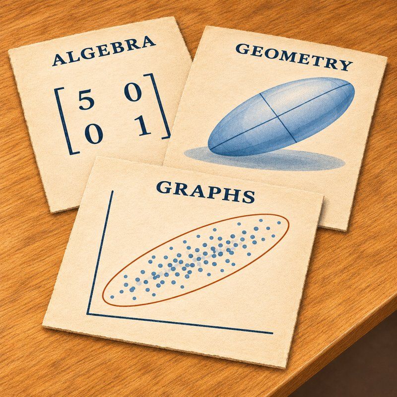

<!-- The precept box, as in the first post: orange for the question -->
```{=html}
<style>
.precept {
  border-top: 3px solid #F58518;
  border-bottom: 3px solid #F58518;
  background: rgba(245, 133, 24, 0.08);
  padding: 0.7em 1.25em;
  margin: 1.5em 1em;
  font-size: 1.15em;
  text-align: center;
}
.precept p { margin: 0; }
.precept .precept-title {
  display: block;
  font-variant: small-caps;
  letter-spacing: 0.06em;
  color: #B85708;
  font-weight: bold;
}
.precept .precept-motto {
  display: block;
  margin-top: 0.4em;
  font-style: italic;
  color: #B85708;
}
/* A small figure floated to the right of the text; full width on narrow screens */
.float-fig {
  float: right;
  width: 38%;
  margin: 0.3em 0 0.8em 1.2em;
}
.float-fig figure, .float-fig p { margin: 0; }
.float-fig img { width: 100%; height: auto; }
@media (max-width: 600px) {
  .float-fig { float: none; width: 80%; margin: 1em auto; }
}
</style>
```

{fig-alt="An illustration in mid-century magazine style: six men in suits sit around a coffee table in front of a brick fireplace. The man in the middle holds up a sheet with two overlapping ellipses, a wide blue one marked H and a steep red one marked E. The man to his left points at the right-hand end of the blue ellipse. On the right, a gray-bearded man with curly hair and a white-haired man in glasses look on and smile. On the table are three mugs, labeled Algebra (with a small matrix), Graphs and Geometry (with an ellipsoid), and a red book with a circle of arrows on its cover: Dempster's Elements of Continuous Multivariate Analysis."}

<!-- Before publishing with Georges named in the caption, send him the picture
     (figures/fireside-image-notes.md). -->


## Introduction {.dropcap}

When we left A. Square, in my last post, [On Extending `lm()` Methods to
`"mlm"`](https://friendly.github.io/blog/posts/2026-11-extending-lm/), the Sphere had just
shown him what one more dimension looks like [@Abbott:1884]. Going from a univariate linear
model to a multivariate one, every object the model produces gains a dimension: a residual
becomes a vector, a coefficient vector a matrix, a variance a covariance matrix.

But earlier in the story, A. Square dreams of a trip the other way, to Lineland, whose King
can't conceive of anything but length. I used to feel a little sorry for the King. Then I
noticed how much of multivariate statistics consists of working out, very carefully, how to
get to Lineland. You start with a matrix of 130 numbers. You'd like to finish with one, and be
able to say "that's big". (Pointland, whose only inhabitant is entirely pleased with himself,
is there for the $p$-value.)

This post is about the trip back down. Each step down answers the same question, and the
question turns out to be harder than it looks:

::: {.precept}
[How big is my matrix?]{.precept-title}
First say *compared to what*, and *in what sense*.
[Every summary is a shadow]{.precept-motto}
:::

::: {.float-fig}
{fig-alt="Three cream cards on a wooden table, each titled in dark blue capitals. ALGEBRA shows the 2 by 2 matrix with rows 5, 0 and 0, 1. GEOMETRY shows a shaded blue ellipsoid with its two axes drawn, casting a shadow below it. GRAPHS, in front, shows a scatterplot of blue points rising to the right inside a red data ellipse."}
:::

**Compared to what** means choosing a metric: the identity, the error covariance, or the total.
**In what sense** means choosing what counts as size: the total, the largest part, or the volume:

* *Algebra* tells you how few numbers you need to keep to say "It's THIS big!" 
* *Geometry* shows you what those numbers measure, and what was thrown away to get them. 
* And *graphs or diagrams* show you what this means, and how to understand it all.

It's the interplay among these three Elemental Forces of Statistical Understanding that intrigues me
in my work on graphical methods for data analysis, often on Un-Vizzed problems. That's the subject
of this article. The rubric that unites them is: To climb back down the ladder of dimensions
of a problem, 

* decide what 'big' means, 
* keep what you need to measure it, and 
* draw a picture of what's left.


My title comes from the scene in the banner. Imagine the people who invented the classical
multivariate tests sitting around a fire with an HE plot, arguing about how big **H** is
compared to **E**. Each one had a different, and perfectly reasonable, answer.
By indirection, this post is also about what I learned from the process of trying to
develop graphical methods for multivariate models in R with the help and inspiration of the gentlemen around
the table.

## Climbing back down {.dropcap}

Here's the whole trip in one picture, for the Pottery data used in the [first post](https://friendly.github.io/blog/posts/2026-11-extending-lm/): the
chemical composition (Al, Fe, Mg, Ca, Na) of 26 samples of Romano-British pottery from four
kiln sites. 

The first question is whether the sites differ. If they do, archaeologists like @Tubb-etal:80 would also want to know _how_ they differ, and relate this to what they knew about the peoples who inhabited these sites.

{#fig-reducing-ladder width="100%" fig-alt="A funnel narrowing from left to right. Left: the data matrix Y, 26 by 5, drawn as 130 small blue cells. Then the 5 by 5 matrices H, in orange, and E, in grey, with their 15 distinct elements shaded. Then a column of three green cells, the eigenvalues 34.16, 1.25 and 0.028. Then one green cell, Pillai's V = 1.554, and finally one more, the effect size eta-squared = V / s = 0.52, on a 0 to 1 scale. Under each arrow is what that step sets aside: cases and grand means; units and directions; how the size is spread over dimensions; how many dimensions. A long arrow along the bottom is labeled set aside."}

Reading @fig-reducing-ladder from left to right:

* The 130 numbers in **Y** become two $5 \times 5$ matrices, **H** for the differences among the
  site means and **E** for the variation within sites. These keep 15 distinct numbers each, and
  set aside the individual cases and the grand means.
* **H** and **E** become $s = 3$ eigenvalues, $\lambda_i$, the nonzero roots of
  $\mathbf{H}\mathbf{E}^{-1}$. These set aside the units of the responses and the directions
  of the effect.
* The eigenvalues become one number, here Pillai's trace, $V$. This sets aside how the size of
  the effect is spread over the dimensions.
* $V$ becomes an effect size, $\eta^2 = V / s = 0.52$, the proportion of the multivariate
  variation explained by the sites. Dividing by $s$ sets aside how many dimensions there are,
  and puts the answer on a 0 to 1 scale that any reader can compare.

Every rung is still an answer to "how big?". A $p$-value would be a different kind of answer:
it sets aside the size itself and keeps only the evidence, so it doesn't belong on this ladder.

Each step is a choice, and each choice is a reasonable answer to "how big?". The rest of this
post is about those choices, and about the pictures that show what each one keeps.

There's a trade-off in coming down the ladder, and Hadley Wickham put it neatly. In a 2013
talk, as [John D. Cook paraphrased
it](https://www.johndcook.com/blog/2013/02/07/visualization-modeling-and-surprises/):

::: {.featured-quote}
> Visualization can surprise you, but it doesn't scale well. Modeling scales well, but it can't
> surprise you.
:::

In *R for Data Science* Hadley and his co-authors give the reason
[@Wickham-etal:2023:r4ds]:

> Visualizations can surprise you, but they don't scale particularly well because they require
> a human to interpret them.

Models scale, but every model makes assumptions it can't question, and so "a model cannot
fundamentally surprise you." Visualization of data and models require shared cognitive and perceptual assumptions
between the graph designer or developer and the human viewer, whose understanding of some
problem or phenomenon a graph is supposed to increase.

Every step down the ladder trades a little more surprise for a little more scale. A single
number, like a $p$-value, scales to any number of tests, but it will never show you
something you didn't think to ask. That's why I want to stop at each rung and look.

<!-- Quotes: 2nd ed. (American spelling), Introduction, "What you will learn". Check against
     the book before publishing; the 1st ed. (2017) has the same passage in British spelling.
     Wickham's slides use the short form: "Surprises, but doesn't scale" (Visualise) and
     "Scales, but doesn't (fundamentally) surprise" (Model), e.g. "Big data pipelines",
     Fields Institute, Feb. 2015. -->


## How big is a vector? {.dropcap}

Start at the bottom, with a single vector. Its size is its *length*, and even that needs a
choice.

Length and distance are the same question from this perspective. The length of $\mathbf{y}$ is just its distance
from $\mathbf{0}$, and how far apart $\mathbf{x}$ and $\mathbf{y}$ are is just how big
$\mathbf{x} - \mathbf{y}$ is. (Center $\mathbf{y}$ first, and its length is its distance from
the mean.) There's no shortage of answers. The animation in
@fig-distance-methods, which went around social media recently, has nine; six of them
are here.

<!-- MF: the animation is @mathemetica's work, credited and linked as used for comment.
     Permission asked 2026-11-24 in a reply on X (the account takes no DMs):
     https://x.com/datavisFriendly/status/2125427011162120500. Awaiting an answer; if none,
     replace the video with just the link.
     Notes section 1a. -->

::: {#fig-distance-methods}

```{=html}
<video src="figures/distance-methods-6.mp4" autoplay loop muted playsinline width="400"
       style="display:block; margin:auto; max-width:100%;"
       aria-label="An animated 2 by 3 grid titled Distance metrics. Each panel shows points A and B and one way to measure the distance between them. Top row: Euclidean, a straight arrow; cosine, the angle between two vectors; Hamming, mismatched bits in two bit strings. Bottom row: Manhattan, a city-block route; Minkowski, a purple unit ball that morphs from a diamond through a circle toward a square as p changes; Chebyshev, the longer leg. A and B move, and the distances update."></video>
```

Six ways to measure how far apart A and B are. Animation by \@mathemetica
([post on X](https://x.com/mathemetica/status/2125197661607514521), November 2026),
cropped: its bottom row, for sets (Jaccard, Sørensen–Dice) and points on a globe (haversine),
is left out.

:::

Most of these are lengths of $\mathbf{x} - \mathbf{y}$ in one sense or another. Euclidean,
Manhattan and Chebyshev are three settings of a single dial, Minkowski's exponent: watch its
unit ball morph from a diamond, through a circle, toward a square, the three shapes in the
left panel of @fig-unit-balls below. Cosine sets length aside and keeps only the angle; center
the two vectors first, and it's their correlation. Hamming counts mismatches between bit
strings, and the three left out are for sets and points on a globe.

What's striking is the question none of these asks: *compared to what?* Every panel
measures in fixed units, as if the axes were on the same scale and uncorrelated. Nine ways to
say how far apart A and B are, and not one asks how far apart points *usually* are. Hold that
thought for the last item below.

{#fig-unit-balls width="90%" fig-alt="Two panels. Left, titled Three lengths: a blue diamond inside an orange circle inside a green square, all centered at the origin and touching at the axes, labeled L1, L2 and L-infinity. Arrow a runs from the origin to (0.6, 0.8) on the circle, with a dashed route along the x axis and up, its vertical leg shaded green; arrow b runs to (-0.5, -0.5) on the diamond. A table below gives a: L1 1.4, L2 1, L-infinity 0.8; b: L1 1, L2 0.71, L-infinity 0.5. Right, titled Change the metric, rho = 0.75: a dashed orange unit circle and a red ellipse tilted at 45 degrees. Points A and B both lie on the circle; A is inside the ellipse and B well outside it. A note reads: A, Euclid 1, Mahalanobis 0.76; B, Euclid 1, Mahalanobis 2.00."}

* The familiar length is Euclidean, $L_2$: $\|\mathbf{y}\|^2 = \mathbf{y}^\top\mathbf{y}$.
  Centered, that's the total sum of squares, and divided by its df, it's the variance. **A
  variance is a squared length.**
* Pythagoras splits it: $SS_T = SS_H + SS_E$. The $F$ ratio compares two squared lengths, each
  per df. So even the univariate test is already asking "how big is H, relative to E?"
* Other lengths are useful too. $L_1$ adds absolute values (city-block distance), and
  $L_\infty$ takes the largest one.
* The choice of length is also **the difference between ridge regression and the lasso**.
  Both shrink the least squares coefficients by limiting their size: ridge limits their
  $L_2$ length, the lasso their $L_1$ length. The estimate moves out from the origin until an
  RSS contour first touches the constraint region (@fig-ridge-lasso). The $L_2$ disk is
  round, so that point almost never lies on an axis, and ridge shrinks every coefficient
  without setting any to zero. The $L_1$ diamond has corners on the axes, and the contours
  tend to meet it there, so the lasso sets some coefficients exactly to zero: it selects
  variables as it shrinks.
* *Compared to what?* With correlated variables, Euclidean distance is the wrong ruler. The
  Mahalanobis distance, $\mathbf{e}^\top \mathbf{S}^{-1} \mathbf{e}$, measures length in
  the metric of the data, and its unit circle is the data ellipse. It's the tenth metric
  that @fig-distance-methods leaves out, and the only one whose unit ball comes from the data
  rather than from a choice of exponent. In the right panel of
  @fig-unit-balls, A and B are both 1 unit from the origin by Euclid, but B is more than
  twice as far as A in the metric of the ellipse.

{#fig-ridge-lasso width="85%" fig-alt="Two panels, Ridge and Lasso, with axes beta1 and beta2. In each, red elliptical contours tilted down to the right surround the OLS point (0.25, 0.85). Left: an orange disk of radius 0.5 at the origin; the outer red contour touches it at (0.23, 0.44), labeled Ridge, and a dashed curve runs from the OLS point to the origin through it. Right: a blue diamond with corners at plus and minus 0.5 on the axes; the outer contour touches its top corner at (0, 0.50), labeled Lasso, and a dashed path runs from the OLS point down to the beta2 axis and then along it to the origin."}

<!-- Drawn by R/ridge-lasso.R. Inspired by a three-panel figure (ridge, lasso, elastic net)
     noted at Reducing-dimensions-notes.md, ~line 103; source unknown, so not used as is.
     The RSS contours are Mahalanobis ellipses in the metric of X'X: a link to the bullet
     above, if wanted. -->

## How big is a covariance matrix? {.dropcap}

One rung up, a covariance matrix $\mathbf{S}$ for $p$ variables holds $p(p+1)/2$ different
numbers: $p$ variances and $p(p-1)/2$ covariances. How big is that? There are two classic
answers, each a single number.

* The **trace**, $\operatorname{tr}(\mathbf{S})$, adds up the variances: the *total
  variance*. It's easy to compute and to explain, but it ignores the covariances entirely.
* The **determinant**, $|\mathbf{S}|$, is what @Wilks:1932 called the *generalized
  variance*. It takes the correlations into account, and it has a lovely geometric meaning.

For any $2 \times 2$ matrix, the determinant is the **area** of the parallelogram spanned by
its rows (left panel of @fig-det-area); for a $3 \times 3$ matrix it's the volume of a
parallelepiped, and so on up [@Hannah:1996; @Locke:1994]. Area is the natural size of a
flat thing, so it's a natural candidate for the size of a matrix.

For a covariance matrix, the better picture is the data ellipse,
$\mathbf{x}^\top \mathbf{S}^{-1} \mathbf{x} = 1$. Its semi-axes point along the
eigenvectors of $\mathbf{S}$ and have lengths $\sqrt{\lambda_1}, \sqrt{\lambda_2}, \dots$,
the square roots of its eigenvalues. Then the two sizes are two ways of combining the same
axes:

$$
\operatorname{tr}(\mathbf{S}) = \sum \lambda_i \quad \text{(sum of squared semi-axes)},
\qquad
|\mathbf{S}| = \prod \lambda_i \quad \text{(product of squared semi-axes)},
$$

and the area of the ellipse is $\pi \sqrt{|\mathbf{S}|}$ (in $p$ dimensions, its volume is
proportional to $\sqrt{|\mathbf{S}|}$).

{#fig-det-area width="90%" fig-alt="Two panels. Left, titled det(A) is an area: arrows a1 from the origin to (3, 1) and a2 to (2, 4), with gray arrows completing an orange parallelogram to (5, 5), labeled area = 10. Right, titled det(S): same variances, less area: a gray unit circle, a shaded red ellipse tilted at 45 degrees, and a thinner blue ellipse along the same diagonal. Two black arrows from the origin mark the semi-axes of the red ellipse, labeled square root of lambda 1 (long, up and to the right) and square root of lambda 2 (short, up and to the left). A table reads: r 0.00, det 1.000, area 3.14; r 0.75, det 0.438, area 2.08; r 0.95, det 0.098, area 0.98."}

<!-- Drawn by R/det-area.R, with matlib::vectors(). The left panel follows step 8 of the
     matlib vignette "Properties of determinants" (a1-det-ex1). -->

The right panel shows why the two answers differ. All three ellipses have the same
variances, so the trace can't tell them apart. But as the correlation grows, the ellipse is
squeezed along its minor axis, and the generalized variance, $1 - r^2$ here, falls toward
zero. Correlated variables carry less information than their variances suggest, and the
determinant is the size that notices.

At $r = 1$ the ellipse collapses to a line: no area, $|\mathbf{S}| = 0$. The data have
dropped into Lineland, and $\mathbf{S}$ has no inverse. That's why the Mahalanobis distance
in the last section needs $|\mathbf{S}| \neq 0$. When it exists, the inverse has
$|\mathbf{S}^{-1}| = 1 / |\mathbf{S}|$, and its ellipse has the same axes with reciprocal
lengths, so the long axis becomes the short one
([geometric diagrams](https://math.stackexchange.com/questions/295250/geometric-interpretations-of-matrix-inverses/2451107#2451107)).

The determinant will be back. Wilks's $\Lambda$, one of the four MANOVA tests below, is a
ratio of two of them, $|\mathbf{E}| / |\mathbf{H} + \mathbf{E}|$: the squared ratio of two
areas.

## How big is a matrix of data? {.dropcap}

A covariance matrix is already a summary. Go back to the data themselves: an $n \times p$
matrix $\mathbf{Y}$, centered at the column means. The tool for sizing up any rectangular
matrix is its **singular value decomposition**,

$$
\mathbf{Y} = \mathbf{U} \mathbf{D} \mathbf{V}^\top ,
\qquad \mathbf{D} = \operatorname{diag}(d_1 \ge d_2 \ge \dots \ge d_p \ge 0) .
$$

$\mathbf{V}$ and $\mathbf{U}$ are rotations, which don't change size at all, so everything
about how big $\mathbf{Y}$ is lives in the singular values $d_i$. They are the semi-axes of
the data ellipsoid, up to a constant: the eigenvalues of the covariance matrix are
$\lambda_i = d_i^2 / (n-1)$. So the sizes of the last section come back, now as different
ways of combining the $d_i$:

| "Size" of $\mathbf{Y}$ | In singular values | For the data ellipsoid | Statistical name |
|---|---|---|---|
| Frobenius norm, squared | $\sum d_i^2$ | sum of squared semi-axes | total variance (trace) |
| Spectral norm, squared | $d_1^2$ | longest semi-axis, squared | variance of the first PC |
| Determinant of $\mathbf{Y}^\top\mathbf{Y}$ (not a norm) | $\prod d_i^2$ | volume, squared | generalized variance |

: Three sizes of a data matrix, up to the factor $n - 1$. {#tbl-sizes}

Here they are for the five oxides in the Pottery data. The oxides are measured in very
different amounts (Al varies about a thousand times as much as Ca or Na), so I standardize
them first. That is the *compared to what?* question again: in raw units, aluminum alone
would decide how big the matrix is.

```{r}
#| label: pottery-svd
data(Pottery, package = "carData")
Z <- scale(Pottery[, -1])            # the five oxides, standardized
d <- svd(Z)$d
round(d, 3)
c(Frobenius2 = sum(d^2), spectral2 = d[1]^2, det = prod(d^2))
round(cumsum(d^2) / sum(d^2), 3)     # proportion of total variance, first k
```

After standardizing, the Frobenius size is just $(n-1)p$ = `r (nrow(Z) - 1) * ncol(Z)`,
and tells us nothing: every standardized matrix of this shape has the same total variance.
The information is in how that total is *spread* over the $d_i$, and that's where the
other sizes come in (@fig-spread-spectra).

{#fig-spread-spectra width="100%" fig-alt="Three bar charts side by side, each with five bars for lambda 1 to lambda 5 and a dashed line at 1. Round: all five bars equal 1. Pottery oxides: a tall red first bar at 3.88, then 0.61, 0.24, 0.18, and a short blue last bar at 0.08. Nearly collinear: four bars near 1.2 to 1.3, the first in red, and a last bar of 0.01, almost invisible. Each panel lists four sizes. Round: total 5, largest 1, product 1, condition 1. Pottery: total 5, largest 3.88, product 0.009, condition 6.78. Nearly collinear: total 5, largest 1.30, product 0.024, condition 11.4."}

* **Keep the big ones: PCA.** The first $k$ singular values and vectors give the best
  rank-$k$ approximation to $\mathbf{Y}$, in both the Frobenius and the spectral norm
  [@EckartYoung:1936]. What's left over has squared Frobenius size
  $\sum_{i > k} d_i^2$, so the proportion of variance kept is
  $\sum_{i \le k} d_i^2 / \sum d_i^2$. For Pottery, two dimensions keep
  `r round(100 * sum(d[1:2]^2) / sum(d^2), 1)`%. This is principal components analysis,
  and the **biplot** draws the observations and the variables together in that
  low-rank space [@Gabriel:71].
* **Watch the small ones: collinearity.** For a matrix of *predictors* $\mathbf{X}$, the
  small end of the spectrum is where the trouble is. A $d_i$ near zero means the ellipsoid
  is nearly flat in some direction, so $|\mathbf{X}^\top\mathbf{X}|$ is nearly zero and
  some coefficients are badly determined. The *condition number* $d_1 / d_p$ measures how
  flat; for the standardized oxides it's `r round(d[1] / d[length(d)], 2)`, no cause for
  alarm.
* **Shrink the small ones: ridge regression.** Ridge regression [@HoerlKennard:1970]
  shrinks the least squares fit along each principal axis of $\mathbf{X}$ by the factor
  $d_i^2 / (d_i^2 + k)$, for ridge constant $k$. Big directions are hardly touched; the
  small, poorly determined ones are shrunk the most. Adding up the factors,
  $\sum d_i^2 / (d_i^2 + k)$, gives the *effective degrees of freedom* of the fit: a whole
  matrix, reduced to one number that says how big the model is [@Friendly:genridge:2013].
  Keep that form in mind. Pillai's trace, one of the four MANOVA tests below, is
  $\sum \lambda_i / (1 + \lambda_i)$, the same kind of sum.

<!-- Figure candidates for this section (see the reply / notes):
     1. Spectrum of Pottery (scree-like bars of d_i^2), marking the three sizes:
        the whole (Frobenius), the first bar (spectral), and k = 2 kept (Eckart-Young).
     2. Ridge shrinkage factors d_i^2/(d_i^2 + k) against k, one curve per component,
        with effective df on a second axis.
     3. Pottery biplot (PCA) beside the canonical HE plot: biggest total variance vs.
        biggest H relative to E. Sets up the next section.
     4. Low-rank approximation of an image, k = 1, 2, 5, 20 (from the MatrixAlgebra
        review). -->

## Ellipses have shadows {.dropcap}

<!-- MF attributes the phrase to Georges Monette. Check whether it's in print anywhere, or
     credit it as his way of saying it. -->

Georges Monette has a short way of putting one of the most useful ideas in this business:
**ellipses have shadows**. Shine a light on an ellipse, and its shadow on a line is an
interval. That is a step down from two dimensions to one, and the ellipse holds *every* such
step at once: for any linear combination of the parameters, the confidence interval is the
shadow of the confidence ellipse on that direction [@Monette:90; @Friendly-etal:ellipses:2012].

This helps you to think constructively about univariate tests in relation to joint tests
of parameters and ideas like Scheffé tests accounting for multiplicity. But it goes
further, because 3D (and higher-D) ellipsoids also have their 2D shadows, whose properties
are illuminating.[^cover] Those are harder to draw, however.

[^cover]: That was the idea that inspired the cover for my Vis-MLM book: Data ellipsoids
for the penguin species, with their 2D shadows shown in different forms on the planes
for pairs of variables. The general class of ellipsoids is explored in my experimental
[`gellipsoid`](https://friendly.github.io/gellipsoid/) package (source on [GitHub](https://github.com/friendly/gellipsoid)).

Here's the example from our ellipses paper (Fig. 13 there), with contrived data on 20
university people: an index of heart damage, predicted from their coffee consumption and
their occupational stress. Coffee and stress are strongly
correlated, so the confidence ellipse for the two slopes is long and thin.

```{r}
#| label: coffee
#| code-fold: true
data(coffee, package = "matlib")
coffee.mod <- lm(Heart ~ Coffee + Stress, data = coffee)
round(cbind(coef(coffee.mod), confint(coffee.mod)), 3)
```

{#fig-coffee-shadows width="100%" fig-alt="Two panels in the space of beta-Coffee (horizontal) and beta-Stress (vertical). In each, a long thin blue ellipse tilts down to the right, centered near (-0.4, 1.2). Left, Shadows on the axes: light orange strips run from the ellipse to both axes, ending in thick orange intervals. The interval for Coffee, on the horizontal axis, includes 0; the one for Stress, on the vertical axis, excludes 0. A larger grey ellipse surrounds the blue one, and its slightly longer grey shadows lie just outside the axes. Right, Shadows in other directions: one strip runs obliquely down to the right, landing on the horizontal axis near 1.1, labeled Coffee, ignoring Stress (the simple regression). Another runs down to the left onto a diagonal axis through the origin, labeled Stress minus Coffee, with tick marks from 0 to 2; that interval excludes 0."}

The shadows tell the whole story of this regression:

* **Straight down**, on the $\beta_\text{Coffee}$ axis, the shadow is the 95% confidence interval
  for Coffee, controlling for Stress. It includes 0. **Straight across**, the interval for
  Stress excludes 0. Once you know a person's stress, coffee adds nothing.
* **Along the tilt of the ellipse**, onto the line $\beta_\text{Stress} = 0$, the shadow lands
  on the slope for Coffee in the *simple* regression, ignoring Stress. That slope is positive
  and clearly not zero. The apparent paradox, that coffee "matters" in one model and not the
  other, is just two shadows of the same ellipse, cast from two directions.
* **On a diagonal axis**, the shadow gives an interval for $\beta_\text{Stress} - \beta_\text{Coffee}$,
  which excludes 0: the two slopes differ.

<!-- TO RESOLVE (see notes, Figures item 6): the oblique shadow's centre is exactly the
     simple-regression slope (1.108), but its width (0.97, 1.25) is narrower than the
     simple-regression CI (0.88, 1.33). Say so here, or show both in the figure. -->

The size of the ellipse depends on how many questions you want to ask of it. Scaled by
$t_{\nu}$, its shadows are ordinary 95% intervals, good for one question at a time. Scaled by
$\sqrt{2 F_{2,\nu}}$, it becomes the joint 95% confidence region, and its shadows are
Scheffé intervals, which hold simultaneously for *every* direction you might look. That's
the price of going fishing, paid in advance.

<!-- Side note, not the main thread: each one-row linear hypothesis L beta = 0 asks about one
     shadow; Scheffé protects all of them at once. A footnote pointing back to L B M = 0 in
     the first post may be enough. -->

So an ellipse is a remarkably economical summary. It stores every one-dimensional answer,
and you choose which one you want by choosing where the light comes from. That idea comes
back below, as Roy's largest root: the direction in which **H** casts its longest shadow
relative to **E**.

## How big is H, relative to E? {.dropcap}

<!-- DRAFT 2026-11-24. Example: heplots::mathscore, as in the book's Hotelling chapter.
     Figure: R/h-relative-e.R. Notes section 3. -->

With one response, this question is easy, because **H** and **E** are just numbers: the
sums of squares for the hypothesis and for error. "How big is $SS_H$ relative to $SS_E$?" is
answered by dividing,
$$\lambda = \frac{SS_H}{SS_E}, \qquad F = \lambda \cdot \frac{df_e}{df_h} .$$
The $F$ statistic is just this ratio, put on a scale where its distribution is known.

Take the smallest multivariate example I know, the `mathscore` data from heplots, which I
used to introduce Hotelling's $T^2$ in the book [@Friendly:2024:VisMLM]. Two groups of six
students, taught by different instructors, have scores on basic math (BM) and word problems
(WP). One response at a time:

| Response | $SS_H / SS_E$ | $F(1, 10)$ | $p$ |
|---|--:|--:|--:|
| BM | 0.42 | 4.24 | 0.066 |
| WP | 1.05 | 10.45 | 0.009 |

So the groups differ on word problems, but not quite on basic math. Keep those two numbers
in mind.

With both responses, **H** and **E** are $2 \times 2$ matrices, and you can't divide one matrix
by another. The product $\mathbf{H}\mathbf{E}^{-1}$ exists, but its entries don't mean much on
their own. The way out is to **change the units** (@fig-h-relative-e):

{#fig-h-relative-e width="100%" fig-alt="Three panels. A, In the units of the data: the 12 students as grey points, with basic math on the horizontal axis and word problems on the vertical. A red ellipse, E, tilts up to the right. A thick blue line, H, runs down to the right between the two group means, group 2 at upper left and group 1 at lower right. B, Measure in units of E: the same picture transformed so that E is a unit circle; H* is a longer blue line through the center, running down to the right. C, Rotate to the axes of H*: the unit circle with the blue line now horizontal, reaching 2.53 from the center, labeled square root of lambda 1, against the circle's radius of 1. A note reads lambda 1 = 6.42, lambda 2 = 0."}

* **Measure in units of E.** Transform the responses so that the error ellipse becomes a
  circle of radius 1:
  $$\mathbf{H}^\star = \mathbf{E}^{-1/2}\,\mathbf{H}\,\mathbf{E}^{-1/2}, \qquad \mathbf{E}^\star = \mathbf{I} .$$
  Now every direction has the same error variance, and **H**\* says how big the effect is in
  each direction, in units of error. This is the matrix version of dividing by $SS_E$, and the
  same change of metric that turns Euclidean distance into Mahalanobis distance.
* **Rotate to the axes of H\*.** A circle looks the same after any rotation, so turn the
  picture until **H**\* lines up with the axes. All that's left are the lengths of its axes:
  the eigenvalues $\lambda_1 \ge \lambda_2 \ge \dots$ of $\mathbf{H}\mathbf{E}^{-1}$. Only
  $s = \min(q, df_h)$ of them can be nonzero. Here there are two responses but only one
  degree of freedom between two groups, so $s = 1$: **H** is a line, and
  $\lambda_1 = 6.42$, $\lambda_2 = 0$.

Now compare. Basic math alone gave 0.42, and word problems alone 1.05. Both responses
together give 6.42, six times the better of the two. The reason is in panel A: within groups,
BM and WP go up together (the red ellipse tilts up), but the group means differ in opposite
directions (the blue line tilts down). The groups are best told apart by a contrast, roughly
BM minus WP, and along that direction the difference is huge relative to error.

This is where [shadows](#ellipses-have-shadows) come back, and they tie the matrix answer to
the univariate one. Pick any weighted combination of the responses, $y = a_1 \text{BM} + a_2 \text{WP}$.
Its sums of squares are the squared shadows of the two ellipses in the direction $\mathbf{a}$:
$$SS_H(y) = \mathbf{a}^\top \mathbf{H}\, \mathbf{a}, \qquad SS_E(y) = \mathbf{a}^\top \mathbf{E}\, \mathbf{a} .$$
So the ratio of the shadows, squared, is the ordinary univariate $\lambda$ for that one variable,
a ratio of variances. Shine the light straight down the BM axis and you get 0.42; straight
across, along WP, 1.05. Turn the light, and the ratio changes. Its largest value, over every
direction you could choose, is $\lambda_1 = 6.42$, and the direction that gives it is the
best combination of the responses. So the multivariate answer is the univariate answer, for the
best variable you could have measured. The axes, BM and WP, are just two of the directions,
and here not good ones. As a test, $F = 28.9$ on 2 and 9 df, $p = 0.0001$.

**Why the eigenvalues are enough.** A sensible answer to "how big?" shouldn't depend on the
units of the responses (points or percent), or on which combinations of them you choose to
analyze (BM and WP, or their sum and difference). Any such change transforms **H** and **E**
together, and leaves the $\lambda$s unchanged. So any test that ignores these arbitrary
choices can depend on the data only through the $\lambda$s. That's how a matrix question
becomes a question about $s$ numbers: invariance does the reducing.

**What's set aside.** The directions. The $\lambda$s say how big, but not which way. Here the
direction is the contrast between BM and WP, given by the eigenvector of
$\mathbf{E}^{-1}\mathbf{H}$, the weights of the linear discriminant function. Getting the
directions back, and showing them, is the job of HE plots and canonical plots
([below](#dont-reduce-too-soon-he-plots)).

With $s = 1$ there's one number, and nothing more to decide: Pillai, Wilks, Hotelling-Lawley
and Roy all give the same $F$. The Pottery data have $s = 3$ eigenvalues, 34.16, 1.25 and
0.028 (@fig-reducing-ladder), and that's where the four tests part company.

## Four kinds of mean {.dropcap}

<!-- DRAFT 2026-11-24. Notes section 4. Figures: four-contours.png (R/four-contours.R) and
     the bar cartoon, copied from drafts/VisMLM/jokes/images/four-tests-cartoon-v3.png. -->

For the Pottery data there are three eigenvalues, $\lambda$ = 34.16, 1.25 and 0.028: one big
dimension of difference among the kiln sites, one modest, and one that is essentially noise.
To get to one number, you have to combine them somehow. The four classical tests are four
ways to do it, and the cleanest way to see how they differ is to notice that each one is an
**average**, of a different kind.

Re-express each eigenvalue as the share of *error* in its dimension,
$$u_i = \frac{1}{1 + \lambda_i} = 1 - r_i^2 ,$$
where $r_i^2 = \lambda_i / (1 + \lambda_i)$ is the squared canonical correlation for that
dimension. A big effect means a small $u_i$. Then each test statistic is a mean of the same
$s$ numbers $u_1, \dots, u_s$, and one minus that mean is a multivariate $\eta^2$:

| Test | Statistic | Mean of the $u_i$ | $\eta^2$ for Pottery |
|---|---|---|--:|
| Pillai | $V = \sum \lambda_i / (1 + \lambda_i)$ | arithmetic: $1 - V/s$ | 0.518 |
| Wilks | $\Lambda = \prod 1 / (1 + \lambda_i)$ | geometric: $\Lambda^{1/s}$ | 0.769 |
| Hotelling-Lawley | $U = \sum \lambda_i$ | harmonic: $s / (s + U)$ | 0.922 |
| Roy | $R = \lambda_1$ | minimum: $1 / (1 + R)$ | 0.972 |

These four means are an old family, the power means of order 1, 0, −1 and $-\infty$, and they
always come in the same order: arithmetic $\ge$ geometric $\ge$ harmonic $\ge$ minimum. So for
*any* data,
$$\eta^2_\text{Pillai} \le \eta^2_\text{Wilks} \le \eta^2_\text{HL} \le \eta^2_\text{Roy},$$
with equality only when all the $\lambda_i$ are equal, or when there's just one of them, as in
`mathscore`.
<!-- Ordering checked 2026-11-24 (notes, To settle item 6): the power-mean inequality, no
     violations in 1e5 random cases, matches heplots::etasq(). Nuance: it orders these eta^2
     measures, not the F statistics or p-values. --> For Pottery, the same three numbers give effect sizes from about half to almost
all. None of them is wrong. They answer "how big?" in different senses.

**What counts as big.** The difference shows most clearly with two effects that have the same
Hotelling-Lawley trace:

| $\lambda$ | Pillai $V$ | Wilks $\Lambda$ | HL $U$ | Roy $R$ |
|---|--:|--:|--:|--:|
| (1, 0), concentrated | 0.50 | 0.50 | 1 | 1.0 |
| (0.5, 0.5), diffuse | 0.67 | 0.44 | 1 | 0.5 |

Pillai and Wilks say the diffuse effect is bigger (larger $V$, smaller $\Lambda$). Roy says
the concentrated one is, because he looks only at the largest root. Hotelling-Lawley can't
tell them apart. @fig-four-contours shows why: each curve is the set of effects that one
test calls equally big.

{#fig-four-contours width="65%" fig-alt="A square plot with lambda 1 on the horizontal axis and lambda 2 on the vertical, both from 0 to 1.25, with the dashed diagonal lambda 1 = lambda 2 and the region above it shaded. Four curves all pass through the concentrated effect at (1, 0) and its mirror image (0, 1). Pillai, in blue, bows furthest toward the origin, crossing the diagonal at 1/3. Wilks, in green, bows less, crossing at about 0.41. Hotelling-Lawley, in orange, is a straight line from (1, 0) to (0, 1), passing through the diffuse effect at (0.5, 0.5). Roy, in red, is a square corner: vertical from (1, 0) up to (1, 1), then across to (0, 1)."}

The shapes should look familiar from @fig-unit-balls. The Hotelling-Lawley contour is a
diamond, the unit ball of the $L_1$ norm: it simply adds up the $\lambda$s. Roy's is a square,
the $L_\infty$ ball: only the largest counts. Pillai and Wilks bend in further than the diamond,
so they give extra credit for spreading an effect over several dimensions. Choosing a test is
choosing a norm.

This is also why the tests differ in power. Roy's test is the most powerful when the group
differences are concentrated in one dimension, and Pillai's when they are spread over several
[@Schatzoff1966]. Pillai's is also the most robust to violations of the assumptions, which
is why @Olson:1974 recommended it as the default, and why `car::Anova()` reports it first.

<!-- TO WRITE: the tests can also disagree about significance, not just size. Find or
     construct an example (s = 2, diffuse effect) where Roy is not significant but Pillai is,
     or the reverse. MF: "hold off on the tests disagreeing for now, but that would be
     something to mention." -->

With Pottery's roots, one big and two small, Roy has the easiest call to make.

{#fig-four-tests-cartoon width="85%" fig-alt="A pen-and-ink cartoon in a pub. Three older men with name badges reading Wilks, Pillai and Hotelling-Lawley sit at the bar over a napkin listing lambda 1 to lambda 5, and together say Probably. The bartender, polishing a glass, asks: Is something going on here? A fourth man, badge Roy, leans away from the bar and points across the room, shouting HIM! at a startled man drinking alone at a table. The caption reads: Wilks, Pillai, Hotelling-Lawley and Roy walk into a bar."}

## Four rulers for one ellipse {.dropcap}

<!-- DRAFT 2026-11-24. Notes section 5; a redraw of Fig. 19 of the ellipses paper.
     Figure: R/four-rulers.R. NOTE colors: here H + E is orange and E grey (as in the ladder
     figure); h-relative-e.png uses blue H and red E. Pick one. -->

The four means have a picture, and it's the one we already have. Go back to panel C of
@fig-h-relative-e: measured in units of **E**, the error ellipse is the unit circle, and the
effect sticks out beyond it. It's easiest to read if you draw **H** + **E**, the total, rather
than **H** alone. With **E** a circle and the axes turned to line up with the effect, **H** + **E**
is an ellipse with semi-axes
$$a = \sqrt{1 + \lambda_1}, \qquad b = \sqrt{1 + \lambda_2} .$$
The more the ellipse sticks out beyond the circle, the bigger the effect. But "how much it
sticks out" can be measured in more than one way, and each test uses a different ruler
[@Friendly-etal:ellipses:2012, Fig. 19]:

{#fig-four-rulers width="85%" fig-alt="Four panels, each with the same picture: a grey unit circle labeled E inside a wider orange ellipse labeled H + E, centered at the origin, with semi-axes a = 2 horizontally and b = 1.41 vertically. Roy, R = a squared minus 1 = 3: a thick blue segment along the long semi-axis, labeled a. Wilks, Lambda = 1 over (ab) squared = 0.125: the ellipse shaded, both semi-axes drawn, labeled area = pi a b. Hotelling-Lawley, U = c squared minus 2 = 4: a blue chord c from the top of the ellipse to its right end, with a dotted box showing it as the diagonal of the a by b rectangle. Pillai, V = 2 minus 1 over d squared = 1.25: the same chord in grey, and a blue perpendicular d from the center to it, with a right-angle mark. A note at the bottom reads lambda = (3, 1): a = 2, b = 1.41, c = 2.45, d = 1.15."}

| Test | Ruler | Relation, for $q = 2$ | Which mean |
|---|---|---|---|
| Roy | the longest semi-axis, $a$ | $R = a^2 - 1$ | minimum |
| Wilks | the area, $\pi a b$ | $\Lambda = 1 / (ab)^2$ | geometric |
| Hotelling-Lawley | the diagonal, $c = \sqrt{a^2 + b^2}$ | $U = c^2 - 2$ | harmonic |
| Pillai | the perpendicular to it, $d = ab / c$ | $V = 2 - 1/d^2$ | arithmetic |

The rulers line up with the means of the previous section, because $1/a^2$ and $1/b^2$ are
just the $u_i$, the shares of error. Roy reads only the longest axis, so he takes the smallest
$u_i$. Wilks multiplies the two axes, so he takes their geometric mean. Hotelling-Lawley adds the
squared axes, $a^2 + b^2$, and Pillai adds their reciprocals, $1/a^2 + 1/b^2 = 1/d^2$: sums of
the $\lambda$s and of the $u_i$s.

And here the shadows come back once more. Every shadow of the unit circle has the same
length, 1, so the shadow of **H** + **E** in any direction measures the effect in that direction,
relative to error. Shadows of this ellipse range from $b$ to $a$:

* **Roy** asks for the **longest shadow**, $a$. That's the direction of the largest root, and
  the best single combination of the responses, as with `mathscore`. It's also why Roy's
  test is the natural one for Scheffé-style protection over all combinations.
* **Hotelling-Lawley** doesn't care which way you look. Cast the ellipse's shadows on *any* two
  perpendicular directions, and the squares of their lengths add up to the same $a^2 + b^2$.
  No rotation needed: the total is the same however the axes are turned.
* **Pillai** does the same with the reciprocals, which weight the *short* shadows most. A
  dimension where the effect is small pulls Pillai down more than it pulls the others.
* **Wilks** measures the whole ellipse at once, as an area (a volume, for $q > 2$): a
  generalized variance, as in [the determinant section](#how-big-is-a-covariance-matrix).

For the toy roots in @fig-four-rulers, the four $\eta^2$s are 0.625 (Pillai), 0.65 (Wilks),
0.67 (Hotelling-Lawley) and 0.75 (Roy), in the order the previous section promised. They are
close here because the two roots, 3 and 1, are not very different. For Pottery, where they are
(34.16, 1.25, 0.028), the four rulers give very different answers.

<!-- CHECK: the Roy/Scheffé link (the union-intersection principle: Roy's root is the
     largest univariate F over all combinations, so its critical value protects them all).
     Accurate, but say it carefully, or drop it. The Pillai sentence about short shadows is
     an interpretation of 1/a^2 + 1/b^2; check it reads right. -->

## All roads lead to F {.dropcap}

<!-- DRAFT 2026-11-24. Notes section 6. Simulation and figure: R/null-pvalues.R (1e5 reps per
     row, about 90 s; it reproduces the table in the notes to within Monte Carlo error). -->

Four tests, four kinds of mean, four rulers: each statistic also has its own sampling
distribution, which depends on $s$ and on the numbers of responses and degrees of freedom.
When I learned this, testing a MANOVA meant looking up Wilks' $\Lambda$ in special tables, or
reading Roy's largest root off Heck's charts. Today nobody does, because each statistic can be
converted to an $F$, and `car::Anova()` reports them all that way. All roads lead to $F$.

The conversions are not all equally good:

| | Pillai | Wilks | Hotelling-Lawley | Roy |
|---|---|---|---|---|
| $s = 1$ | exact | exact | exact | exact |
| $s = 2$ | approximate | **exact** | approximate | upper bound |
| $s \ge 3$ | approximate | approximate | approximate | upper bound |

With $s = 1$ there is only one $\lambda$, so there is nothing to average, and the four tests are
the same test. For `mathscore`, `car::Anova()` prints $F = 28.88$ on 2 and 9 df four times over.
Hotelling's $T^2$ is this case, and so is every 1-df term in a MANOVA or multivariate regression.
For Wilks with $s = 2$ the $F$ is exact, by way of $\sqrt{\Lambda}$; otherwise it is Rao's
approximation, which is very good. Pillai and Hotelling-Lawley use approximations too.

Roy is the odd one out. His statistic is the largest root, and the $F$ that R reports treats it
as if it were the only one. That gives an upper bound on the true $F$, so the $p$-value is too
small whenever $s > 1$. How much too small? I simulated 100,000 data sets with *no* effect at all,
in a design the size of Pottery: five responses, four groups, 26 cases. If a test is doing its job,
its $p$-values should then be spread evenly between 0 and 1, and about 5% should fall below .05
(@fig-null-pvalues).

```{r}
#| label: null-table
#| echo: false
tab <- readRDS("R/null-pvalues-table.rds")
names(tab)[1:3] <- c("$q$", "$df_h$", "$df_e$")
knitr::kable(tab, digits = 3, align = "rrrrrrrr")
```

{#fig-null-pvalues width="100%" fig-alt="Four histograms of p-values from 0 to 1, one per test, with a dashed line at density 1 marking the flat ideal. Pillai, blue: nearly flat, slightly low at both ends; p below .05 in 0.038 of cases. Wilks, green: flat; 0.049. Hotelling-Lawley, orange: nearly flat, slightly high at both ends; 0.061. Roy, red: a steep spike near 0, about 7.5 times the flat height, falling off quickly; p below .05 in 0.377 of cases."}

Wilks is right on target. Pillai is a little conservative and Hotelling-Lawley a little liberal,
neither by enough to matter much. Roy's test, with nothing there at all, says "significant" 38% of
the time. That's what "upper bound" means in practice: when $s > 1$, treat Roy's $p$-value as a
lower limit, not as a $p$-value.[^roy-he]

[^roy-he]: This also matters for HE plots, whose default scaling uses Roy's test; see
[below](#dont-reduce-too-soon-he-plots), and the footnote in the
[first post](https://friendly.github.io/blog/posts/2026-11-extending-lm/).

There's one more trap in the common currency. Because each road to $F$ starts somewhere
different, $F$s from different tests can't be compared as sizes. For Pottery, the same three
eigenvalues give

| Test | $F$ | df | $p$ |
|---|--:|---|--:|
| Pillai | 4.30 | 15, 60 | $2.4 \times 10^{-5}$ |
| Wilks | 13.09 | 15, 50.1 | $1.8 \times 10^{-12}$ |
| Hotelling-Lawley | 39.38 | 15, 50 | $< 2.2 \times 10^{-16}$ |
| Roy | 136.64 | 5, 20 | $9.4 \times 10^{-15}$ |

All four say the kiln sites differ, which is the question a test answers. But the $F$s run from 4
to 137, and none of them is a measure of *how much*. For that, go back up a rung, to the
$\lambda$s and the four $\eta^2$s.

## Don't reduce too soon: HE plots {.dropcap}

<!-- DRAFT 2026-11-24. Notes section 7. Figure: R/pottery-he.R, which replaces
     he-vs-canonical.png (its right panel repeated fig-pottery-can in the first post). -->

The last section ended on a complaint: four tests, four $F$s running from 4 to 137, and none of
them says how much. Going back up a rung, to the $\lambda$s and the $\eta^2$s, gets *how much*
back. Going up one more, to **H** and **E** themselves, gets back what the $\lambda$s set
aside: the directions. That's what an HE plot shows. It answers the same question as a test,
"how big is **H** relative to **E**?", but it stops in two dimensions instead of one, and
leaves the last step of reading to you.

The recipe uses only ideas from above:

* **Center** both ellipsoids at the grand mean, so they share one frame, and the group means
  can go in it too.
* **Scale** both by $df_e$. **E** is then the covariance ellipse of the residuals, and **H**
  is in the same units. This is *effect* scaling, and it answers "how big?".
* **Or rescale H** for *significance* (evidence) scaling, which answers "big enough?". By
  default, heplots scales **H** so that it sticks out beyond **E** in some direction exactly
  when Roy's test is significant. With $s > 1$ that's the upper bound of the last section, so
  when **H** barely pokes out, check Pillai or Wilks before believing it.

@fig-pottery-he is a reading of the Pottery data, the way @fig-h-relative-e reads `mathscore`.

![Pottery, read the way @fig-h-relative-e read `mathscore`, with effect scaling (**H** and
**E** divided by $df_e$). (A) Data space for Al and Fe: the shadows of the five-dimensional
**E** (red) and **H** (blue) ellipsoids on that plane, with the cases (grey) and site means.
(C) Canonical space, the first post's canonical plot in effect units: **E** is the unit circle,
and **H** lies on the axes, with semi-axes $\sqrt{\lambda_1}$ and $\sqrt{\lambda_2}$. Grey
arrows show the correlations of the oxides with Can1 and Can2.](figures/pottery-he.png){#fig-pottery-he width="100%" fig-alt="Two panels. A, In the units of the data: Fe against Al for the 26 pots as grey points. A small red ellipse, E, tilts slightly upward at the center. A long thin blue ellipse, H, runs steeply down to the right across it, from Llanedyrn and Caldicot at upper left (low Al, high Fe) to Isle Thorns and Ashley Rails at lower right (high Al, low Fe). C, Canonical space: Can2 against Can1. A red unit circle, E = I, at the origin, inside a long flat blue ellipse, H, reaching 5.84 along Can1, marked square root of lambda 1, and 1.12 along Can2, marked square root of lambda 2. Isle Thorns and Ashley Rails lie at the left, Llanedyrn at the right, and Caldicot at the lower right, near Can2 = -3.4. Grey arrows: Al points left; Fe and Mg right; Ca down and to the right; Na up and to the right. A note reads lambda = 34.16, 1.25, 0.028."}

Panel A is an ordinary HE plot, for Al and Fe, the two oxides that matter most to the first
canonical dimension. It's also a shadow: the two-dimensional projection of five-dimensional
ellipsoids, and another pair of oxides would cast a different one. Even so, it shows something
no test statistic can. **H** is long and thin, and it runs *across* **E**, not along it. The
sites differ mostly in one direction, aluminum against iron, and that's a direction in which
pots from the same site hardly vary.

Panel C turns to the *best* shadow. It's the canonical plot from the
[first post](https://friendly.github.io/blog/posts/2026-11-extending-lm/), redrawn in effect units, and it's panel C of
@fig-h-relative-e with real data: **E** is the unit circle, and **H** lies along the axes, with
semi-axes $\sqrt{\lambda_1} = 5.84$ and $\sqrt{\lambda_2} = 1.12$. (The third, 0.17, is in a
dimension we can't see here, well inside the circle.) Now the disagreements of the last
two sections are out in the open:

* **The effect is concentrated.** **H** sticks far out of the circle in one direction,
  barely in a second, and hardly at all in a third. That's the concentrated point in
  @fig-four-contours, which Roy's square corner counts as biggest and Pillai's bowed curve as
  smallest, and it's why the $\eta^2$s run from .52 (Pillai) to .97 (Roy).
* **Which way, and for whom.** The arrows give the directions back. Can1 is aluminum against
  iron, magnesium and calcium, with Ashley Rails and Isle Thorns at one end and Llanedyrn and
  Caldicot at the other. The small second dimension separates Caldicot from Llanedyrn:
  a little more calcium, and a fifth of the sodium. None of the four statistics knows any of this.
* **Not the biggest variance.** The canonical axes aren't the principal axes of the
  [data matrix](#how-big-is-a-matrix-of-data). For the same five standardized oxides, the first
  principal component holds 78% of the total variance; Can1 holds 96% of the *effect*.
  PCA finds the biggest shadow of the data, and candisc the biggest shadow of **H** relative
  to **E**. That's the sense in which the canonical plot is a biplot: of the effect, in the
  metric of error.

This is Wickham's trade-off again. The test scales: it handles any number of responses and
returns one number, ready for a table. The plot doesn't scale as well, since it's a shadow in
two dimensions and needs a person to read it. But it's where the surprises are: the shape of
**H**, the direction it points, and which sites are doing the differing. Reduce, by all means,
but not before you've looked.

## Smaller R objects, too {.dropcap}

<!-- DRAFT 2026-11-25. Notes section 8. Numbers checked in R: vcov(pottery.mlm) equals
     kronecker(estVar, (X'X)^{-1}); vcov() of an "mlmridge" object equals
     kronecker(Sigma, cov[[k]]) for each lambda (genridge 0.8.1). -->

The ladder works for the objects R hands back, too. In the [first post](https://friendly.github.io/blog/posts/2026-11-extending-lm/), going from `lm` to
`mlm` gave every object an extra dimension. Some of that size is real, and some is just
bookkeeping. Knowing the structure tells you which numbers you don't need to store.

The plainest case is `vcov()`. For Pottery there are five responses and four coefficients
for each, so the covariance matrix of the coefficients is $20 \times 20$: 400 numbers, 210 of
them distinct. But the [first post](https://friendly.github.io/blog/posts/2026-11-extending-lm/) gave its structure,
$\textrm{Var}(\textrm{vec}\, \widehat{\mathbf{B}}) = \boldsymbol{\Sigma} \otimes (\mathbf{X}^\top \mathbf{X})^{-1}$,
so all of it is made from two small matrices, with 15 and 10 distinct numbers:

```{r}
#| label: pottery-vcov
pottery.mlm <- lm(cbind(Al, Fe, Mg, Ca, Na) ~ Site, data = Pottery)
V <- vcov(pottery.mlm)
dim(V)
S <- estVar(pottery.mlm)                    # Sigma-hat, 5 x 5
XtXinv <- chol2inv(qr.R(pottery.mlm$qr))    # (X'X)^{-1}, 4 x 4
all.equal(V, kronecker(S, XtXinv), check.attributes = FALSE)
```

The same thing happens elsewhere in the [first post](https://friendly.github.io/blog/posts/2026-11-extending-lm/):

| Object | Stored in full | Enough to rebuild it |
|---|---|---|
| `vcov()`, Pottery | $20 \times 20$: 210 distinct numbers | $\widehat{\boldsymbol{\Sigma}}$ and $(\mathbf{X}^\top\mathbf{X})^{-1}$: 15 + 10 |
| covariances of the fitted values, $n$ cases | an $n \times q \times q$ array: $26 \times 5 \times 5$ | $n$ leverages $h_i$ and one $\widehat{\boldsymbol{\Sigma}}$: 26 + 15 |
| ridge covariances, $L$ values of $\lambda$ | $L$ matrices, each $pq \times pq$ | one $\widehat{\boldsymbol{\Sigma}}$ and $L$ matrices $\mathbf{V}_\lambda$, each $p \times p$ |
| influence of all subsets of $m$ cases | two $m \times m$ matrices for each subset | one number for each: their `det()` or `tr()` |

: What an `mlm` object needs to keep. {#tbl-smaller}

The first three rows lose nothing. The full object is a Kronecker or scalar multiple of
smaller ones, and a method can rebuild it whenever it's asked for. genridge already works
this way. An `"mlmridge"` object keeps one $3 \times 3$ $\widehat{\boldsymbol{\Sigma}}$ and a
$5 \times 5$ $\mathbf{V}_\lambda$ for each $\lambda$, and its `vcov()` method expands them into
$15 \times 15$ matrices only on request.

The last row is different in kind. Reducing an $m \times m$ matrix to its determinant or trace
throws something away, and which one you choose is a choice of "how big?", just as in the
sections above. That's why mvinfluence makes [`FUN` an argument](https://friendly.github.io/mvinfluence/reference/influencePlot.mlm.html#arg-fun) instead of deciding for you.

So, a design rule: **store the factors, and let the methods expand or reduce them.**
Expanding is just arithmetic. Reducing is a choice, so leave it to the user.

This may also answer the question the [first post](https://friendly.github.io/blog/posts/2026-11-extending-lm/) left open: what should `predict()` return
for an `mlm`? Not an array of intervals, one response at a time, but the fitted values, a
leverage $h_i$ for each case and one $\widehat{\boldsymbol{\Sigma}}$. The confidence ellipse
for case $i$ is centered at $\widehat{\mathbf{y}}_i$ with shape $h_i \widehat{\boldsymbol{\Sigma}}$
(for a prediction interval, $(1 + h_i)\widehat{\boldsymbol{\Sigma}}$), so a `plot()` method
can draw any of them, and an `intervals` method can take their shadows on the axes. For
Pottery, a one-way design, $h_i$ is just $1/n_j$ for the site a pot comes from, and the
ellipse for each site mean is $\widehat{\boldsymbol{\Sigma}}$ shrunk by its sample size.

<!-- heplots dev/pred.mlm.R currently keeps only diag(Sigma) (the "sigmas"), so its
     intervals are per response, not ellipses. -->

## Conclusion {.dropcap}

<!-- DRAFT 2026-11-25. Notes section 9. Calls back to the precept, Lineland, the banner, the
     Elemental Forces and the three-point rubric in the Introduction. -->

A. Square went up a dimension, and saw more: 3D objects whose visions suggested a wider view
of what _Flatland_ society could become.
This post has been about the trip the other
way, from the 130 numbers in the Pottery data down to one, and about what each step leaves
behind, when we focus on "How big?" a statistical object really is.

The same question came up at every rung, and it never had just one answer. The size of a
vector depends on the norm you choose. The size of a covariance matrix depends on whether you take its
trace, its largest eigenvalue or its determinant. The size of **H** depends on whether you
measure it against the identity or against **E**. And once **H** is measured in units of
**E**, there are still four reasonable ways to turn its eigenvalues into one number. 

Around
the fire in the banner image, Wilks, Pillai, Hotelling-Lawley and Roy aren't arguing about
arithmetic. They're giving different answers to the precept's two questions: *compared to
what?*, and *in what sense?*. Nobody wins the argument, and that's as it should be.

That's why the precept's motto is *every summary is a shadow*. A confidence interval is the
shadow of an ellipse on one axis. Roy's largest root is the longest shadow of **H** in units
of **E**. An HE plot is the shadow of two ellipsoids on a plane, and the canonical plot is
the best such plane. A shadow is a fine thing to look at, as long as you remember where the
light comes from and what it can't show.

The first post warned about methods that quietly turn one multivariate question into $q$
univariate answers. The opposite mistake is just as easy: to return one multivariate answer
and forget what was averaged to get it. A Pillai trace of 1.55, or an $\eta^2$ of .52, is a
good answer to "how big?". It's no answer at all to "in which direction?" or "which pottery sites differ, and how?".

Back to the three Elemental Forces. *Algebra* told us how few numbers we need to keep: three
eigenvalues, or a leverage and a $\boldsymbol{\Sigma}$ in place of an array. *Geometry*
showed what those numbers measure: semi-axes, areas, shadows. And *graphs* showed what was
set aside on the way down. So climb down the ladder one rung at a time, and at each one:

* decide what 'big' means,
* keep what you need to measure it, and
* draw a picture of what's left.

The King of Lineland knew only one kind of size. We have many, and choosing among them is
the work.

::: {.callout-note icon=false}
## To cite this article

Friendly, M. (2026, November). How Big Is My Matrix? Reducing dimensions in multivariate linear
models and in graphical methods: Stories from a fireside chat. *Michael Friendly's blog*.
<https://friendly.github.io/blog/posts/2026-11-How-big/>

```bibtex
@Misc{Friendly:2026:HowBig,
  author       = {Friendly, Michael},
  title        = {How Big Is My Matrix? Reducing dimensions in multivariate linear models
                  and in graphical methods: Stories from a fireside chat},
  year         = {2026},
  month        = nov,
  howpublished = {Blog post},
  url          = {https://friendly.github.io/blog/posts/2026-11-How-big/},
}
```
:::

## References {.unnumbered}

::: {#refs}
:::
