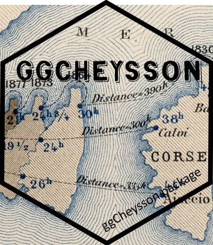
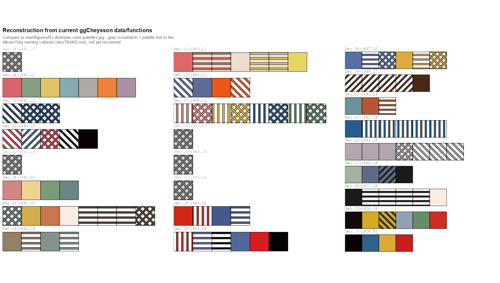
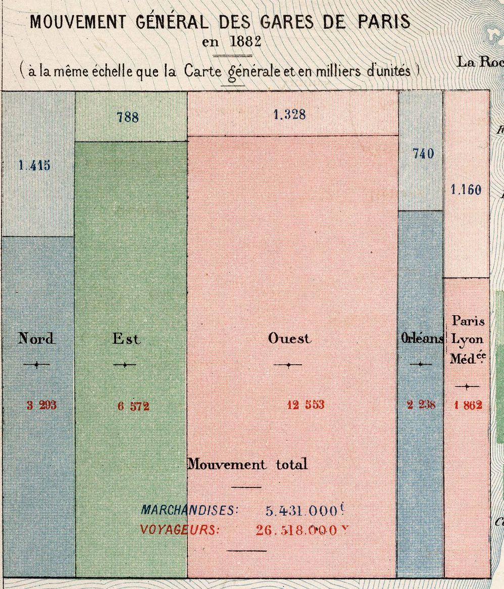
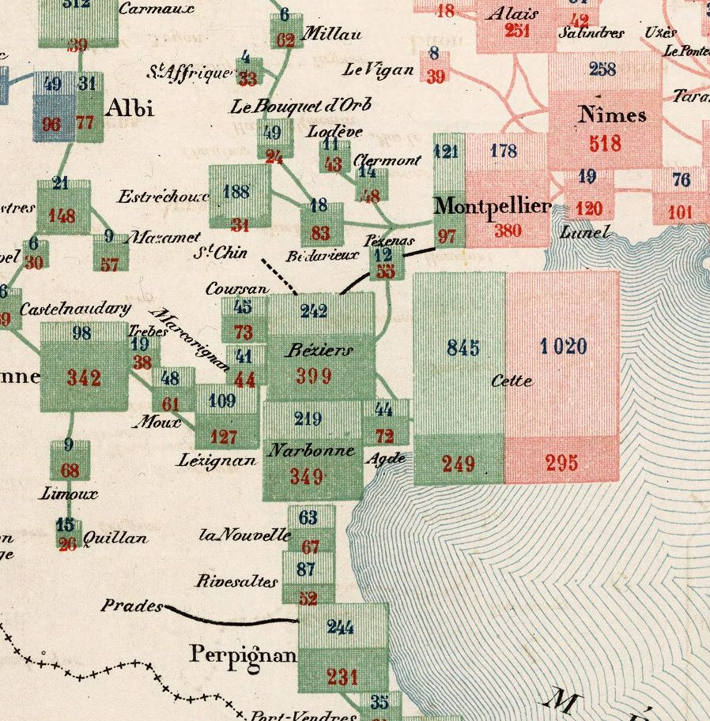

{style="float:right; margin-left:1.5em; margin-bottom:1em; width:22%" fig-alt="ggCheysson hex logo"}

The French *Albums de Statistique Graphique*,
produced by the Ministry of Public Works from 1879 to 1897 under the direction of
[**Émile Cheysson**](https://en.wikipedia.org/wiki/%C3%89mile_Cheysson) (with two later
volumes, in 1900 and 1906), have impressed me
since the day Antoine de Falguerolles showed me a copy of the 1884 volume. I still think
of them as perhaps the finest achievement of what I've called the
[Golden Age of Statistical Graphics](https://doi.org/10.1214/08-STS268): maps of freight and
passengers, rivers of trade flowing into French ports, pie charts sitting on the cities they
describe. All of it was drawn and colored by hand, and all of it is beautiful.
(I said more about how I fell for them in a recent
[interview with Attila Bátorfy](https://attilabatorfy.substack.com/p/not-just-pretty-pictures-interview).)

.](figures/cheysson-maps-grid.png){#fig-plates width="80%" fig-alt="A 5 by 5 grid of close-up crops from maps in the Albums de Statistique Graphique, each labeled with its year and map number, from 1880 Map 7 to 1906 Map 50. They show pie charts, flow bands, shaded regions and bar charts on old French maps, in soft pinks, blues, golds, greens, browns and black, many with fine hatched lines."}

I was so taken with them that I tracked down a complete set in an antiquarian bookshop in
Paris. It was more than I could buy on my own, so I formed a small group of co-conspirators,
*Les Chevaliers des Albums de Statistique Graphique*, to purchase them. (The Chevaliers have
since gone on to [other adventures](https://medium.com/nightingale/raiders-of-the-lost-tombs-the-search-for-some-heroes-of-the-history-of-data-visualization-c4a4b4690d24),
mostly involving cemeteries.) Later, I convinced fellow Chevalier David Rumsey to find and
[digitize the entire collection](https://www.davidrumsey.com/luna/servlet/view/search?q=album+de+statistique),
so that anyone can now zoom in on the brush strokes and marvel at their design.

So I was delighted when [RJ Andrews](https://infowetrust.com/) ran a month-long Twitter
thread, an Advent calendar of sorts, in which each day he took one plate from the *Albums*
and pulled out its colors and hatching patterns as a reusable palette. He collected all 25
in January 2020 as [Classic Map Color Design](https://infowetrust.com/project/album-colors)
(@fig-andrews). Tom Shanley soon turned Andrews' swatches into an
[Observable notebook](https://web.archive.org/web/20210130125506/https://observablehq.com/@tomshanley/cheysson-color-palettes)
for D3, and Kenneth Field went further still and made
[hand-drawn fonts](https://www.esri.com/arcgis-blog/products/arcgis-pro/mapping/the-style-of-emile-cheysson/)
from the lettering on the plates.

.](figures/RJ-Andrews-color-palettes.jpg){#fig-andrews fig-alt="A grid of 25 color and hatching palettes taken from plates of the Albums de Statistique Graphique"}

Colors for D3, fonts for ArcGIS. What was missing was a way to make graphs in this style in
R, my own home ground. That became [ggCheysson](https://friendly.github.io/ggCheysson/), and
this post is the story of making it. (Version 1.2.0 is on CRAN:
`install.packages("ggCheysson")`.) 

I could tell this story the usual way: a list of design
decisions, bugs found and fixed, and a few lessons learned. But the more I worked on it, the
more I found myself wondering what Cheysson and his draftsmen would have made of the whole
enterprise to reproduce their style. So I went to ask them.

## A ticket to 1886

 collection.](figures/cheysson-drawing-office.png){#fig-cheysson-office fig-alt="An AI-generated illustration: Émile Cheysson stands beside a draftsman painting red and blue river bands on a map of France. At the next table, a draftsman rules fine hatch lines."}

I should explain that I have recently discovered I **can travel in time**, though only in my
dreams. (I discovered this skill after re-reading Edwin Abbott's _Flatland_, about A Square who
encounters A Sphere, and learned to travel in higher dimensions, in his imagination.
Hey, time is just one more dimension.)

The *Albums* had been on my mind for years, so one night I closed my eyes and booked a round trip:
Toronto-YYZ (2026) to Paris-CDG (1886), with an open return ticket.
The booking went through without a hitch, which worried me more than if it hadn't. 
I had a flash memory of Chris Marker's _La Jetee_ (1962), a masterpiece of _avant-garde_ cinema,
of a post-apocalyptic
world involving time travel, romance in memory, and an inescapable time loop.

Some practical questions while I packed were: Did I
need a visa? Was my passport sufficiently *down*-to-date? And did my time-travel
`SKILL.md` say anything about who would build the airplane, or the airport?

Whatever the answers, I arrived. I had packed light: a bottle of Niagara ice-wine and a bottle
of Canadian maple syrup for Monsieur Cheysson. But also with my 16" Dell laptop: loaded with R 4.6.1, `ggplot2`, and my
library of packages that extend it. Self-contained; no need for a Wi-Fi connection.

The drawing office for the _Albums_ was at the top of the Ministry, where the light was best, in the old Hôtel de Roquelaure on the
boulevard Saint-Germain. Half a dozen
draftsmen sat at tall tables, working on the plates for next year's *Album*. One was laying
bands of color along the rivers of France, each as wide as the tonnage it carried. Another
was ruling hatch lines, very close together, with a steadiness I could only envy. Yet another was figuring out 
how to translate proportions of a whole across _departemants_ of France into visual symbols.

Cheysson received the ice-wine graciously and the maple syrup with genuine curiosity. 
I said, "Try this on pancakes."
What interested him most, though, was the lid of my laptop, which is covered in hexagons. I
explained that in my time every useful piece of software comes with a sticker, and that
people collect them, out of joy for what they help with. He studied them for a while. In his office, he said,"any useful thing
comes with a plate number, and a reason for being featured in one of my _Albums_".

Then he found the one sticker with his own name on it, the hex logo for `ggCheysson`.
He tilted the laptop toward the lamp and
traced the coast of Corsica with a finger, past the crossing times and the dotted routes
to Calvi and Ajaccio, through the fine engraved ripples of the sea. "A good choice", he
said. "Any fool can draw a coastline; it is the water that takes a week."

He was pleased for another reason. The clipped image comes from one of his office's anamorphic
maps, of which he was most proud. This graphic invention
deforms the map of France itself to show how much shorter the journeys had
become, decade by decade; a brilliant contribution to thematic cartography.

An 1880s reflection of "A map of time travel?", I said of this, now on the upper shell of my time traveler's
laptop. He liked that. It established our rapport across time and space.

I had come with three questions to start the discussion with Émile & his colleagues:

1. What can we learn from each other?
2. How should I design an R package that lets people make graphics in your style?
3. What will be hard about this once I'm back in Toronto?

We talked until the lamps were lit. What follows is roughly what came up, in the order it
came up.

```{r}
#| label: setup
#| include: false
knitr::opts_chunk$set(dev = "ragg_png", dpi = 120, comment = "#>")
library(ggplot2)
library(ggpattern)
library(ggCheysson)    # >= 1.2.0
invisible(capture.output(load_cheysson_fonts()))
```

## Drawn, drawn again, passed along, described

I spent a long time watching the draftsman who was ruling hatch lines for a future album. When he paused, I
asked him how he knew how far apart to draw them. He held up a finished plate: *comme
ça*. Like this one. He just took instructions from Cheysson, but appreciated the range of choices
from previous albums.

That, it turns out, is how a swatch traveled for the next 140 years: as a picture.
Cheysson's draftsmen drew each one directly on the plate. Andrews drew them again, as small SVG
tiles. Tom Shanley's notebook simply passed Andrews' tiles along. In a web browser, a
tile is a perfectly good fill, so one line, `fill: pattern(#id)`, paints a bar or a whole map region
with it, and the browser does the rest. (I compared the two approaches in more detail in
[some working notes](https://github.com/friendly/friendly.github.io/blob/master/blog/posts/2026-11-ggCheysson/Observable-notes.md).)

Alas, `ggplot2` has no easy way to fill a bar with someone else's picture described in SVG. 
So ggCheysson has to
*describe* each swatch instead: read Andrews' SVG, reduce it to a handful of numbers, and
then draw it using [gridpattern](https://trevorldavis.com/R/gridpattern/) notation.
Here is the first swatch of palette `1886_28`, Cheysson's red vertical stripes, as the
package sees them:

```{r}
#| label: spec-sheet
str(cheysson_patterns[["1886_28"]]$patterns[[1]])
```

To ggplot2, in other words, a swatch is a printer's spec sheet: type, color, angle,
spacing, line width. Nearly every bug I met lived in the translation from picture to spec
sheet. SVG lets you leave out a coordinate that is zero, and Andrews often did; my first
parser insisted on all four, silently threw away every line it couldn't read, and left 15
swatches in 6 palettes empty. His files came in two dialects (one hand-written, one apparently exported
from Illustrator). And some things simply have no number to go in: the round white dots of
`1891_25` and the dashed stripes of `1891_19` were lost in translation, and still are.

Then there was the plumbing. In ggplot2 every visual property is a separate aesthetic,
with its own `scale_*()` mapping a data value into what is drawn.
So in [version 1.1.0](https://github.com/friendly/ggCheysson/releases/tag/v1.1.0), applying one of Cheysson's palettes to a bar chart
took five mappings and five scales:

```{r}
#| label: old-way
#| eval: false
# ggCheysson 1.1.0
pats <- cheysson_pattern("1886_28")   # the palette's list of swatch specs
ggplot(d, aes(category, value, fill = category)) +
  geom_col_pattern(aes(pattern = category, pattern_fill = category,
                       pattern_fill2 = category, pattern_angle = category),
                   pattern_density = 0.35, color = "black") +
  scale_fill_cheysson_pattern("1886_28") +
  scale_pattern_manual(values = cheysson_pattern_params(pats, "pattern_type")) +
  scale_pattern_fill_manual(values = cheysson_pattern_params(pats, "pattern_fill")) +
  scale_pattern_fill2_cheysson("1886_28") +
  scale_pattern_angle_cheysson("1886_28")
```

It worked, but nobody would call it Cheysson's style. The fix, in [version 1.2.0](https://github.com/friendly/ggCheysson/releases/tag/v1.2.0), was to
stop splitting a swatch into parts. Each of the 134 swatches is now registered with
`gridpattern` as a pattern of its own, with a name (`"1886_28-1"`, `"1886_28-2"`, ...), and
`scale_cheysson()` simply hands out names:

```{r}
#| label: fig-new-way
#| fig-width: 6
#| fig-height: 4
#| fig-cap: "Palette `1886_28` applied with `scale_cheysson()`. The legend keys are the same swatches as the bars."
d <- data.frame(category = LETTERS[1:6], value = c(15, 23, 18, 20, 12, 9))

ggplot(d, aes(category, value, pattern = category)) +
  geom_col_pattern(color = "black") +
  scale_cheysson("1886_28") +
  theme_cheysson()
```

That is exactly what Shanley's notebook did on day one: a swatch is known by its name.
Getting R back to that point took me several detours, a function new in gridpattern 1.5.0
(`register_pattern()`), and patient advice from its author, Trevor Davis, in a
[GitHub issue](https://github.com/trevorld/ggpattern/issues/154).

When I showed Cheysson the three lines of code, he nodded. Of course a swatch is known by
its name, he said. By its plate number.

`show_swatches()` draws the whole collection, or any part of it, as an atlas
(@fig-atlas). A swatch's name is its row and column.

```{r}
#| label: fig-atlas
#| fig-width: 8
#| fig-height: 4
#| fig-cap: "Four of the 25 palettes, one of each type, drawn by `show_swatches()`."
show_swatches(c("1888_27", "1883_21", "1886_24", "1886_28"))
```

## Three names for the same 25 plates

Plate numbers turned out to be a sore point. On Cheysson's table I laid out three index
cards, all for the plate on his wall: `Dec.05-1886.28`, `category12516028`, and `1886_28`.
He read them twice and asked, very politely, why one plate needed three names.

Because three people named it, each for good reasons of his own. Andrews labeled his
palettes by the day of his Advent calendar on which they appeared, plus album and plate.
Shanley used the palette type and the catalog number from the David Rumsey collection.
I used album year and plate. None of us was wrong, and none of us agreed with the others.

So the package now carries a crosswalk, `cheysson_labels`, that lets you go from any one
name to the others. Here are the six palettes from the 1886 *Album*:

```{r}
#| label: crosswalk
subset(cheysson_labels, album_year == 1886,
       c(name, advent_day, type, rumsey_no, andrews_label, shanley_id))
```

Building it was a small lesson in how names drift when they are copied by hand. Two of
Shanley's IDs have typos (`diverging12541021` has two digits swapped; `category1252605`
has lost its last one), and in a few places his notebook disagrees with itself, because a
display name was copied from a neighboring cell and never changed. I don't say this to
pick on Tom, whose notebook is lovely and whose design, as you've seen, was right all
along. The point is that any name typed twice will, sooner or later, be typed two ways.

I also had to confess something to Cheysson. Even the "plate" in `1886_28` is not really
his plate number. It is the suffix of Rumsey's catalog number, the best unique key we
have. His own numbering isn't in any of our data.

## The bug that ate five plates

Cheysson then asked how many plates I had brought. Twenty-five, I said. Then, because he
was looking at me, I admitted that for most of this year my software had quietly kept only
twenty.

The first versions of the package built each palette's name from the album year and a
field called `Qty`, which I took to be the plate number. It isn't: it's a count of the
colors and patterns in the palette, and different plates in the same album can have the
same count. Three palettes from 1886, for example, all have four elements, so all three
were named `1886_04`. Each was stored with a plain `palettes[[name]] <- ...`, so each one
overwrote the one before. No error, no warning. Four such collisions, and 5 of the 25
palettes were simply gone, through a release on CRAN and the months that followed.

I found out only by rebuilding Andrews' grid of palettes, row by row, from the package's
own data, and setting it beside his (@fig-reconstruct). Some rows had nothing to show.

{#fig-reconstruct}

The fix was to build names from Rumsey's catalog number, which really is unique. That
brought back all 25 palettes, but it renamed 19 of the 20 that had shipped, so
[version 1.1.0](https://github.com/friendly/ggCheysson/releases/tag/v1.1.0) also had to tell users of the old names where their palette had gone.

Cheysson grinned and chuckled at this. His archive, he observed, had never lost a plate to arithmetic. A few were lost in his edits of the Albums, but these were due to
redundancy or failure to meet his standard of truth and beauty.

## Cheysson had no need of underscores

The lettering draftsman, whose titles I had admired all afternoon, was the next person I
showed the laptop to. On the screen was one of my plot titles, `Palette 1880` followed by
a small empty box and `21`. I asked if he could draw me the missing character. He asked
what it was for.

He had a point. The package's fonts, which Kenneth Field drew from the lettering on the
plates, have no underscore. (They come with the package; `load_cheysson_fonts()` makes them
available to your graphics device, once per session.) Not one of the five families:

```{r}
#| label: underscore
fams <- cheysson_fonts$family
sapply(fams, function(f) systemfonts::glyph_info("_", family = f)$name)
```

`.notdef` is a font's way of saying "I have nothing for this". So any title or label in a
Cheysson font that contains a palette name, like `1880_21`, can come out with a little box
(tofu, in the trade) where the underscore should be. Some graphics devices quietly borrow
the missing character from another font, so you may never see the box. Others don't.

There was nothing to fix in the font. An 1880s alphabet had no use for a character that
came in with the typewriter, for underlining, and was later taken up by programmers. I changed my text instead:
the title now reads `Palette 1880, Plate 21`. Cheysson had no need of underscores!

## Let the title fill the page

Next to the plate on the wall I held up the laptop, with a map drawn with a default
ggplot2 theme. Cheysson looked from one to the other and asked why my title was so timid.

I had already had a version of this conversation with myself. Someone (me) complained that
the text in the package's vignettes was too small. I measured: the sizes of title, axis
labels and legend relative to each other were exactly those of `theme_minimal()`. The
trouble was absolute size. An 11-point theme in a 7-inch figure looks small next to the
text of a web page, and a ggplot2 theme has to work at whatever size the reader's window
happens to be. Cheysson's plates were engraved once, for one page, and every element on
them knew how big it was. Mine never do.

For maps, though, the old convention had more to teach than the size of the page. On the
maps of [**André-Michel Guerry**](https://www.datavis.ca/papers/guerry-STS241.pdf), which
Cheysson may well have known, the title runs nearly the whole width of the map. No default
ggplot2 theme would ever choose that: the panel dominates, and the title is a modest line
at the top. A single ratio of title to body text couldn't give me both, because a title
big enough for Guerry would have blown the legend text up to 30 points along with it.

So `theme_cheysson_map()` now has its own, poster-style hierarchy: the title at five times
the base size (55 points at the default `base_size = 11`, up from about 17), and the
subtitle, legend and caption scaled up to match (@fig-literacy). Here the 19th century
didn't just lend me colors; it changed a design decision.

{#fig-literacy width="80%"}

## The eye, which no package supplies

Colors, fonts and title sizes were the things I could pack into the laptop and carry home.
What I most wanted to learn from Cheysson's office was something no package supplies: the
eye for choosing the right visual form for a given set of numbers. The *Albums* have no
house "chart type" or "house style". Nearly every plate is a fresh decision: flow bands along rivers and
railways, as wide as the traffic they carried; pie charts sitting on the cities they
describe; bars, squares and sectors arranged on the map wherever the data lived.

The plate I asked about was the one that first caught my eye, years ago, in the 1884 volume
Antoine showed me: the
[*Carte figurative des expéditions de voyageurs et de marchandises effectuées en 1882*](https://www.davidrumsey.com/luna/servlet/detail/RUMSEY~8~1~309212~90079118),
the passengers and goods sent out from the principal railway stations of France in 1882.

It begins in Paris (@fig-voyageurs-paris). Each of the five railway companies with a
terminus in the capital (Nord, Est, Ouest, Orléans and Paris-Lyon-Méditerranée) gets a
column, in its own color, and each column is split into goods above, in thousands of
metric tons, and passengers below, in thousands of travelers. Then the same design goes out
across the map (@fig-voyageurs-south). Every station gets its own small block, split the
same way into goods and passengers, in the color of the company that serves it. Where two
companies meet, as at Cette (now Sète) or Montpellier, their blocks stand side by side. The
inset is even drawn "at the same scale as the general map", so a Paris terminus can be
compared, by area, with Narbonne or Perpignan.

::: {#fig-voyageurs layout-ncol="2"}

{#fig-voyageurs-paris}

{#fig-voyageurs-south}

Two details of the *Carte figurative des expéditions de voyageurs et de marchandises effectuées en 1882*, *Album de Statistique Graphique de 1884*. In each block, goods are on top (blue numbers) and passengers below (red numbers). Source: [David Rumsey Map Collection](https://www.davidrumsey.com/luna/servlet/detail/RUMSEY~8~1~309212~90079118), 12515.017.
:::

It is, in effect, a recursive mosaic display, subdivided at every station in France. I have spent a
good part of my career on [mosaic displays](https://www.datavis.ca/papers/moshist.pdf),
which divide a rectangle by one variable of a table, and then each piece by the next. Here
was Cheysson's office doing it by hand, on a map, with the railway company as the first
variable and passengers versus goods as the second. I asked him how they had arrived at it.
He seemed puzzled by the question. "What is being divided", he said, "is the traffic. So you
divide the traffic. And so on, until the job is done".

The office drew this map again for later *Albums*, with newer figures. One version is
[Map 11](https://www.davidrumsey.com/luna/servlet/detail/RUMSEY~8~1~309237~90079152)
of the 1886 *Album*, showing the traffic of 1883, the plate whose colors became palette `1886_11` in ggCheysson. That
palette is eight swatches in four pairs, a light stripe and a denser crosshatch for each
color: exactly what a map like this needs, one color per company, two textures for goods
and passengers.

That is Émile's lesson, and one I find hardest to put in a package: the eye of a master graphic designer,
with only pen-and-ink technology, a collection of graphic forms to choose from, and a desire to
communicate complex problems to policy makers in 19th C. France.

`ggplot2` gives me a grammar to build
almost any of these forms, and an active R community continues to extend this.
`ggCheysson` can now dress them in Cheysson's colors and
hatching. But the grammar doesn't choose the form, and neither do the palettes. That choice,
seeing what the **structure of the data asks for**, was the real craft of Cheysson's office,
and it still has to come from whoever is making the graph.

## The flight home

By the time the lamps were beginning to dim in Paris, and my dream was interrupted by
my alarm clock in Toronto, I had answers of a sort to my three questions.

**What could we learn from each other?** From them: that a swatch is a thing with a name, that
a plate's number matters more than any label you put on it, that a title can be as
large as the map deserves, and, most of all, that the form of a graph should follow the
structure of its data. From me, I am less sure. The one thing that truly impressed the
draftsmen was `reverse = TRUE`. I showed them a map hatched from light to dark, added that
one argument, and it came back hatched from dark to light. For them, that would have meant
a week of ruling every line again. The draftsman with the steady hand asked whether the
laptop could stay.

**How should the package be designed?** Around the swatch as a single named thing, and around
data you can check against the originals. The rest, the scales that pick light to dark
from a palette, the handling of missing values, one swatch serving bars, tiles, maps and
legend keys alike, follows from that.

**What will be hard back in Toronto?** The dots and the dashes, still lost in translation. And
a question I keep coming back to: whether ggCheysson could skip the spec sheet entirely,
and fill with Andrews' tiles directly, as the browser does. R's own graphics engine can now
fill a shape with a pattern; not every graphics device can draw one.

Then I woke up. Coming back is always the hard part of time travel; things are rarely as
you left them, at least in your imagination. I once lost an afternoon's work, not to war, revolution or shipwreck, but to
a Dropbox-sync issue. But that's is another story.

I still have the open return, in my dreams.

Another night, I might ask Cheysson to meet me at [La Closerie des Lilas](https://en.wikipedia.org/wiki/La_Closerie_des_Lilas), near where
Minard and Guerry rest today in Montparnasse Cemetery.
With any
luck, Minard will be drawing on the menu, Guerry will turn it over to see what
he can map on the back, and Florence Nightingale will ask what we mean to do
about the numbers. I’ll book a table for five and leave the date blank.

## Further reading

- Friendly, M. (2008). The Golden Age of Statistical Graphics. *Statistical Science*,
  23(4), 502--535. <https://doi.org/10.1214/08-STS268>
- Andrews, RJ (2020). [Classic Map Color Design](https://infowetrust.com/project/album-colors).
- Shanley, T. (2021). [Cheysson Color Palettes](https://web.archive.org/web/20210130125506/https://observablehq.com/@tomshanley/cheysson-color-palettes). Observable notebook.
- Friendly, M. (2026). [Notes: Shanley's Observable palettes vs. ggCheysson swatches](https://github.com/friendly/friendly.github.io/blob/master/blog/posts/2026-11-ggCheysson/Observable-notes.md).
- Field, K. [The style of Émile Cheysson](https://www.esri.com/arcgis-blog/products/arcgis-pro/mapping/the-style-of-emile-cheysson/).
- [ggCheysson](https://friendly.github.io/ggCheysson/) package documentation, especially
  the Guerry maps vignette.

::: {.callout-note icon=false}
## To cite this article

Friendly, M. (2026, November). Émile Cheysson Meets `ggplot2`: Making `ggCheysson`, told as a
dream trip to 1886, with a laptop full of hex stickers and some questions. *Michael Friendly's blog*.
<https://friendly.github.io/blog/posts/2026-11-ggCheysson/>

```bibtex
@Misc{Friendly:2026:ggCheysson,
  author       = {Friendly, Michael},
  title        = {\'{E}mile {Cheysson} Meets {ggplot2}: Making {ggCheysson}, told as a
                  dream trip to 1886, with a laptop full of hex stickers and some questions},
  year         = {2026},
  month        = nov,
  howpublished = {Blog post},
  url          = {https://friendly.github.io/blog/posts/2026-11-ggCheysson/},
}
```
:::
