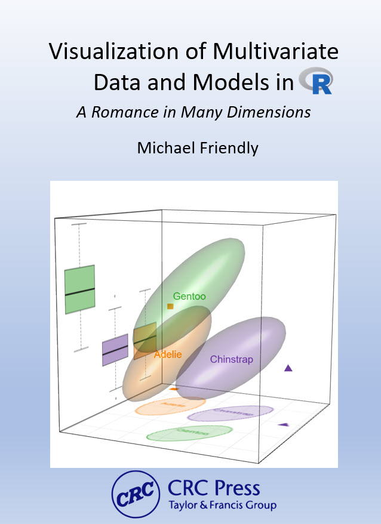
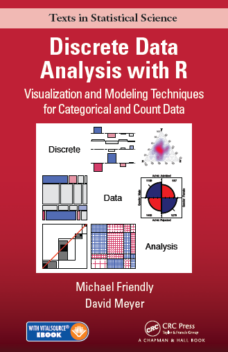
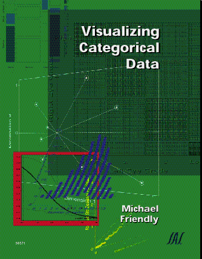
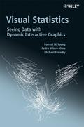

::: {.column-page}

I have authored and co-authored several books on data visualization and statistical methods in R. These books emphasize graphical understanding of statistical concepts and practical implementation.

::: {.card .book-card}
::: {.card-body}

::: {.book-card-content}

### Visualizing Multivariate Data and Models in R

A comprehensive guide to understanding multivariate linear models through visualization. Covers HE plots, canonical discriminant analysis, and other graphical methods for multivariate data.

**Status**: Under review. To be published by CRC Press, 2026. Available online

[Read online →](https://friendly.github.io/Vis-MLM-book/){.btn .btn-primary}

:::

:::
:::

::: {.card .book-card}
::: {.card-body}

::: {.book-card-content}

### Discrete Data Analysis with R

Co-authored with David Meyer, this book provides an accessible introduction to the major methods of categorical data analysis for data exploration, statistical testing and visualization. As opposed to more theoretical books, the goal here is to help the reader to translate theory into practical application, by providing skills and software tools for carrying out these methods.

**Publication information**: Michael Friendly and David Meyer, [Discrete Data Analysis with R: Visualization and Modeling Techniques for Categorical and Count Data]( https://www.crcpress.com/9781498725835 ), 2016, Chapman and Hall/CRC, ISBN 9781498725835.

[Book website →](http://ddar.datavis.ca/pages/home){.btn .btn-primary}

:::

:::
:::

::: {.card .book-card}
::: {.card-body}

::: {.book-card-content}

### A History of Data Visualization & Graphic Communication

Co-authored with Howard Wainer, this book provides a comprehensive historical account of data visualization. It addresses three central questions: How did graphic representations of numerical data originate and why? What innovations led to the common graphs and diagrams we use today? How have graphical inventions contributed to understanding phenomena and communicating findings?

**Publication information**: Michael Friendly and Howard Wainer, [A History of Data Visualization & Graphic Communication](https://www.hup.harvard.edu/catalog.php?isbn=9780674975231), 2021, Harvard University Press, ISBN 978-0674975231.

[Companion website →](https://friendly.github.io/HistDataVis/){.btn .btn-primary}

:::

:::
:::

::: {.card .book-card}
::: {.card-body}

::: {.book-card-content}

### Visualizing Categorical Data

The forerunner of *Discrete Data Analysis with R*, using SAS. It covers graphical methods for categorical data, from fitting and graphing discrete distributions, two-way and n-way contingency tables, mosaic displays and correspondence analysis to logistic regression and loglinear and logit models, with SAS programs and macros for all the methods.

**Publication information**: Michael Friendly, *Visualizing Categorical Data*, 2000, SAS Institute, Cary, NC, ISBN 1-58025-660-0.

**See also**: [A reader's guide to *Visualizing Categorical Data*](https://friendly.github.io/papers/sugi/vcdguide/vcdguide.pdf) (SUGI 26 paper); [Visualizing categorical data: Data, stories, and pictures](https://friendly.github.io/papers/sugi/vcdstory/vcdstory.pdf) (SUGI 25 paper).

[SAS macros on GitHub →](https://github.com/friendly/SAS-macros){.btn .btn-primary}

:::

:::
:::

::: {.card .book-card}
::: {.card-body}

::: {.book-card-content}

### Visual Statistics: Seeing Data with Dynamic Interactive Graphics

Co-authored with Forrest W. Young and Pedro M. Valero-Mora, this book describes a paradigm for doing statistical analysis in a purely visual way with dynamic interactive graphics. It illustrates these ideas using [ViSta: The Visual Statistics System](https://www.uv.es/visualstats/Book/DownloadBook.htm), freely available on the internet.

**Publication information**: Forrest W. Young, Pedro M. Valero-Mora and Michael Friendly, *Visual Statistics: Seeing Data with Dynamic Interactive Graphics*, 2006, Wiley Series in Probability and Statistics, New York, ISBN 978-0-471-68160-1.

[Companion website →](https://www.uv.es/visualstats/Book/){.btn .btn-primary}

:::

:::
:::

::: {.card .book-card}
::: {.card-body}

::: {.book-card-content}

### SAS System for Statistical Graphics

A book in SAS Institute's series of statistical applications guides, showing how to use the SAS System to produce meaningful displays of statistical data. It emphasizes displays that reveal aspects of data not easily captured in numerical summaries or tables, and diagnostic displays that help determine whether the assumptions of an analysis are met. The book contains almost 250 displays, and implements 15 graphical methods as general SAS macro programs that can be used with any data.

**Publication information**: Michael Friendly, *SAS System for Statistical Graphics*, First Edition, 1991, SAS Institute, Cary, NC, ISBN 978-1-55544-441-9.

**See also**: [Statistical graphics for multivariate data](https://friendly.github.io/papers/sugi/sugi16-paper.pdf) (SUGI 16 paper); [Designer graphics: Anatomy of some SAS macros for statistical graphics](https://friendly.github.io/papers/sugi/sugi20.pdf) (SUGI 20 paper).

[SAS macros on GitHub →](https://github.com/friendly/SAS-macros){.btn .btn-primary}

:::

:::
:::

::: {.card .book-card}
::: {.card-body}

::: {.book-card-content}

### Advanced Logo: A Language for Learning

**Publication information**: Michael Friendly, *Advanced Logo: A Language for Learning*, 1988, L. Erlbaum Associates, Hillsdale, NJ, ISBN 0-89859-933-4.

[Google Books →](https://books.google.ca/books/about/Advanced_logo.html?id=zvF5wb12E0wC){.btn .btn-primary}

:::

:::
:::

## Additional Resources

For more information about my books and related materials, visit my [books page at datavis.ca](https://www.datavis.ca/books/) (presently down for maintenance).

:::
